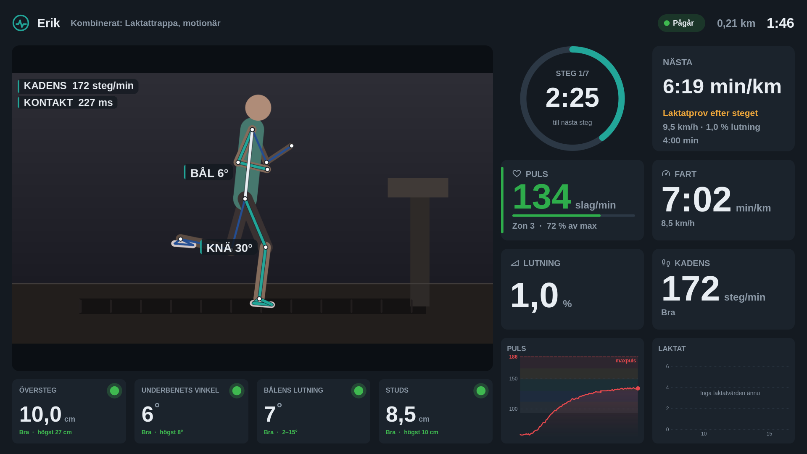
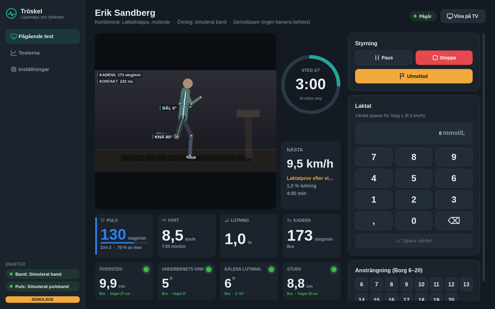
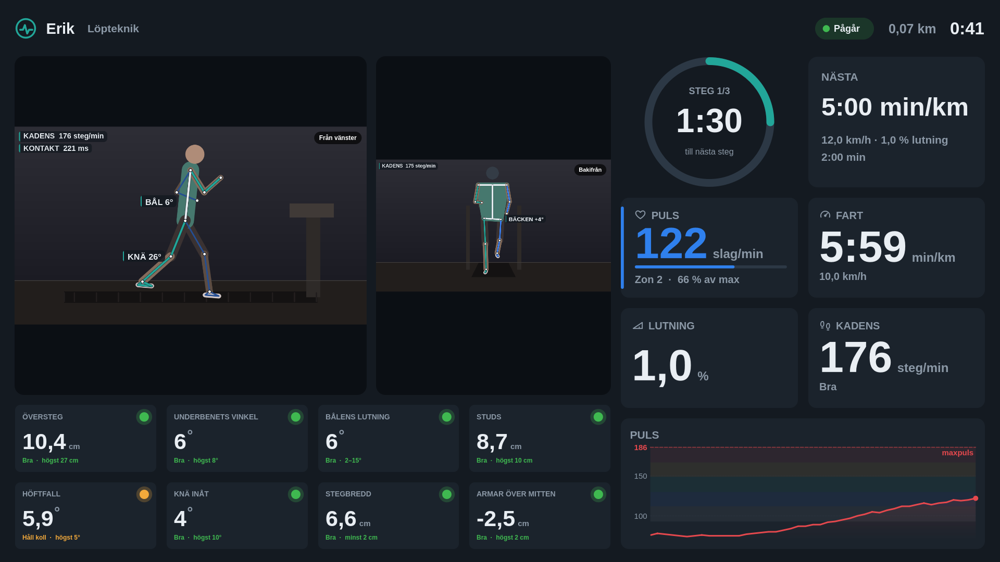
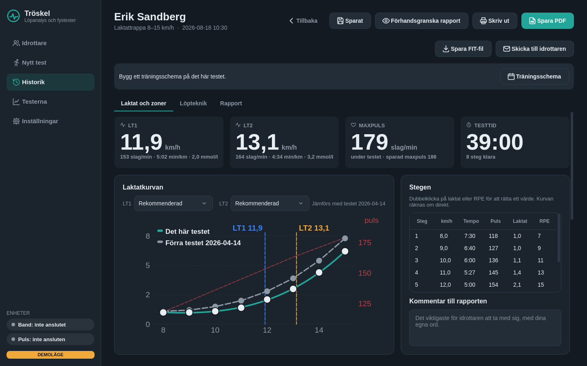
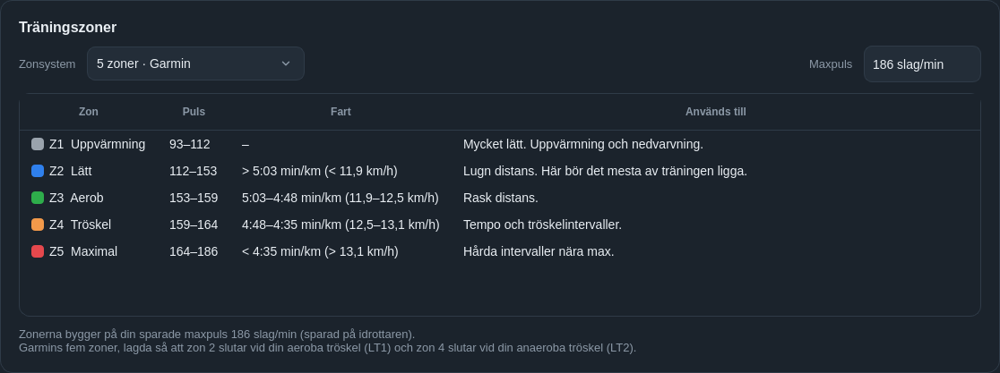
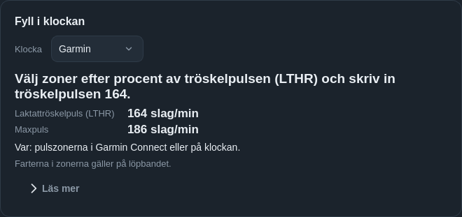
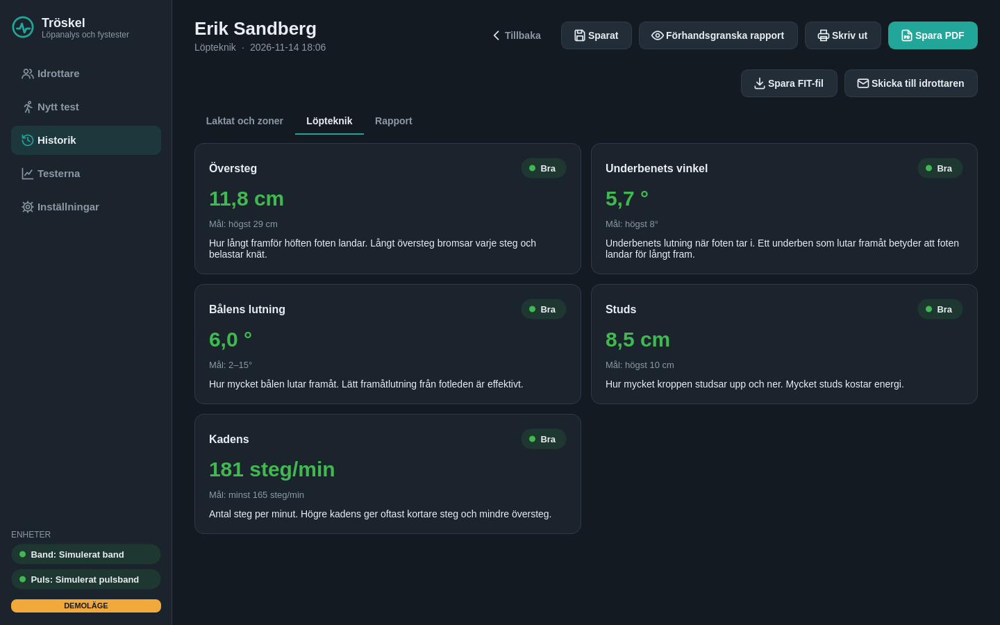
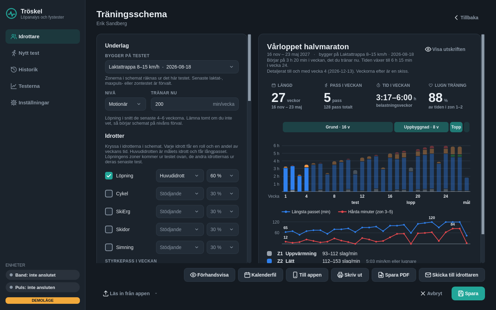

# Tröskel

*Tröskel* (repot och programfilen heter `lopanalys`) är löpanalys och fystester för coacher: kameran (även GoPro), löpbandet, cykeltrainern och SkiErgen, pulsbandet, laktatet och utskrivna rapporter. Se [docs/ARKITEKTUR.md](docs/ARKITEKTUR.md). [English: README.md](README.md)



*TV-vyn under en laktattrappa, i helskärm för idrottaren. Alla skärmbilder är från demoläget: påhittade idrottare och simulerad utrustning.*

## Skärmbilder

**Operatörssidan.** Coachens vy under testet: knapparna, sifferfältet för laktatvärdet och pulsen, farten och tekniken just nu.



**Två kameror.** Löparen filmas från sidan och bakifrån samtidigt, och TV:n visar värdena från båda.



**Laktatkurvan.** LT1 och LT2 på kurvan, jämförda med förra testet, och stegen som går att rätta efteråt.



**Träningszonerna.** Zonerna i det valda systemet, i puls och tempo.



**Fyll i klockan.** Det som ska in i idrottarens klocka, här en Garmin.



**Löptekniken.** Testets mätvärden mot målen.



**Träningsschemat.** Ett schema fram till ett mållopp, byggt på testets zoner.



## Dokumentation

Allt står i [docs/index.md](docs/index.md): [handboken](docs/handbok/handbok.md) för den som kör testerna, arkitekturen, proven på riktig hårdvara och underlagen.

Dokumentationen följer [dokumentationsrutinen](docs/dokumentationsrutin.md): en sida per mapp, innehållsförteckningar, index och skärmdumpar som skrivs av verktygen i `tools/`, och kontroller vid varje commit. Slå på kontrollerna en gång per klon:

```bash
git config core.hooksPath tools/hooks
```

## Utveckla

```bash
python -m venv .venv && .venv/bin/pip install -e .[dev]
pytest
```

**Linux utan skärm och utan root** (utvecklingsmiljön): Qt behöver libGL med flera. Hämta dem med `apt-get download` och packa upp dem med `dpkg-deb -x` i `.syslibs/root`. Kör sedan `source scripts/headless_env.sh` före `pytest`.

**Starta programmet:** `python -m lopanalys.ui.app`. Med `--demo` körs simulerade enheter och en exempelvideo.

## Licens och bidrag

Copyright 2026 GeneralTgul

Tröskel är fri programvara under GNU Affero General Public License, version 3 eller senare (AGPL-3.0-or-later). Texten finns i [LICENSE](LICENSE). Varje commit från en bidragsgivare signeras enligt Developer Certificate of Origin (`git commit -s`), se [CONTRIBUTING.md](CONTRIBUTING.md).
