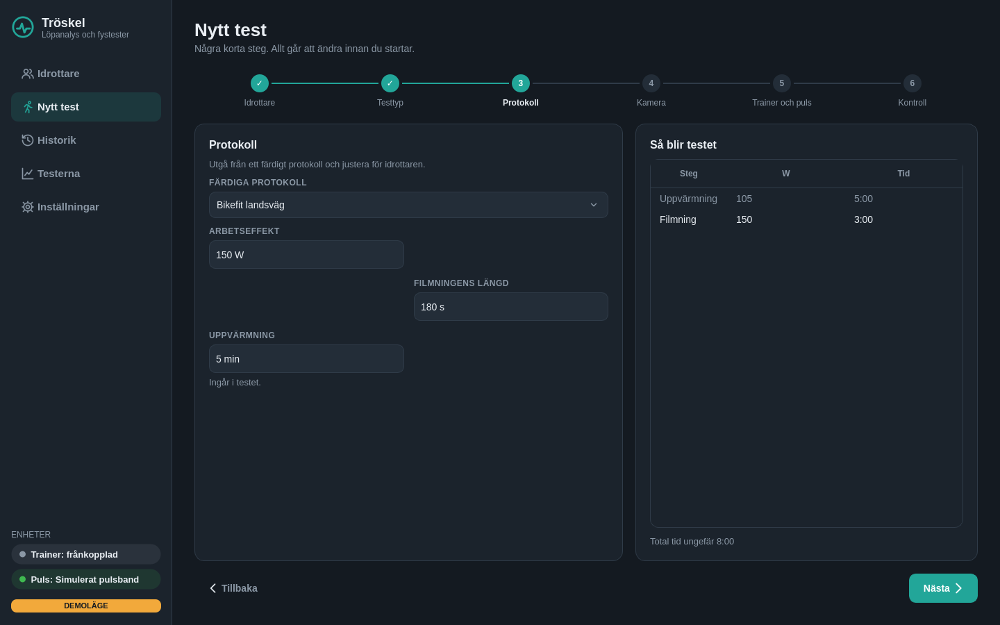
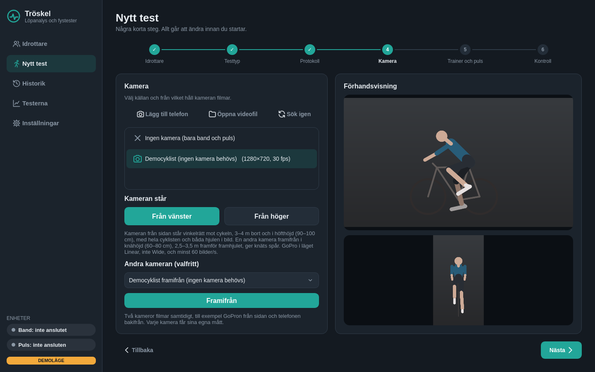
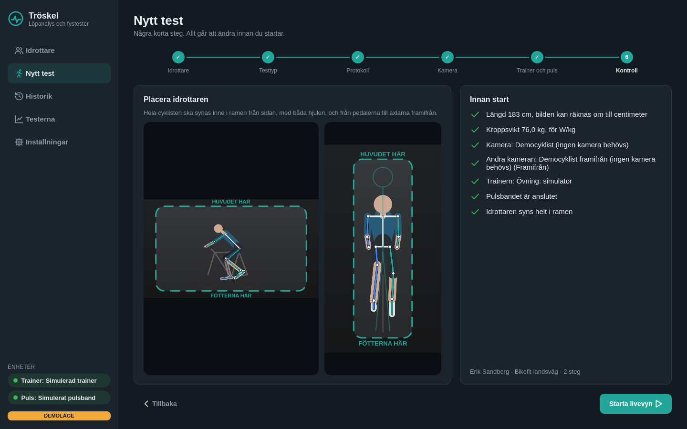
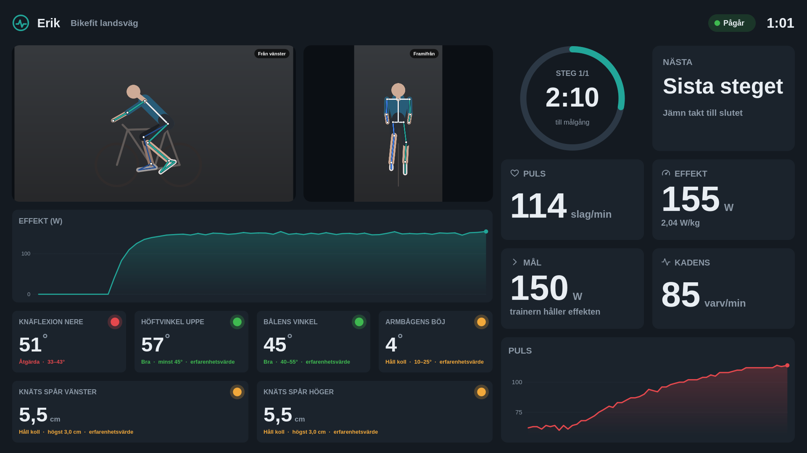
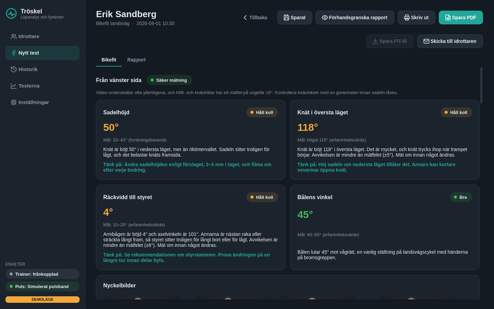
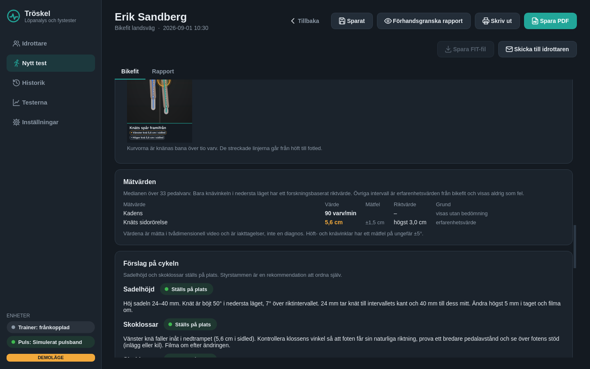
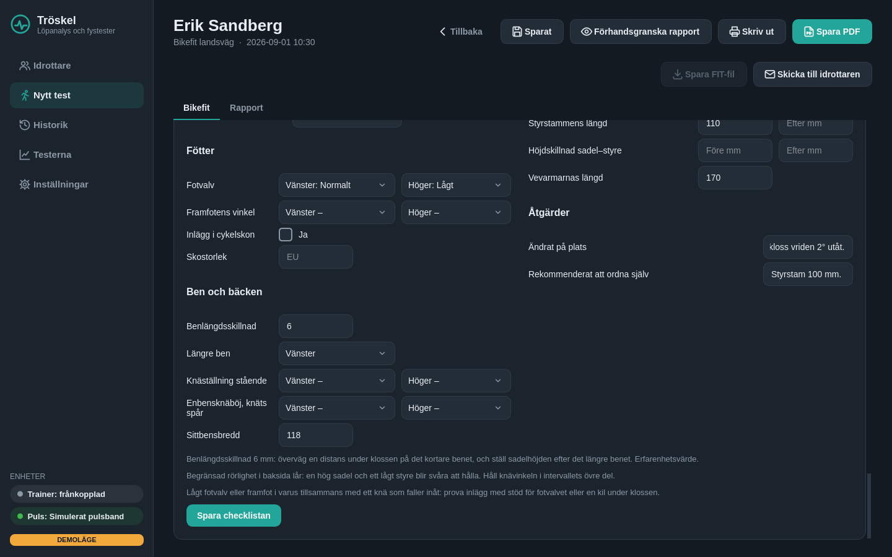

# Bikefit

*Cyklisten filmas på trainern från sidan och framifrån. Programmet mäter vinklarna i pedalvarvet och föreslår sadelhöjd, klossar och styrstam, och coachen fyller i den manuella genomgången. Tillbaka till [handboken](../handbok.md).*

<!-- toc -->
## Innehåll

- [Läget](#läget)
- [Det här behövs](#det-här-behövs)
- [Filma](#filma)
- [Testet i guiden](#testet-i-guiden)
- [Resultatet](#resultatet)
- [Mätvärdena och vad de jämförs med](#mätvärdena-och-vad-de-jämförs-med)
- [Förslag på cykeln](#förslag-på-cykeln)
- [Manuell genomgång](#manuell-genomgång)
- [När mätningen är osäker](#när-mätningen-är-osäker)
- [Rapporten](#rapporten)
<!-- /toc -->

## Läget

*Bikefit* väljs i *Nytt test* under sporten *Cykel*. Programmet styr trainern genom uppvärmningen och det filmade steget, analyserar filmerna när testet är klart och öppnar fliken *Bikefit* av sig själv. Allt är provat i demoläget med en syntetisk cyklist, inget på en riktig cyklist än, se [Prov](../../PROV.md#bikefit-och-stakteknik). Filmer som redan finns granskas med verktyget i [Arkitektur](../../ARKITEKTUR.md#bikefit-och-stakteknik).

Bikefit gäller landsvägscykel. Tempocykel, MTB och film bakifrån finns inte.

## Det här behövs

- Cykeln på trainern, i våg och rakt.
- En kamera med minst 60 bilder/s. Med 30 bilder/s rör sig veven 18° mellan två bilder vid 90 varv/min, och mätningen märks som osäker.
- Idrottarens längd, ifylld under *Idrottare*. Sadelhöjden i millimeter räknas ur den.
- Åtsittande kläder och gott ljus.
- En goniometer, eller vinkelmätaren i mobilen, för att kontrollera knävinkeln innan sadeln låses.

## Filma

| | Från sidan | Framifrån |
|---|---|---|
| Kameran står | Vinkelrätt mot cykeln, siktad mot sadelns framkant | I cykelns längdlinje, framför framhjulet |
| Linsens höjd | Höfthöjd på cykeln, cirka 90–100 cm | Knähöjd, cirka 60–80 cm |
| Avstånd | 3–4 m | 2,5–3,5 m |
| I bild | Hela cyklisten och båda hjulen | Från pedalerna till axlarna |
| Ger | Knä, höft, bål, axel och armbåge, kadens | Knäts spår |

- Använd GoProns läge *Linear*, inte *Wide*. Vidvinkeln böjer linjerna och förstör vinklarna.
- Cyklisten har händerna på bromsgreppen under det filmade steget. Ställningen ändras med belastningen, så filmen tas i arbetseffekt efter uppvärmningen.
- Från sidan mäts bara benet och armen närmast kameran.
- Utan kamera framifrån mäts inte knäts spår, och skoklossarna får inget förslag.

## Testet i guiden

1. **Testtyp:** välj sporten *Cykel* och testet *Bikefit*.
2. **Protokoll:** *Bikefit landsväg* är 5 min uppvärmning i ERG-läge, som inte filmas, och sedan 3 min *Filmning* på 150 W. Ändra *Arbetseffekt* till en effekt cyklisten tränar på, gärna kring 65–75 % av FTP, så att ställningen blir den riktiga. *Filmningens längd* är minst 30 sekunder.

   

3. **Kamera:** välj kameran från sidan och om den filmar *Från vänster* eller *Från höger*. Den andra kameran är *Framifrån*. Ger kameran under 60 bilder/s säger steget till. *Nästa* är grå utan kamera.

   

4. **Trainer och puls:** anslut trainern. Pulsbandet behövs inte.
5. **Innan start:** cyklisten ska synas inom ramen i båda bilderna. Listan säger till om kameran framifrån saknas eller om idrottarens längd saknas.

   

6. **Under testet** visar TV:n bilden, skelettet, watt, puls och kadens, och under bilden rutor med de viktigaste vinklarna:
   - från sidan *Knäflexion nere* (knäets böj när pedalen är längst ner, riktvärdet 33–43°), *Höftvinkel uppe*, *Bålens vinkel* och *Armbågens böj*,
   - framifrån *Knäts spår vänster* och *höger*: hur mycket knät rör sig i sidled under ett varv.

   Rutorna visar medianen av de sex senaste pedalvarven och uppdateras varje sekund, med samma riktvärden och färger som resultatet. Tills tre varv är mätta står det *–* och *Väntar på 3 varv*. Ändrar du sadeln under uppvärmningen syns den nya knävinkeln efter några varv. Resultatet räknas ändå ur hela filmen efter testet. Filmen börjar när uppvärmningen är slut och testet slutar av sig självt efter det filmade steget.

   

Resultatsidan visar bara fliken *Bikefit* och *Rapport*. Medan filmerna analyseras står förloppet överst på fliken. Har idrottaren inte samtyckt till film startar testet inte, eftersom inget går att mäta utan filmen.

## Resultatet

Resultatet öppnas på fliken *Bikefit*, med en del per film:

- **Säkerheten** står bredvid rubriken: *Säker mätning*, *Osäker mätning* eller *Mätningen går inte att bedöma*. Varningarna under säger varför.
- **Korten** visar det viktigaste först, med värdet, riktvärdet och vad det betyder.
- **Nyckelbilderna** är stillbilder ur ett pedalvarv med vinklarna inritade:

| Bild | Visar |
|---|---|
| *Nedersta läget* | Knävinkeln när benet är som mest sträckt. Den avgör sadelhöjden |
| *Översta läget* | Knävinkeln och höftvinkeln när knät är som högst |
| *Klockan 3* | Lodlinjen från knät mot pedalen |
| *Ställningen* | Bålens vinkel, axelvinkeln och armbågens böjning |
| *Pedalvarvet* | Fyra lägen i rad, med fotledens bana |
| *Knäts spår framifrån* | Knänas bana över tio varv |

Grönt, gult och rött visar hur värdet ligger mot riktvärdet. **Grått betyder att värdet visas utan bedömning.**

## Mätvärdena och vad de jämförs med

Tabellen *Mätvärden* har en rad per värde med kolumnerna *Värde*, *Mätfel*, *Riktvärde* och *Grund*. Grunden säger hur riktvärdet är underbyggt:

| Grund | Betyder | Gäller |
|---|---|---|
| *forskningsbaserat* | Publicerat intervall | Knäflexion i nedersta läget, 33–43° |
| *erfarenhetsvärde* | Praxis från bikefit. Visas som mest som *Håll koll*, aldrig som *Åtgärda* | Knät överst, höftvinkel, bål, axel, armbåge, höftens höjdrörelse, knäts sidorörelse |
| *visas utan bedömning* | Mäts och visas, bedöms inte | Kadens, fotledens omfång, knä över pedalaxel |

| Mätvärde | Riktvärde | Mätfel |
|---|---|---|
| *Knäflexion i nedersta läget* | 33–43° | ±5° |
| *Knäflexion i översta läget* | högst 115° | ±5° |
| *Höftvinkel i översta läget* | minst 45° | ±5° |
| *Bålens vinkel* | 40–55° mot vågrätt | ±5° |
| *Axelvinkel* | 80–95° | ±6° |
| *Armbågens böjning* | 10–25° | ±6° |
| *Höftens höjdrörelse* | högst 2 cm per varv | ±1,5 cm |
| *Knäts sidorörelse* (framifrån) | högst 3 cm per varv | ±1,5 cm |

Fotleden bedöms inte, eftersom video mäter den med ett fel på 15–22°. Knä över pedalaxel bedöms inte heller: pedalaxeln är ingen mätpunkt, och felet på ±2 cm är lika stort som intervallet man vill hålla. Källorna står i [underlaget](../../sporter/bikefit-och-stakteknik.md#källor).

## Förslag på cykeln

| Del | Förslaget bygger på | Märkning |
|---|---|---|
| *Sadelhöjd* | Knävinkeln i nedersta läget. Programmet räknar om avvikelsen till millimeter ur benets längd: det första talet tar knät till intervallets kant, det andra till dess mitt | *Ställs på plats* |
| *Skoklossar* | Knäts spår framifrån: ett knä som faller inåt eller går utåt. Klossens läge i längsled ställs för hand enligt checklistan | *Ställs på plats* |
| *Styrstam* | Armbågens böjning, axelvinkeln och höftvinkeln | *Rekommendation* |

- **Ändra sadeln högst 5 mm i taget** och filma om efter varje ändring. Fotleden tar upp en del av ändringen, så knävinkeln ändras mindre än geometrin säger.
- **Osäkert: kontrollera först** står på ett förslag när avvikelsen är mindre än mätfelet eller när filmen är osäker. Då ger programmet inget millimetertal, utan ber dig mäta med goniometer först.
- Styrstammen bygger på erfarenhetsvärden. Låt kunden prova innan något köps.

## Manuell genomgång

Kameran ser cyklisten på cykeln. Resten av en bikefit görs för hand och fylls i under *Manuell genomgång* längst ner på fliken:

| Del | Fyll i |
|---|---|
| *Samtal* | Mål, besvär och hur mycket kunden cyklar |
| *Rörlighet* | Baksida lår, höftböjare, höftens rotation, framåtfällning, axlar och nacke |
| *Fötter* | Fotvalv, framfotens vinkel, inlägg och skostorlek |
| *Ben och bäcken* | Benlängdsskillnad, knäställning, enbensknäböj och sittbensbredd |
| *Skoklossar* | Trampdynan över pedalaxeln, klossens vinkel, pedalavstånd och slitage |
| *Cykelns mått, före och efter* | Sadelhöjd, bakåtläge, lutning, styrstam, höjdskillnad till styret och vevlängd |
| *Åtgärder* | Det som ändrades på plats och det kunden ska ordna själv |

Tryck på *Spara checklistan*. Den sparas med testet och skrivs ut i rapporten. Under listan står det som är värt att väga in, till exempel en benlängdsskillnad på 5 mm eller mer.

## När mätningen är osäker

| Varning | Gör så här |
|---|---|
| Filmen har för få bilder per sekund | Filma med minst 60 bilder/s |
| Pedalvarven gick inte att hitta | Se till att foten och hela benet syns, och att kameran står rakt från sidan. Inget bedöms ur filmen |
| Fotledens bana avviker från en cirkel | Kameran står snett eller foten skyms av cykeln |
| Kadensen varierar | Filma i jämn fart efter uppvärmningen |
| Armbågen och handleden syntes inte | Armens värden och styrstammen utelämnas. Flytta kameran så att handen syns |
| Trampets riktning stämmer inte | Fel sida är vald eller filmen är spegelvänd |

Varje film får också påminnelsen att video underskattar ytterlägena. Kontrollera därför knävinkeln med goniometer innan sadeln låses.

## Rapporten

Rapporten har nyckelbilderna, mätvärdena med mätfel och grund, iakttagelserna, *Förslag på cykeln* och *Manuell genomgång*. Har idrottaren en tidigare bikefit jämförs varje värde med den. Utskrift, PDF och mejl fungerar som för de andra testerna, se [Resultat](../resultat/resultat.md).
