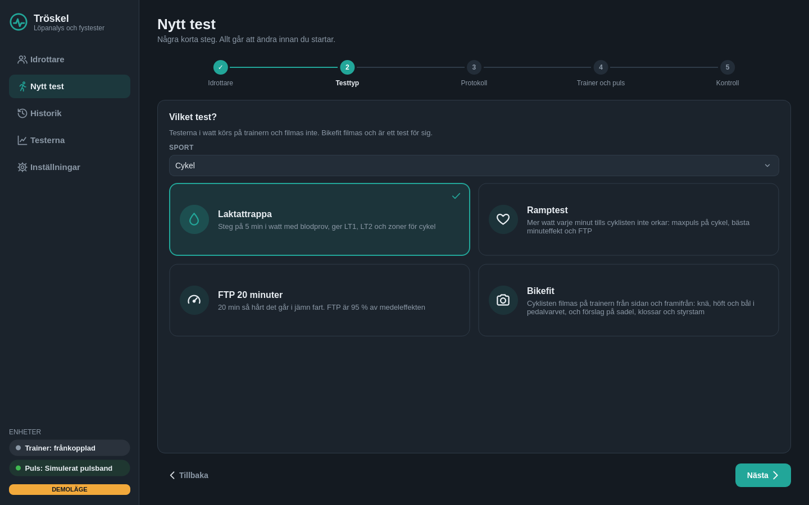
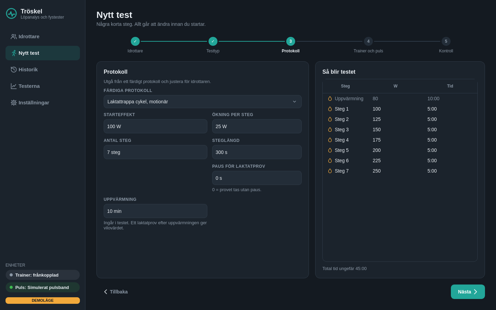
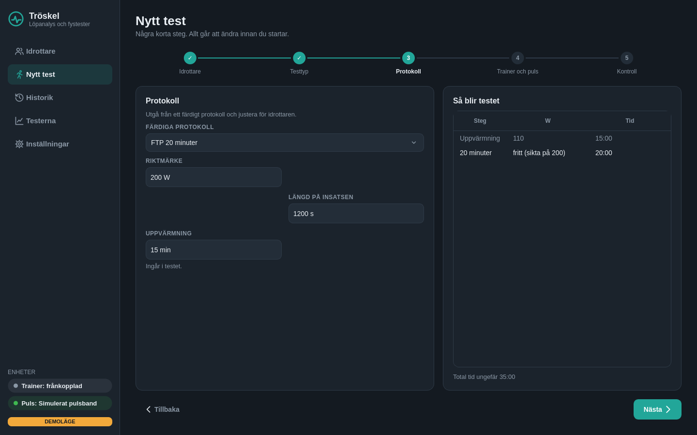
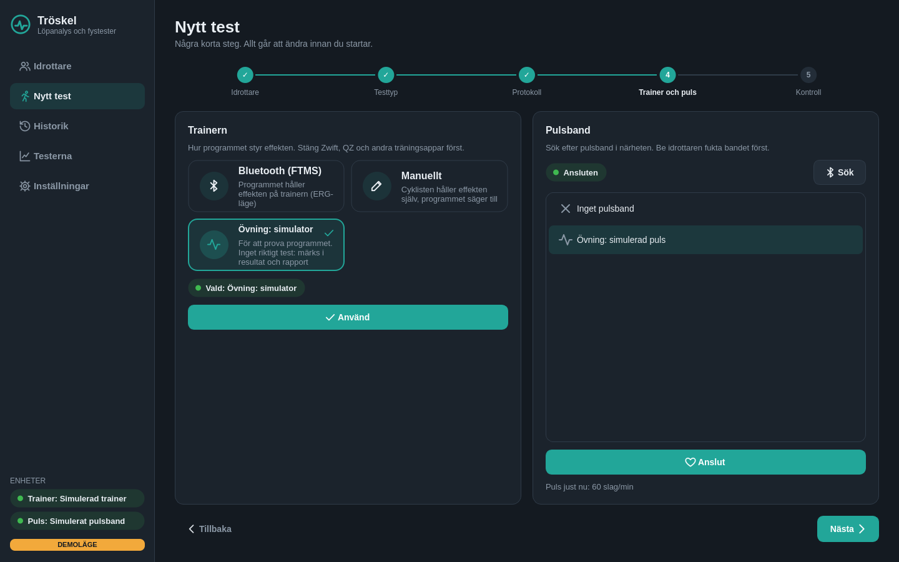
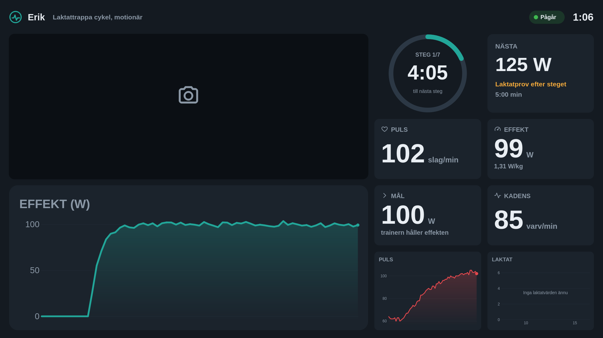
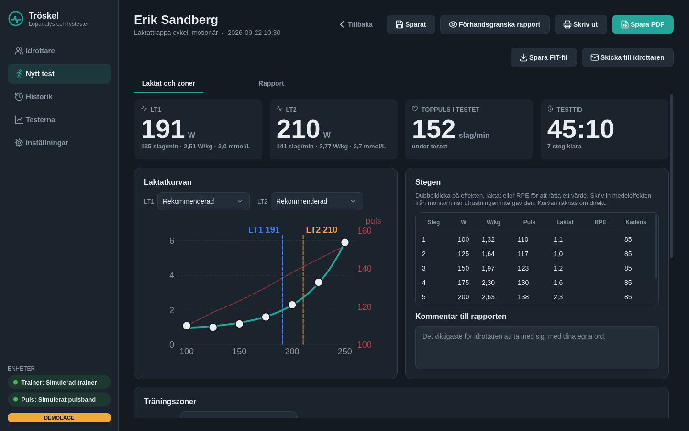
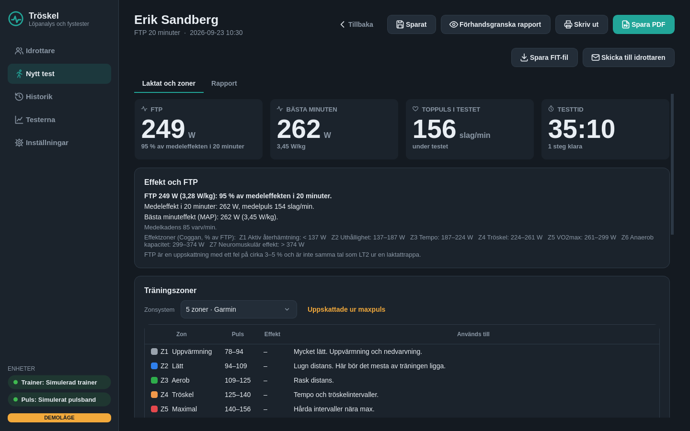

# Cykeltester

*Laktattrappa, ramptest och FTP-test på en cykeltrainer, med watt i stället för fart. Ger trösklar, zoner och maxpuls för cykel. Tillbaka till [handboken](../handbok.md).*

<!-- toc -->
## Innehåll

- [Det här behövs](#det-här-behövs)
- [Välj sport och test](#välj-sport-och-test)
- [Protokollet](#protokollet)
- [Trainern och pulsen](#trainern-och-pulsen)
- [Kör testet](#kör-testet)
- [Resultatet](#resultatet)
- [Maxpuls och zoner gäller bara cykel](#maxpuls-och-zoner-gäller-bara-cykel)
<!-- /toc -->

## Det här behövs

- **En smart trainer med Bluetooth (FTMS)** som kan hålla en bestämd effekt, så kallat ERG-läge. Programmet är byggt för en Tacx NEO 2T *(inte provat på riktig hårdvara, se [PROV.md](../../PROV.md#cykeltrainern))*.
- **Ett pulsband.**
- **Kroppsvikten.** Den behövs för W/kg. Saknas den på idrottaren frågar guiden efter dagens vikt när du går vidare från steget *Testtyp*, och sparar den på idrottaren och på testet.
- **Stäng Zwift, QZ och andra träningsappar** innan du ansluter. Trainern tar två Bluetooth-anslutningar åt gången, och programmet ska ensamt styra motståndet under ett test.
- **Laktatmätare** för laktattrappan.

Testerna i watt filmas inte. [Bikefit](../bikefit/bikefit.md) är ett eget test, som filmas.

## Välj sport och test

Välj *Cykel* i listan *Sport* överst i steget *Testtyp*. Sporten bestämmer vilka tester som finns, enheten i protokollet och vilken enhet som ansluts.

| Test | Vad det är | Ger |
|---|---|---|
| *Laktattrappa* | Steg på 5 min i watt, med blodprov under varje stegs sista 30 sekunder | LT1 och LT2 i watt och W/kg, och zonerna för cykel |
| *Ramptest* | 20 W mer varje minut tills cyklisten inte orkar | Maxpulsen på cykel, bästa minuteffekten och ett uppskattat FTP |
| *FTP 20 minuter* | 20 min så hårt cyklisten orkar hålla | FTP som 95 % av medeleffekten, och Coggans sju effektzoner |
| *Bikefit* | Uppvärmning och sedan ett filmat steg i jämn arbetseffekt | Vinklarna i pedalvarvet och förslag på cykeln, se [Bikefit](../bikefit/bikefit.md) |

## Protokollet

| Protokoll | Innehåll |
|---|---|
| *Laktattrappa cykel, motionär* | 10 min uppvärmning på 80 W, sedan 7 steg på 5 min: 100 W och 25 W mer för varje steg |
| *Laktattrappa cykel, vältränad* | Start på 140 W och 30 W mer för varje steg |
| *Laktattrappa cykel, nybörjare* | Start på 50 W och 25 W mer för varje steg |
| *Ramptest cykel (maxpuls och FTP)* | 10 min uppvärmning, sedan 100 W och 20 W mer var 60:e sekund. Den andra varianten börjar på 150 W med 25 W per minut |
| *FTP 20 minuter* | 15 min uppvärmning i ERG-läge, sedan 20 min där cyklisten väljer effekten själv |

- **Fälten** *Starteffekt*, *Ökning per steg*, *Antal steg*, *Steglängd*, *Paus för laktatprov* och *Uppvärmning* går att ändra. Lutning finns inte för cykel.
- **Stegen är 5 min,** en minut längre än i löpningens trappa. Kortare steg ger högre tröskelwatt, så håll samma steglängd mellan tester som ska jämföras.
- **Laktatprovet tas utan paus:** cyklisten trampar vidare och räcker fram handen eller örat. *Paus för laktatprov* står därför på 0 s. Sätter du en paus släpper trainern motståndet under den.
- **Startwatten och stegen är programmets egna förslag,** inte ett publicerat protokoll. Välj en starteffekt som ger ungefär fyra steg under tröskeln.

I *FTP 20 minuter* heter fältet *Riktmärke*. Det är bara en siffra att sikta på i 20-minuterssteget, där trainern inte håller någon effekt. Tabellen visar steget som *fritt (sikta på 200)*.

## Trainern och pulsen

| Val | Vad det gör |
|---|---|
| *Bluetooth (FTMS)* | Programmet håller effekten på trainern (ERG-läge). Tryck *Sök*, välj trainern i listan och *Anslut*. Trampa ett par varv om den inte syns, så vaknar den |
| *Manuellt* | Ingen anslutning. TV:n visar effekten, cyklisten håller den själv och du bekräftar varje steg med *Idrottaren håller …*. FTP och bästa minuteffekt räknas inte, eftersom inget är uppmätt. Stegets medeleffekt från en egen effektmätare går att skriva in i resultatet |
| *Övning: simulator* | För att prova programmet. Testet märks som övning i resultat och rapport |

Hittar programmet ingen trainer, eller går den inte att styra, är en annan app oftast ansluten: stäng Zwift och QZ och försök igen. Listan *Innan start* i sista steget påminner om det.

## Kör testet

- **Rutorna** visar puls, effekt (med W/kg), målet för steget och kadensen i varv per minut. Diagrammet under meddelanderutan visar effekten över tid.
- **Trainern håller effekten.** Cyklisten väljer bara kadens. Håll ungefär samma kadens hela testet, 80–100 varv per minut.
- **Under 50 varv per minut** kan trainern inte hålla effekten: motståndet ökar när kadensen faller. TV:n säger då *Öka kadensen*.
- **Laktatprovet** skrivs in på operatörssidan som för löpningen. Raden över knappsatsen säger vilket steg värdet sparas för, till exempel *Värdet sparas för Steg 3 (150 W)*.
- **Ramptestet avslutas av sig självt** när cyklisten slutar trampa i fem sekunder. Trainern går då ner till 80 W, och pulsen mäts en minut till. *Utmattad* gör samma sak. I laktattrappan avslutar en kort trampvila inte testet.
- **I FTP-testets 20 minuter** släpper trainern effektmålet och beter sig som platt väg. Cyklisten väljer effekten med växlar och kadens. TV:n visar *Fritt* i rutan *Mål*.

## Resultatet

- **Laktattrappan** ger LT1 och LT2 i watt, med W/kg och puls under. Tabellen *Steg* har effekt, W/kg, puls, laktat och medelkadens per steg. Zonerna visas med puls och effekt.
- **Medeleffekt för hand:** gav trainern ingen effekt i ett steg, eller kördes testet manuellt, dubbelklicka på effekten i tabellen *Steg* och skriv medeleffekten, till exempel från cykelns effektmätare. Talet får en \* i tabellen och i rapporten, och trösklarna räknas om. Töm rutan för att ta tillbaka programmets värde.
- **Ramptestet och FTP-testet** visar rutorna *FTP* och *Bästa minuten* i stället för LT1 och LT2, och kortet *Effekt och FTP* med hur FTP är räknat och Coggans effektzoner.

| Värde | Så räknas det |
|---|---|
| FTP ur *FTP 20 minuter* | 95 % av den bästa medeleffekten under 20 sammanhängande minuter. Kräver hela 20 minuter: ett avbrutet test ger inget FTP |
| FTP ur *Ramptest* | 75 % av bästa minuteffekten. Kan bli för högt för den som har stark spurt |
| Bästa minuten (MAP) | Den högsta medeleffekten under 60 sekunder i testet |
| W/kg | Watt delat med kroppsvikten som sparades med testet |

- **FTP och LT2 är inte samma tal.** FTP är en uppskattning med ett fel på cirka 3–5 %. Rapporten visar dem var för sig med metoden angiven.
- **Föll effekten mer än 8 %** från första till andra halvan av 20 minuter varnar resultatet: ett jämnare upplägg ger ett säkrare FTP.
- **Uppskattat VO2max visas inte** för cykel. Uppskattningen bygger på löpningens ekvation.
- **FIT-filen** är en cykling inomhus med effekt, kadens och puls, utan fart och sträcka. Den följer med i mejlet till idrottaren. Se [Resultat → Spara FIT-fil](../resultat/resultat.md#spara-fit-fil).

## Maxpuls och zoner gäller bara cykel

Maxpulsen är oftast lägre på cykel än i löpning, och tröskelpulsen ännu mer. Hur mycket skiljer mellan personer. Programmet håller därför sporterna isär:

- **Maxpulsen sparas per sport.** Ett ramptest på cykel fyller i *Maxpuls cykel* på idrottaren och rör inte löpningens maxpuls. Fälten finns på idrottarens sida, se [Kom igång](../kom-igang/kom-igang.md#idrottare).
- **Zonerna räknas ur cykelns egna tester.** Löpningens maxpuls och trösklar används aldrig för cykel.
- **Saknas ett eget test** säger resultatet det: *Den här idrottaren har inget eget maxpulstest eller laktattest i cykel.* Zonerna bygger då bara på testets högsta puls. Programmet räknar inte om zoner från en annan sport, eftersom det inte finns belägg för hur stort avdraget ska vara.
- **Historiken** skriver sporten först, till exempel *Cykel · Laktattrappa*. Jämförelsen och den samlade rapporten tar bara tester i samma sport.
- **Åldern används inte** när ett cykelmax bedöms. Kriteriet 208 − 0,7 × ålder gäller löpning.
