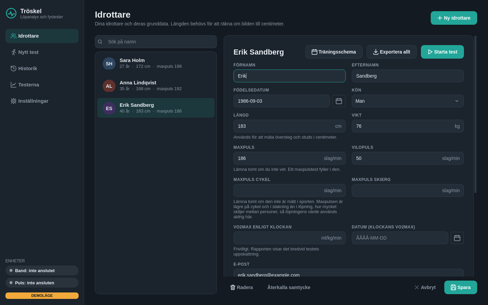
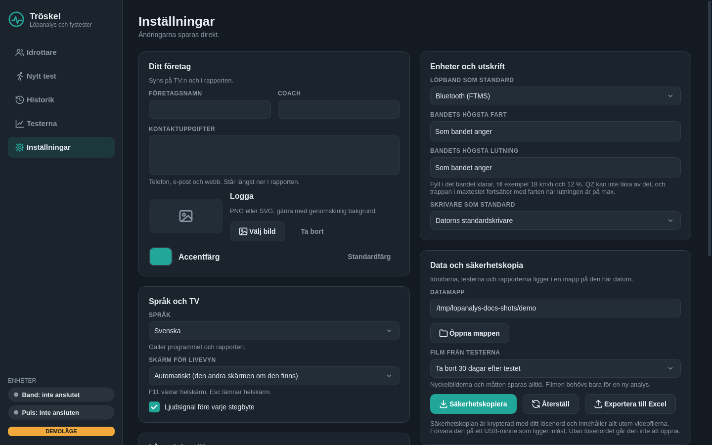
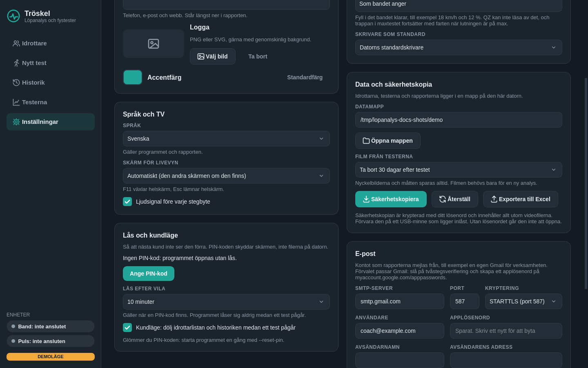
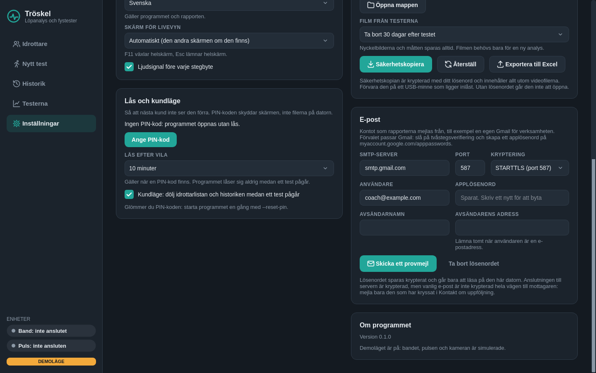

# Kom igång

*Starta programmet, lägg upp idrottarna och gör inställningarna som gäller alla tester. Tillbaka till [handboken](../handbok.md).*

<!-- toc -->
## Innehåll

- [Starta programmet](#starta-programmet)
- [Fönstret](#fönstret)
- [Idrottare](#idrottare)
  - [Samtycke](#samtycke)
  - [Påminnelsen efter 24 månader](#påminnelsen-efter-24-månader)
- [Inställningar](#inställningar)
  - [Lås och kundläge](#lås-och-kundläge)
  - [E-post](#e-post)
<!-- /toc -->

## Starta programmet

Starta *Tröskel* (genvägen på skrivbordet, programfilen heter `Lopanalys.exe`). En startruta med texten *Startar …* visas medan programmet laddas. Programmet går bara att ha igång en gång: startar du det igen får du beskedet *Tröskel är redan igång*.

Från en kommandorad startas det med `lopanalys`, eller `python -m lopanalys.ui.app` i utvecklingsmiljön. Tre växlar finns:

| Växel | Vad den gör |
|---|---|
| `--demo` | Demoläget: simulerat band, simulerad puls, en ritad löpare i stället för kamera och tre påhittade idrottare |
| `--lang sv` eller `--lang en` | Språket för den här starten, oavsett inställningen |
| `--fast N` | Bara i demoläget: testklockan går N gånger fortare, så att ett helt test går att visa på några minuter |

**Öva i demoläget först.** Allt i handboken går att göra där utan utrustning. Märket *DEMOLÄGE* nere till vänster visar att läget är på. Demoläget har sina egna idrottare och tester, skilda från dina riktiga, så det går att visa programmet för en kund utan att en riktig person syns.

## Fönstret

Menyn till vänster har fem sidor: *Idrottare*, *Nytt test*, *Historik*, *Testerna* och *Inställningar*. Medan ett test pågår finns också *Pågående test* överst, och *Idrottare*, *Nytt test* och *Historik* är dolda (kundläget, se [Lås och kundläge](#lås-och-kundläge)). Under *ENHETER* längst ner står om bandet och pulsbandet är anslutna.

Har du valt en PIN-kod öppnas programmet låst: skriv koden och tryck på *Lås upp*.

Första gången, när inga idrottare finns, öppnas *Idrottare*. Annars öppnas *Nytt test*.

## Idrottare

Tryck på *Ny idrottare*, fyll i uppgifterna och tryck på *Spara*. *Spara*, *Avbryt*, *Radera* och *Återkalla samtycke* står alltid under formuläret, även när fälten måste rullas på en liten skärm. *Avbryt* tar tillbaka det som senast sparades.

Alla fält utom *Förnamn* får vara tomma. Sifferfälten är tomma tills något skrivs in, och går du in i ett fält som redan har ett värde markeras det, så att det du skriver ersätter det. *Födelsedatum* skrivs som 1986-09-03, 19860903 eller 860903, eller väljs i kalendern med knappen bredvid. Ett datum eller en siffra som inte går att läsa, eller ligger utanför gränserna, ger ett meddelande när du trycker på *Spara*.

| Fält | Varför |
|---|---|
| *Förnamn* | Måste finnas |
| *Födelsedatum*, *Kön*, *Vikt* (högst 200 kg) | Står i rapporten. Åldern används när maxpulsen bedöms |
| *Längd* (100–230 cm) | Räknar om bilden till centimeter. Utan längden går översteg och studs inte att mäta |
| *Maxpuls* (120–230 slag/min) | Ger pulszonernas färg i livevyn. Lämna tomt om du inte vet: ett maxpulstest fyller i den. Programmet minns att den är inskriven och när, och zonerna säger det. Ett maxtest sänker den aldrig av sig själv, se [Maxpulstest](../maxpulstest/maxpulstest.md#resultatet) |
| *Maxpuls cykel* och *Maxpuls SkiErg* (120–230 slag/min) | Maxpulsen i de andra sporterna, var för sig. Lämna tomt om den inte är mätt i sporten: maxpulsen är lägre på cykel och i stakning än i löpning, och löpningens värde används aldrig där. Ett ramptest i sporten fyller i den |
| *Vilopuls* (högst 120 slag/min) | Används i värdena till klockan och i en av metoderna för uppskattat VO2max. Måste vara lägre än maxpulsen |
| *VO2max enligt klockan* (15–95 ml/kg/min) och datum | Frivilligt. Rapporten visar det bredvid testets uppskattning och varnar när de skiljer mer än 10 % |
| *E-post* | Frivilligt. Hit kan rapporten och FIT-filen mejlas, se [Resultat](../resultat/resultat.md#skicka-till-idrottaren). En adress som inte går att läsa ger ett meddelande |
| *Anteckningar* | Dina egna |

**Osparade ändringar:** trycker du på *Ny idrottare*, väljer en annan idrottare i listan, går till en annan sida eller stänger programmet innan du har sparat, frågar programmet *Du har inte sparat. Vill du kasta ändringarna?* *OK* kastar dem, *Avbryt* låter dig stanna kvar och spara.

- *Starta test* öppnar *Nytt test* med idrottaren redan vald.
- *Träningsschema* öppnar idrottarens [träningsschema](../traningsschema/traningsschema.md).
- *Exportera allt* sparar allt som finns om personen i en zip-fil: en sammanställning att läsa, alla mätvärden, filmerna, nyckelbilderna och de sparade rapporterna. Använd den när personen ber om ett utdrag. Filen är inte lösenordsskyddad: lämna den till personen och ta sedan bort den.
- *Radera* tar bort idrottaren helt, efter en fråga: alla tester, filmer, nyckelbilder och de rapporter du har sparat från programmet. Det går inte att ångra. Efteråt visar programmet vad det inte når och som du tar bort själv: säkerhetskopior, exporter, rapporter som flyttats eller mejlats, utskrifter och film på kamerans minneskort.

### Samtycke

Under uppgifterna står *Samtycke*. Fyll i det efter den underskrivna blanketten: datumet och de fyra rutorna. Kryssar du i en ruta utan datum sätts dagens datum, och *I dag* bredvid datumet sätter det direkt.

Sparar du samtycket medan *Nytt test* står öppet gäller det när testet startar. Du behöver inte välja idrottaren igen.

| Ruta | Vad den styr |
|---|---|
| *Test och mätvärden* | Utan den frågar programmet innan ett test startar |
| *Film under testet* | Utan den spelas ingen film in. Livebilden visas under testet men sparas inte, och det blir inga nyckelbilder |
| *Spara för uppföljning (högst 24 månader)* | Utan den frågar programmet om allt ska raderas när du har sparat eller skrivit ut rapporten. Rapporten du just sparade ligger kvar |
| *Kontakt om uppföljning* | Utan den mejlar programmet inget till idrottaren. Rapporten och FIT-filen skickas med vanlig e-post, som inte är krypterad, så rutan ska stå på den underskrivna blanketten |

En idrottare utan ifyllt samtycke har *Samtycke saknas* i listan. *Återkalla samtycke* används när personen tar tillbaka sitt samtycke: efter en fråga raderas allt, som med *Radera*.

### Påminnelsen efter 24 månader

Har en idrottare inte testats på 24 månader visas en påminnelse överst i listan, och antalet står i menyn: *Idrottare (2)*. *Visa* öppnar personen, där det står när det senaste testet var. Radera personen, eller be om ett nytt samtycke vid nästa test. Samma påminnelse visas för den som har tester kvar utan samtycke till att de sparas. Programmet raderar inget av sig självt.

## Inställningar

Längre ner på sidan finns korten [*Lås och kundläge*](#lås-och-kundläge) och [*E-post*](#e-post).

Ändringarna sparas direkt.

- **Ditt företag:** företagsnamn, coach, kontaktuppgifter, logga (PNG eller SVG) och accentfärg. Det syns på TV:n och i rapporten, och kontaktuppgifterna står längst ner i rapporten.
- **Språk och TV:**
  - *Språk* gäller programmet och rapporten, från nästa start.
  - *Skärm för livevyn* väljer vilken skärm TV-vyn öppnas på. *Automatiskt* tar den andra skärmen om det finns en.
  - *Ljudsignal före varje stegbyte* slår av och på ljudet.
- **Enheter och utskrift:** vilket sätt att styra löpbandet som är förvalt i *Nytt test*, bandets högsta fart och lutning (*Som bandet anger* om de lämnas tomma; QZ kan inte läsa av dem, se [Maxpulstest](../maxpulstest/maxpulstest.md#bandets-högsta-fart-och-lutning)), och vilken skrivare som är förvald vid utskrift.
- **Data och säkerhetskopia:**
  - *Datamapp* visar var idrottarna, testerna och rapporterna ligger på datorn. *Flytta mapp* kopierar allt till en ny mapp, kontrollerar kopian och stänger programmet. När du startar det igen används den nya mappen, och den gamla töms. Knappen finns inte i demoläget.
  - *Film från testerna* bestämmer hur länge filmen sparas: *Ta bort direkt efter analysen*, *Ta bort 30 dagar efter testet* (förvalt) eller *Behåll*. Nyckelbilderna och måtten sparas alltid. Filmen behövs bara om du vill göra om analysen.
  - *Säkerhetskopiera* frågar efter ett lösenord (minst åtta tecken) och sparar en krypterad fil med allt utom videofilerna. Förvara den på ett USB-minne som ligger inlåst, och lösenordet på ett annat ställe. Utan lösenordet går kopian inte att öppna.
  - *Återställ* ersätter allt i programmet med en säkerhetskopia. Det som fanns sparas som en kopia i datamappen i 30 dagar. Personer som du har raderat sedan kopian gjordes tas bort igen.
  - *Exportera till Excel* sparar testerna som en fil som Excel öppnar, för alla idrottare eller en. Varje steg är en rad med sporten. Ett löptest har farten under *km/h*, ett test på cykel eller SkiErg har effekten under *watt*, och *watt för hand* säger *ja* när medeleffekten är inskriven i resultatet. Filen är inte krypterad och innehåller namn, puls och laktat: ta bort den när du är klar.

### Lås och kundläge

Kortet *Lås och kundläge* ligger under *Språk och TV* och är till för att nästa kund inte ska se den förra.

- *Ange PIN-kod* väljer en kod på minst fyra tecken. Sedan öppnas programmet låst, och *Lås nu* låser det direkt. *Ta bort PIN-koden* tar bort låset.
- *Lås efter vila* låser programmet när ingen har rört det på en stund (tio minuter är förvalt). Det låser sig aldrig medan ett test pågår.
- *Kundläge* döljer *Idrottare*, *Nytt test* och *Historik* medan ett test pågår. TV-vyn visar bara idrottarens förnamn.

PIN-koden skyddar skärmen, inte filerna på datorn. Har du glömt koden: starta programmet en gång med `--reset-pin`.

Filerna i datamappen heter efter testets nummer, aldrig efter personen. En rapport får personens namn i filnamnet först när du har sparat rapporter i en mapp utanför datamappen.

Säkerhetskopian, återställningen, flytten av datamappen, exporten och låset är *(inte provat på riktig hårdvara)*, se [PROV.md](../../PROV.md).

### E-post

Kortet *E-post* ligger under *Data och säkerhetskopia*. Här står kontot som rapporterna mejlas från. Använd ett eget konto för verksamheten, till exempel en Gmail som bara används till det.

| Fält | Innehåll |
|---|---|
| *SMTP-server*, *Port*, *Kryptering* | Förvalet passar Gmail: `smtp.gmail.com`, port 587 och *STARTTLS (port 587)*. Det andra valet är *TLS (port 465)*. Anslutningen till servern är alltid krypterad |
| *Användare* | Kontots e-postadress |
| *Applösenord* | Ett lösenord som bara gäller programmet. För Gmail: slå på tvåstegsverifiering och skapa applösenordet på `myaccount.google.com/apppasswords`. Kontots vanliga lösenord fungerar inte |
| *Avsändarnamn* | Namnet som mottagaren ser. Tomt fält ger namnet under *Coach* |
| *Avsändarens adress* | Lämna tomt när användaren är en e-postadress |

- **Lösenordet sparas krypterat** och går bara att läsa av ditt Windows-konto på den här datorn. Fältet töms när lösenordet är sparat och visar *Sparat. Skriv ett nytt för att byta*. Efter en återställning på en annan dator skriver du lösenordet igen. *Ta bort lösenordet* tar bort det.
- ***Skicka ett provmejl*** frågar vart mejlet ska gå och skickar det dit från kontot. Ange en inkorg du kan läsa, till exempel din egen. Gmail lägger ett mejl till kontot självt bara under *Skickat*, så det syns inte i inkorgen. Nästa gång står den senaste adressen ifylld. Raden under knappen säger att det gick, eller vad som är fel: inloggningen, servern eller krypteringen.
- **Vanlig e-post är inte krypterad** hela vägen till mottagaren. Programmet mejlar bara den som har rutan *Kontakt om uppföljning* ikryssad, se [Samtycke](#samtycke).
- **Skräpposten:** ett nytt konto utan historik hamnar lätt i mottagarens skräppost. Programmet gör det som går: ämnet säger vem mejlet är från, mejlet har en vanlig textdel bredvid HTML, svar går till e-postadressen under *Kontaktuppgifter* och mejlet har inga länkar. Be mottagaren markera det första mejlet som *Inte skräppost*. Den riktiga lösningen är en egen domän för verksamheten med SPF och DKIM inställda hos e-postleverantören.

Provmejlet från en riktig dator och lösenordet i Windows är *(inte provat på riktig hårdvara)*, se [PROV.md](../../PROV.md#fit-filen-och-mejlet).
