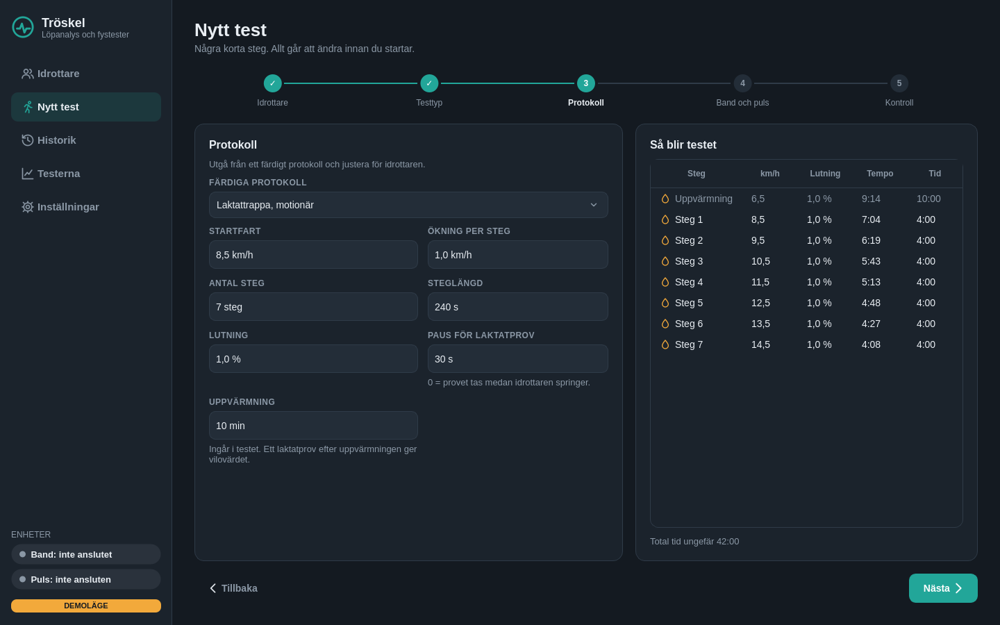
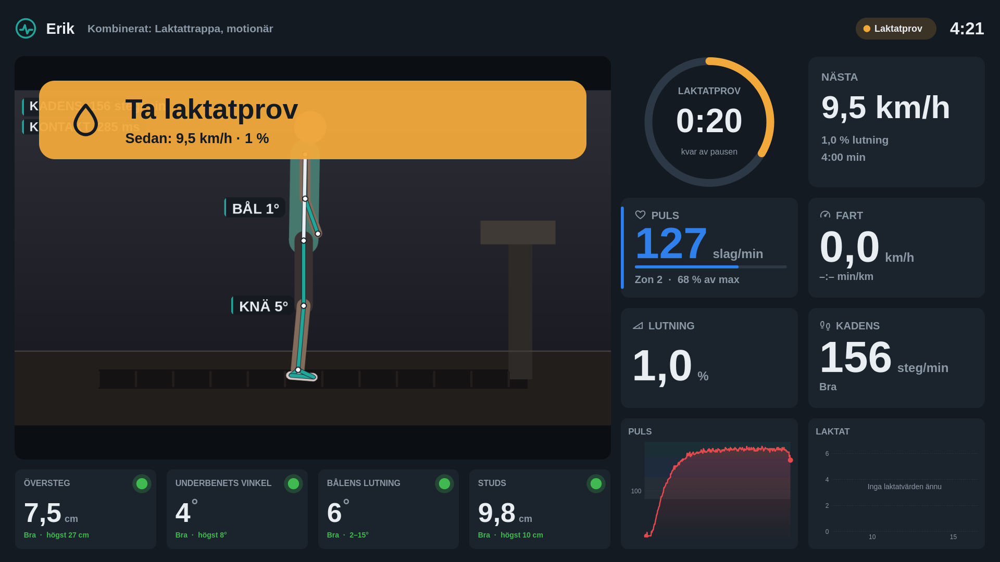
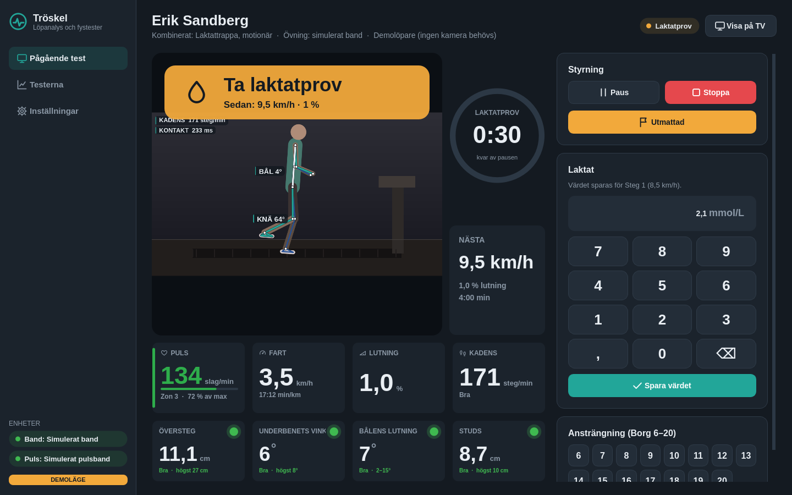

# Laktattrappa

*Steg på fyra minuter med ett blodprov efter varje steg. Ger den aeroba tröskeln (LT1), den anaeroba tröskeln (LT2) och träningszonerna. Tillbaka till [handboken](../handbok.md).*

<!-- toc -->
## Innehåll

- [Det här behövs](#det-här-behövs)
- [Protokollet](#protokollet)
- [Kör testet](#kör-testet)
- [Ta provet och skriv in värdet](#ta-provet-och-skriv-in-värdet)
- [Resultatet](#resultatet)
<!-- /toc -->

## Det här behövs

- Löpbandet och ett pulsband.
- En laktatmätare med stickor. Mätaren är inte kopplad till programmet: du läser av värdet och skriver in det.
- Kameran är valfri. Välj testtypen *Kombinerat* om löptekniken ska mätas i samma test.

## Protokollet

Tre färdiga protokoll finns:

| Protokoll | Innehåll |
|---|---|
| *Laktattrappa, motionär* | 10 min uppvärmning, sedan 7 steg på 4 min med 1 km/h högre fart för varje steg, 1 % lutning och 30 s paus för provet |
| *Laktattrappa, vältränad* | Samma trappa med högre startfart |
| *Laktattrappa till max* | Laktatsteg, och efter sista provet fortsätter testet direkt som en lutningstrappa till utmattning. Ett besök ger både trösklarna och maxpulsen |

- **Startfarten** i de färdiga protokollen är vald så att fyra steg hamnar under den tröskelfart som nivån brukar ha. Ändra den när idrottaren är långsammare eller snabbare än så.
- **Uppvärmningen** går 2 km/h under första steget. Provet efter uppvärmningen ger vilovärdet, som flera av tröskelmetoderna utgår från.
- **Pausen:** sätt *Paus för laktatprov* till 0 om provet ska tas medan idrottaren springer.

Det behövs minst tre laktatvärden för att trösklarna ska gå att räkna fram.

## Kör testet

1. Gå igenom [Nytt test](../nytt-test/nytt-test.md) med testtypen *Laktattrappa* och tryck på *Starta livevyn*.
2. Tryck på *Starta testet*. Uppvärmningen börjar efter nedräkningen.
3. Efter uppvärmningen och efter varje steg visar TV:n *Ta laktatprov*. Ta provet och skriv in värdet, se nedan.
4. Fråga efter ansträngningen och tryck på siffran under *Ansträngning (Borg 6–20)*.
5. Nästa steg börjar när pausen är slut, även om värdet inte är inskrivet än.
6. Testet är klart efter sista steget. Orkar idrottaren inte hela trappan trycker du på *Utmattad*: stegen som är gjorda räknas, och det avbrutna steget sparas som det är.

Knapparna och TV-vyn beskrivs på [Under testet](../under-testet/under-testet.md).

## Ta provet och skriv in värdet

Med ett band som programmet styr stannar bandet under pausen, och ringen på TV:n räknar ner tiden som är kvar.

- **Skriv värdet** med sifferknapparna på skärmen eller med tangentbordet, och tryck på *Spara värdet* eller Enter. Backsteg tar bort en siffra.
- **Raden över knapparna** säger vilket steg värdet hamnar på, till exempel *Värdet sparas för Steg 1 (8,5 km/h).* Det är alltid det äldsta steget som väntar på ett värde. Du hinner alltså skriva in värdet även efter att nästa steg har börjat.
- **Värdena som är inskrivna** står i en lista under knapparna och ritas i diagrammet *LAKTAT* på TV:n.
- **Fel värde** rättar du efteråt i resultatet, se [Resultat](../resultat/resultat.md#rätta-ett-värde).

En laktattrappa på ett riktigt band med pulsband är *(inte provat på riktig hårdvara)*, se [PROV.md](../../PROV.md#testerna-och-databasen).

## Resultatet

Resultatet visar LT1 och LT2 med fart, puls och laktat, laktatkurvan, träningszonerna, rutan *Fyll i din klocka* och uppskattat VO2max. Allt beskrivs på [Resultat](../resultat/resultat.md).
