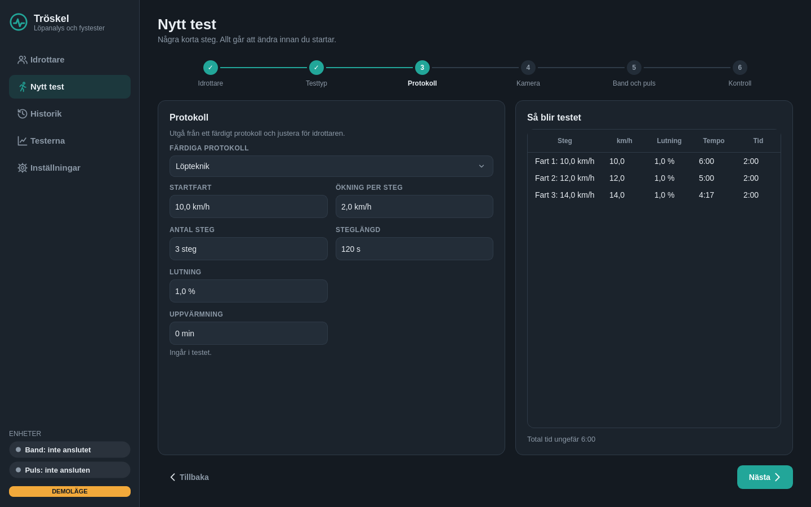
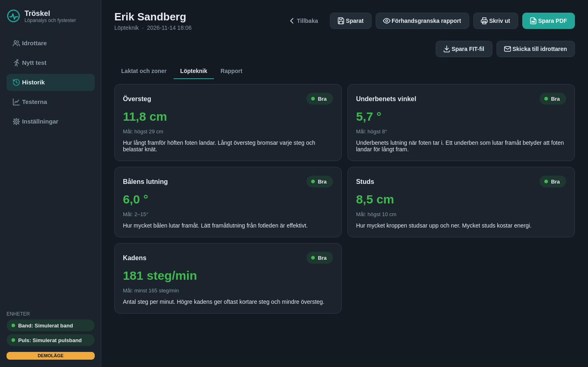

# Löpteknik

*Idrottaren springer några farter medan kameran filmar. Programmet mäter stegen och visar vad som är bra och vad som bör åtgärdas. Tillbaka till [handboken](../handbok.md).*

<!-- toc -->
## Innehåll

- [Det här behövs](#det-här-behövs)
- [Protokollet](#protokollet)
- [Välj håll](#välj-håll)
- [Kör testet](#kör-testet)
- [Resultatet](#resultatet)
<!-- /toc -->

## Det här behövs

- Löpbandet och en kamera. Pulsband är valfritt.
- Idrottarens längd, ifylld under *Idrottare*. Utan den går bilden inte att räkna om till centimeter.
- Kameran från sidan eller bakifrån, så långt bort att hela kroppen syns i ramen även i flygfasen. Med två kameror filmas båda hållen i samma test.

## Protokollet

Det färdiga protokollet *Löpteknik* har tre farter, 10, 12 och 14 km/h, med 120 s på varje och 1 % lutning. Två minuter ger steget tid att sätta sig efter fartbytet, och fler steg att analysera. Ändra *Startfart*, *Ökning per steg* och *Antal steg* så att farterna passar idrottaren.

## Välj håll

Hållet väljs i steg 4, *Kamera*, under *Kameran står*:

| Håll | Ger |
|---|---|
| *Från vänster* eller *Från höger* | Översteg, underbenets vinkel, bålens lutning, studs och kadens |
| *Bakifrån* | Höftfall, knä inåt, stegbredd och armar som korsar mittlinjen |

Med en kamera filmas testet från ett håll. Med [två kameror](../nytt-test/nytt-test.md#två-kameror-samtidigt) filmas båda hållen samtidigt, till exempel GoPron från sidan och [telefonen](../nytt-test/nytt-test.md#telefonen-som-kamera) bakifrån.

## Kör testet

1. Gå igenom [Nytt test](../nytt-test/nytt-test.md) med testtypen *Löpteknik*. I steg 6 ska hela idrottaren synas i ramen.
2. Tryck på *Starta livevyn* och sedan på *Starta testet*.
3. Bandet går igenom farterna. Kameran spelar in hela testet, och värdena för löptekniken syns live på TV:n.
4. Testet är klart efter sista farten.

Knapparna och TV-vyn beskrivs på [Under testet](../under-testet/under-testet.md).

## Resultatet

Resultatet öppnas på fliken *Löpteknik*. Varje mått har ett kort:

- **Bedömningen** uppe till höger: *Bra*, *Håll koll* eller *Åtgärda*.
- **Värdet** och *Mål*, riktvärdet som värdet jämförs med.
- **Förklaringen** av vad måttet betyder, och ett *Tips* när analysen har ett.

| Mått | Betyder |
|---|---|
| *Översteg* | Hur långt framför höften foten landar. Ett långt översteg bromsar varje steg och belastar knät |
| *Underbenets vinkel* | Underbenets lutning när foten tar i |
| *Bålens lutning* | Hur mycket bålen lutar framåt |
| *Studs* | Hur mycket kroppen rör sig upp och ner. Mycket studs kostar energi |
| *Kadens* | Antal steg per minut |
| *Höftfall* | Hur mycket höften faller på motsatt sida i stödfasen |

| *Knä inåt* | Hur mycket knät faller inåt i stödfasen |
| *Stegbredd* | Avståndet i sidled mellan fötternas isättningar |
| *Armar över mitten* | Hur långt handen går över kroppens mittlinje |

Gränserna är riktvärden för en observation i video, inte en diagnos.

**Två kameror.** Fliken har då en rubrik per kamera, *Kameran: Från vänster* och *Kameran: Bakifrån*, med varje kameras kort och stillbilder under sin rubrik. Under den andra rubriken står hur många steg som hittades i båda filmerna och hur långt efter den andra kameran låg. Få gemensamma steg betyder att en av kamerorna tappade bilder eller inte såg fötterna. Rapporten har på samma sätt bilderna, mätvärdena och fynden en gång per kamera, och sammanfattningen på första sidan räknar med båda.

**Videoanalysen.** Direkt efter testet analyseras den inspelade filmen i bakgrunden, och en rad med en stapel visar hur långt den har kommit. Med två kameror analyseras filmerna efter varandra, och det tar ungefär dubbelt så lång tid. Du kan arbeta vidare under tiden. När analysen är klar ersätter den värdena från livevyn, och kortet *Stillbilder* visar upp till sex bilder ur filmen. Bilderna kommer med i rapporten. För ett äldre test med sparad film finns knappen *Analysera videon*.

**När landningarna är osäkra.** Kontakttiden, översteget, underbenets vinkel och knäet vid isättningen mäts i bilden där foten landar. Analysen säger till bland varningarna när landningarna inte går att lita på: när en stor del av dem inte gick att mäta (foten skymd, till exempel bakom bandets stolpe), när kontakttiden är orimlig eller varierar mycket mellan stegen, och när vänster och höger ben ofta blandades ihop i bilden. Läs då de värdena med försiktighet eller spela in igen. Tiden innan löparen springer jämnt, till exempel när hen står på bandet i början, räknas inte med.

**Bildtakten.** En landning faller oftast mellan två bilder, och med 25 bilder/s är det 40 ms mellan dem. Därför märks markkontakten, flygtiden och vinklarna i landningen och frånskjutet *Osäkert* när filmen har under 50 bilder/s: på kortet i resultatet, i rapportens tabell och bland varningarna överst på fliken. Under 20 bilder/s visas de inte alls. Kadensen, studsen, bålens lutning och knäböjningen i stödfasen håller även i 25 bilder/s. Gränserna är provisoriska tills löptekniken är kontrollerad mot klockans löpdynamik *(inte provat på riktig hårdvara)*, se [PROV.md](../../PROV.md#löptekniken). Programmet filmar i dag med livebildens bildtakt, med GoPron cirka 25 bilder/s, så de värdena är märkta i de flesta tester. Inspelning i 120 bilder/s på GoProns kort under testet kommer efter kontrollen.

Bilden ovan är från demoläget utan videoanalys. Den visar värdena från livevyn och saknar därför *Stillbilder*.

Löptekniken med en riktig kamera och en löpare på bandet är *(inte provat på riktig hårdvara)*, utom att skelettet ritades på en person i livebilden. Se [PROV.md](../../PROV.md#löptekniken).
