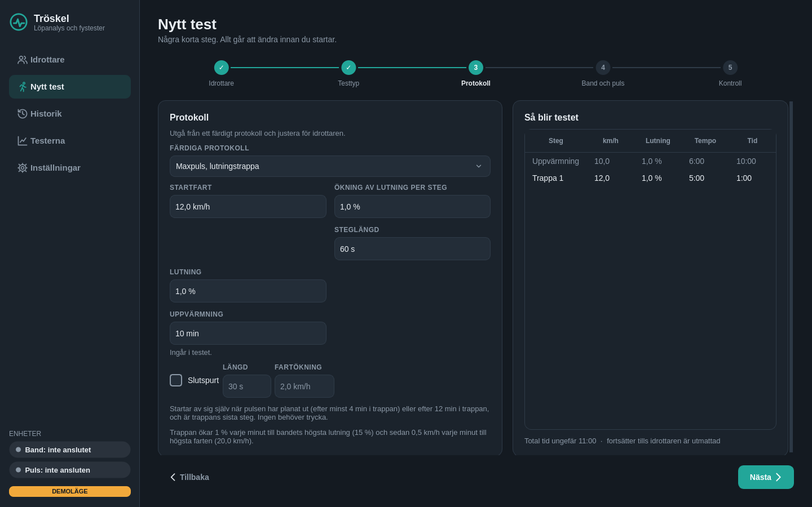
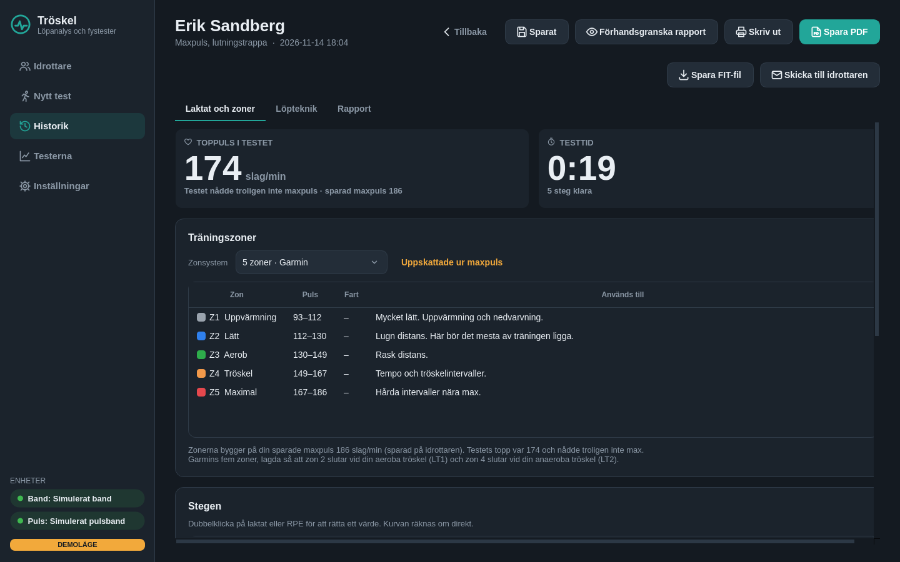

# Maxpulstest

*En trappa som blir tyngre tills idrottaren inte orkar mer. Ger maxpulsen och hur snabbt pulsen går ner efteråt. Tillbaka till [handboken](../handbok.md).*

<!-- toc -->
## Innehåll

- [Det här behövs](#det-här-behövs)
- [Protokollet](#protokollet)
- [Välj startfart](#välj-startfart)
- [Bandets högsta fart och lutning](#bandets-högsta-fart-och-lutning)
- [Slutspurten](#slutspurten)
- [Kör testet](#kör-testet)
- [Resultatet](#resultatet)
- [Maxpuls med löpteknik](#maxpuls-med-löpteknik)
<!-- /toc -->

## Det här behövs

- Löpbandet och ett pulsband. Utan pulsband ger testet ingen maxpuls.
- Testet går till utmattning.

## Protokollet

| Protokoll | Innehåll |
|---|---|
| *Maxpuls, lutningstrappa* | 10 min uppvärmning på 1 %, sedan fast fart 12 km/h med 1 % lutning på steg 1 och 1 % mer var 60:e sekund. Steg N har N % lutning |
| *Maxpuls, fartrappa* | Uppvärmning, sedan 0,5 km/h högre fart var 30:e sekund på 1 % lutning, med slutspurt |

Uppvärmningen och steg 1 har samma lutning. Tabellen *Så blir testet* visar fart och lutning för varje steg.

Testet har inget sista steg. Det fortsätter tills du trycker på *Utmattad* eller idrottaren stoppar bandet på panelen, och raden under tabellen säger *fortsätter tills idrottaren är utmattad*.

Under tabellen står vad trappan gör vid bandets gränser, till exempel *Trappan ökar 1 % varje minut till bandets högsta lutning (12 %) och sedan 0,5 km/h varje minut till högsta farten (18,0 km/h).* Bandets gränser: se [Bandets högsta fart och lutning](#bandets-högsta-fart-och-lutning).

## Välj startfart

Ett maxtest bör ta 8–12 minuter från steg 1 till stopp. Blir det längre tröttnar benen innan pulsen når max, blir det kortare hinner pulsen inte upp.

- **Med ett tidigare maxtest** bygger guiden förslaget på det. Tog trappan mer än 12 min, eller nådde den bandets högsta lutning, står till exempel *Förra testet tog 13 min och nådde 12 %: välj fartrappan eller +1 km/h* och knappen *Använd 13,0 km/h*. Tog den under 6 min föreslås 1 km/h lägre.
- **Med ett uppskattat VO2max från ett tidigare test** räknar guiden ut hur länge trappan troligen tar, varnar *Trappan blir troligen längre än 12 min. Ett maxtest bör ta 8–12 min: höj startfarten* (eller kortare än 6 min: sänk), och föreslår den startfart som ger ungefär 10 min.
- **Utan tidigare test** gäller tumregeln, som bara är ett grovt förval:
  - lutningstrappan: ungefär 75–80 % av milfarten (milfart 15 km/h ger 11–12 km/h),
  - fartrappan: ungefär 3 km/h under milfarten.

  För en vältränad löpare kan 75–80 % vara för snällt, så att trappan tar mer än 12 min. Välj hellre för högt än för lågt för den som är van vid hård träning.

Milfarten kan också användas som ungefärligt tröskeltempo tills en laktattrappa har gett tröskeln.

## Bandets högsta fart och lutning

Fyll i bandets högsta fart och lutning under *Inställningar → Enheter och utskrift* (*Bandets högsta fart*, *Bandets högsta lutning*), för Gymkompaniet Recoil 18 km/h och 12 %. QZ kan inte läsa av vad bandet klarar och antar 20 km/h och 15 %; utan inställningen skickar programmet lutningar som bandet aldrig når. FTMS-band anger det själva, och inställningen gäller då bara om den är lägre.

Belastningen slutar aldrig öka bara för att bandet är på max, eftersom en vältränad löpare kan nå bandets högsta lutning och orka mer:

- **Lutningstrappan** fortsätter med 0,5 km/h högre fart per steg när lutningen är på max. TV:n säger *Bandet är på högsta lutningen (12 %): farten ökar 0,5 km/h per steg i stället*.
- **Fartrappan** fortsätter med 1 % mer lutning per steg när farten är på max.
- **Den kombinerade trappan** efter laktatstegen gör som lutningstrappan.
- När både farten och lutningen är på max står det *Bandet är på max fart och lutning*, och testet fortsätter på samma steg tills idrottaren slutar.

## Slutspurten

Rutan *Slutspurt* i protokollsteget, med *Längd* (30 s) och *Fartökning* (2 km/h). Den är förvald för fartrappan och av för lutningstrappan.

Slutspurten startar av sig själv, eftersom idrottaren ofta är ensam på bandet och ingen kan trycka. Den blir trappans sista steg i stället för nästa steg:

- när pulsen har planat ut (steg högst 2 slag den sista minuten) efter minst 4 min i trappan, eller
- efter 12 min i trappan.

TV:n säger *Slutspurt nu!*. Efter spurten går bandet ner till gångfart och återhämtningspulsen mäts. Är farten redan på bandets max ökar spurten lutningen 2 % i stället. Bara när både farten och lutningen är på max blir det ingen spurt. Knappen *Slutspurt* i livevyn finns kvar för den som vill starta den själv.

Under knappen *Slutspurt* på operatörssidan står hur nära spurten är, med värdena just nu, till exempel *Slutspurten: pulsen +5 slag senaste minuten (startar vid högst 2, tidigast 4:00 in i trappan) · senast om 6:30*. Tiderna räknas från trappans första steg. Under uppvärmningen står bara villkoren, och när spurten har startat står det när och varför, till exempel *Slutspurten startade 9:12 in i trappan (pulsen planade ut)*. TV:n visar inte raden.

## Kör testet

1. Gå igenom [Nytt test](../nytt-test/nytt-test.md) med testtypen *Maxpuls* och tryck på *Starta livevyn*.
2. Tryck på *Starta testet*. Uppvärmningen börjar efter nedräkningen, och sedan trappan.
3. Trappan blir tyngre för varje steg. Pulsen syns på TV:n, med zonen och procent av max när idrottaren har en maxpuls sedan tidigare.
4. Tryck på *Utmattad* i samma stund som idrottaren inte orkar mer. Bandet går ner till gångfart.
5. Låt idrottaren gå lugnt. TV:n visar *Bra kämpat! Gå lugnt*, och pulsen mäts en minut till för att se hur snabbt den går ner.
6. Testet avslutas av sig självt efter återhämtningen. *Avsluta* avslutar den tidigare.

Tryck på *Utmattad*, inte på *Stoppa*. Bara då räknas testet som ett test till max. Stoppar idrottaren bandet på panelen räknas det också som *Utmattad*. Har idrottaren ingen maxpuls sedan tidigare är det bara då som testets högsta puls används som maxpuls i värdena till klockan.

Loggen skriver varje ny fart och lutning som bandet får, till exempel `stage 5: 12.0 km/h, 5 %`.

Maxpulstrappan på ett riktigt band är *(inte provat på riktig hårdvara)*, se [PROV.md](../../PROV.md#testerna-och-databasen).

## Resultatet

Bilden är från demoläget med snabbspolad klocka. Därför är testtiden bara några sekunder och pulsen långt från max.

- **Rutan för pulsen** heter *Maxpuls* när kriterierna för maxpuls är uppfyllda (*sannolikt verklig maxpuls*) och *Toppuls i testet* när de inte är det. Då står *Testet nådde troligen inte maxpuls* under siffran, och rapporten säger detsamma i stället för att kalla toppen maxpuls. Kriterierna är platå i pulsen, nära den åldersberäknade maxpulsen, Borg 19–20 och laktat minst 8 mmol/l; två ska stämma.
- **Idrottarens maxpuls sänks aldrig av sig själv.** Den höjs när testets topp är högre än den sparade, eller sätts när den saknas, bara när testet slutade med *Utmattad*. Är toppen lägre frågar programmet en gång: *Testets toppuls 179 är lägre än din sparade maxpuls 185. Behåll 185?* *Ja* (förvalt) behåller den sparade. *Nej* byter till testets topp, till exempel när maxpulsen har sjunkit med åren.
- **Zonerna** räknas ur maxpulsen när det inte finns några laktattrösklar, och märks då *Uppskattade ur maxpuls*. Under zonerna, i rapporten och på förstasidan står vilken maxpuls de bygger på, till exempel *Zonerna bygger på din sparade maxpuls 188 slag/min (inskriven 2026-03-02). Testets topp var 176 och nådde troligen inte max*, eller *Zonerna bygger på maxpulsen från det här testet, 192 slag/min*.
- **Laktat visas inte** efter ett test utan laktatprov och utan inskrivna värden: ingen laktatkurva, ingen laktatkolumn, inga metodval och inga LT-rutor. Maxpulsen och pulszonerna kommer överst.
- **Uppskattat VO2max** visas bara när kriterierna för maxpuls är uppfyllda. Det räknas inte ur ett sista steg som är brantare än 5 % eller kortare än 2 min, och en uppskattning mer än 15 % från värdet ur maxpuls och vilopuls visas inte. Annars står *Kan inte uppskattas ur det här testet* med skälet. Skälet är att en brant lutningstrappa kan ge ett värde långt över klockans. Har idrottaren *VO2max enligt klockan* ifyllt visar rapporten det bredvid, och varnar när skillnaden är över 10 %.
- **Ett nytt maxtest** föreslås på sidan *Idrottare* och i guiden när det senaste är äldre än två år.

Resten av sidan beskrivs på [Resultat](../resultat/resultat.md).

## Maxpuls med löpteknik

Testtypen *Maxpuls med löpteknik* är samma trappa, men kameran filmar och livevyn visar löpstegets värden, som i *Kombinerat*. Välj kamera och kamerans håll i guiden som för ett löptekniktest.

Maxpulstestet ändras inte för att passa filmen. Löpteknik kräver jämn fart och oförändrad lutning i minst 60 sekunder per steg, se [Nytt test](../nytt-test/nytt-test.md#löpteknik-tillsammans-med-ett-annat-test). Lutningstrappan uppfyller aldrig det, och fartrappan gör det först när du sätter *Steglängd* till 60 s. Annars är *Nästa* grå i guiden: gör då maxpulstestet och löptekniken var för sig. Vill du ha maxpulsen, löptekniken och farten för zonerna i samma test passar [Puls- och fartzoner](../puls-och-fartzoner/puls-och-fartzoner.md).

Tekniken bryts ned de sista minuterna mot utmattning, och de säger lite om hur idrottaren springer. Därför analyseras filmen bara fram till slutet av det sista steget där pulsen låg under 90 % av testets högsta puls, och aldrig de sista två minuterna. Saknas pulsen räknas alla steg i trappan utom de tre sista. Resultatet och rapporten säger vilka steg som är bedömda, och rapporten har både maxpulsen och löptekniken. Det gäller också den samlade rapporten.

Ett maxpulstest som avbryts går inte att fortsätta: kör det på nytt, se [Under testet](../under-testet/under-testet.md#testet-sparas-hela-tiden).

Filmningen under en hel maxpulstrappa är *(inte provat på riktig hårdvara)*, se [PROV.md](../../PROV.md#testerna-och-databasen).
