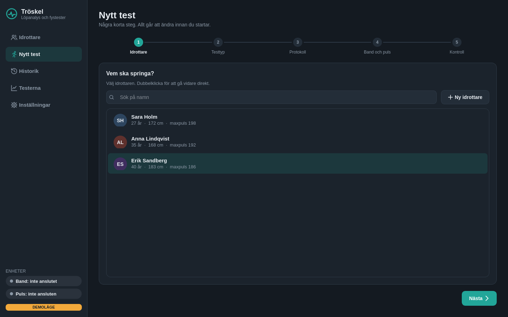
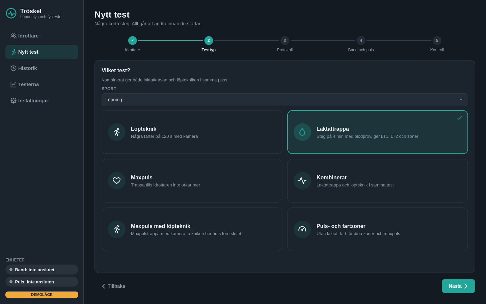
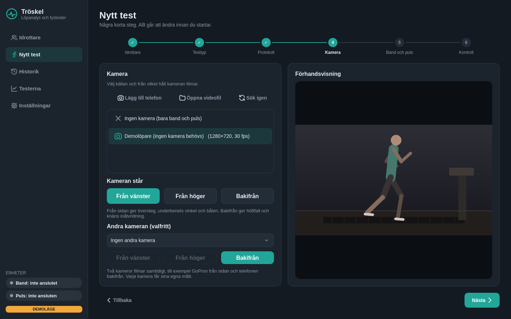
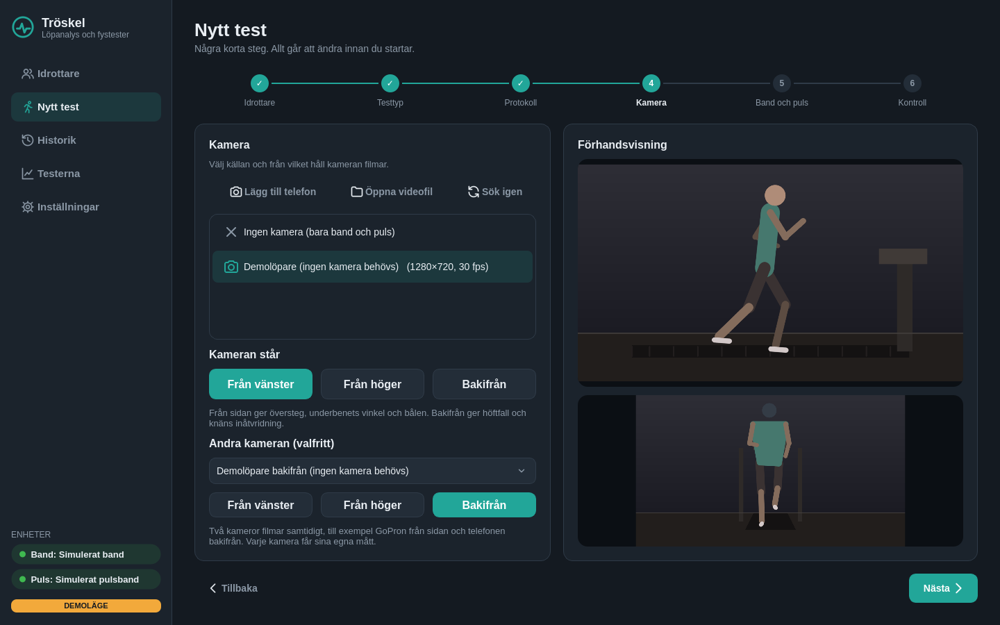
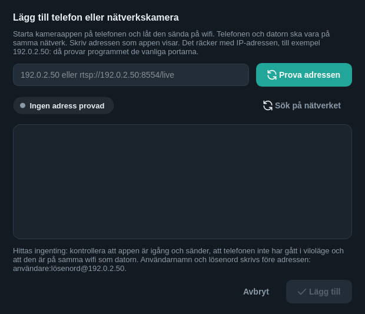
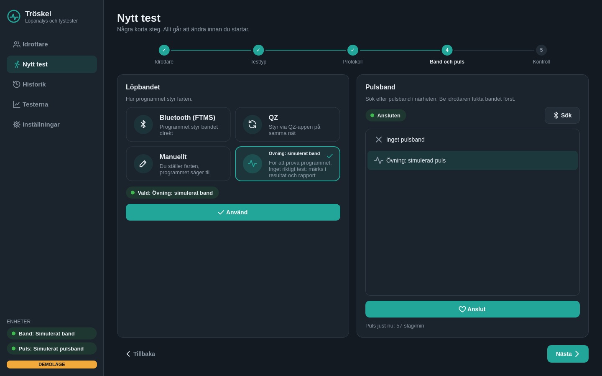
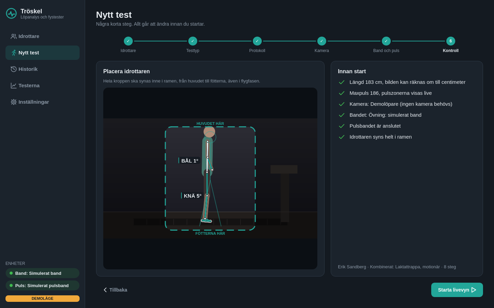
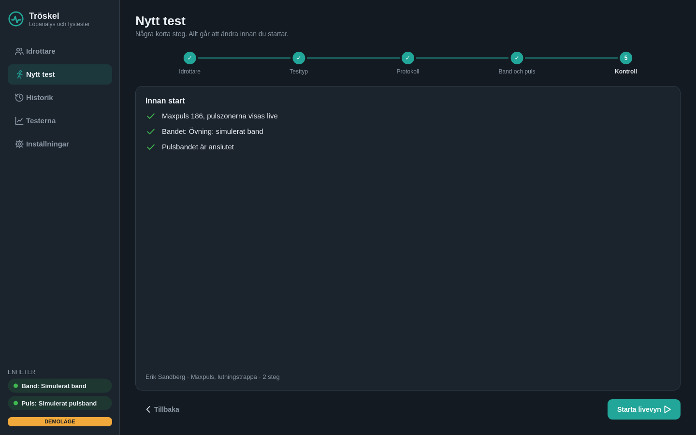

# Nytt test

*Guiden som leder fram till livevyn: idrottare, testtyp, protokoll, kamera när testet filmas, band och puls, kontroll. Tillbaka till [handboken](../handbok.md).*

<!-- toc -->
## Innehåll

- [Idrottare](#idrottare)
- [Testtyp](#testtyp)
  - [Löpteknik tillsammans med ett annat test](#löpteknik-tillsammans-med-ett-annat-test)
- [Protokoll](#protokoll)
- [Kamera](#kamera)
  - [Två kameror samtidigt](#två-kameror-samtidigt)
  - [Telefonen som kamera](#telefonen-som-kamera)
- [Band och puls](#band-och-puls)
- [Kontroll](#kontroll)
<!-- /toc -->

Raden överst visar var i guiden du är, och bara de steg som gäller för testtypen. Ett test som filmas har sex steg. Laktattrappan och maxpulstestet filmas inte och har fem: steget *Kamera* hoppas över, både framåt och bakåt. *Tillbaka* går ett steg bakåt, och allt går att ändra tills du startar. När *Nästa* är grå står skälet bredvid knappen, till exempel *Välj en idrottare först.*

## Idrottare

Välj vem som ska springa. Sök på namn i rutan, eller tryck på *Ny idrottare* om personen saknas. Ett dubbelklick går direkt till nästa steg.

## Testtyp

**Sporten väljs först,** i listan *Sport* överst: *Löpning*, *Cykel* eller *SkiErg*. Den bestämmer vilka tester som finns, om protokollet står i km/h eller watt, och om steget efter protokollet ansluter löpbandet, trainern eller SkiErgens monitor. Tabellen här gäller löpning. Testerna för de andra sporterna står på [Cykeltester](../cykeltester/cykeltester.md) och [SkiErg](../skierg/skierg.md). Av dem filmas bara tekniktesterna [Bikefit](../bikefit/bikefit.md) och [Stakteknik](../stakteknik/stakteknik.md).

| Testtyp | Vad det är | Sida |
|---|---|---|
| *Löpteknik* | Några farter på 120 s med kamera | [Löpteknik](../lopteknik/lopteknik.md) |
| *Laktattrappa* | Steg på 4 min med blodprov. Ger LT1, LT2 och zoner | [Laktattrappa](../laktattrappa/laktattrappa.md) |
| *Maxpuls* | Trappa tills idrottaren inte orkar mer | [Maxpulstest](../maxpulstest/maxpulstest.md) |
| *Kombinerat* | Laktattrappa och löpteknik i samma test: laktattrappans protokoll, med filmning och löpteknik på varje steg | Båda sidorna |
| *Maxpuls med löpteknik* | Maxpulstrappan filmad som *Kombinerat*. Går bara med en trappa som uppfyller [regeln nedan](#löpteknik-tillsammans-med-ett-annat-test) | [Maxpulstest](../maxpulstest/maxpulstest.md#maxpuls-med-löpteknik) |
| *Puls- och fartzoner* | Utan laktat: fart för dina zoner och maxpuls. Steg på 4 min i jämn fart och sedan en trappa till max | [Puls- och fartzoner](../puls-och-fartzoner/puls-och-fartzoner.md) |

### Löpteknik tillsammans med ett annat test

Ett test görs för det som det ska mäta, och ändras inte för att passa filmen. Det viktigaste är att testerna blir så bra som möjligt, inte att de blir många och halvbra.

Regeln: löpteknik får kombineras med ett annat test bara när stegen har jämn fart och oförändrad lutning i minst 60 sekunder.

| Protokoll | Går att kombinera med löpteknik |
|---|---|
| Laktattrappans steg på 4 min | Ja |
| *Puls- och fartzoner* | Ja: stegen är 4 min, trappans steg 60 s, och lutningen är 1 % hela testet |
| *Maxpuls, fartrappa* | Bara när *Steglängd* är minst 60 s. Förvalet är 30 s |
| *Maxpuls, lutningstrappa* | Nej: lutningen ändras för varje steg |
| *Laktattrappa till max* | Nej: testet slutar med en lutningstrappa |

Uppfyller protokollet inte regeln är *Nästa* grå i steget *Protokoll*, och bredvid knappen står: *Löpteknik kräver jämn fart och lutning i minst 60 s per steg. Välj ett protokoll som uppfyller det, eller gör testen var för sig.* Samma besked kommer om du kortar steglängden under 60 s i en kombination. Gör då maxpulstestet som det är, och löptekniken som ett eget test.

## Protokoll

Välj ett färdigt protokoll under *Färdiga protokoll* och justera det för idrottaren. Tabellen *Så blir testet* visar varje steg med fart, tempo och tid, och den ungefärliga totaltiden står under den. En droppe framför ett steg betyder att ett laktatprov tas efter steget.

| Fält | Betydelse |
|---|---|
| *Startfart* | Farten på första steget |
| *Ökning per steg* | Hur mycket farten ökar för varje steg. I maxpulstestet med lutningstrappa är det lutningen som ökar |
| *Antal steg* | Finns inte för maxpulstestet, som fortsätter tills idrottaren är utmattad. I *Puls- och fartzoner* är det stegen före trappan |
| *Steglängd* | Sekunder per steg |
| *Lutning* | Bandets lutning, eller startlutningen i en lutningstrappa |
| *Paus för laktatprov* | Bara för laktattester. 0 betyder att provet tas medan idrottaren springer |
| *Uppvärmning* | Minuter. Uppvärmningen ingår i testet |
| *Filma löptekniken* | Bara för *Puls- och fartzoner*. Ikryssad får guiden steget *Kamera*, och tekniken bedöms på stegen före slutet |

För cykel och SkiErg står fälten i watt (*Starteffekt*), och *Lutning* finns inte.

Bilder av protokollsteget finns på sidan för varje test.

## Kamera

Steget finns bara när testet filmas: *Löpteknik*, *Kombinerat*, *Maxpuls med löpteknik*, och *Puls- och fartzoner* när rutan *Filma löptekniken* är ikryssad i steget *Protokoll*. För de andra testerna startar ingen kamera och ingen förhandsvisning.

Programmet letar efter kameror och visar dem i listan. Välj en, så syns bilden under *Förhandsvisning*.

- **Källor:** webbkameror, inspelningskort och en GoPro över USB hittas av sig själva. *Öppna videofil* väljer en inspelad film i stället (mp4, mov, avi eller mkv). *Sök igen* letar på nytt.
- ***Ingen kamera (bara band och puls)*** går att välja i *Kombinerat* och de andra kombinationerna. Löpteknik kräver en kamera.
- ***Demolöpare (ingen kamera behövs)*** är den ritade löparen i bilden ovan. Den finns alltid i listan.
- **Kameran står:** välj *Från vänster*, *Från höger* eller *Bakifrån*. Från sidan ger översteg, underbenets vinkel och bålen. Bakifrån ger höftfall och knäns inåtvridning.
- **En GoPro som är inkopplad men inte syns:** då visas en rad under listan som säger vad som är fel med drivrutinen i Windows och vad du ska göra.

Kamerorna och hållen du valde är förvalda nästa gång.

Kamerorna är *(inte provat fullt ut på riktig hårdvara)*. Läget för GoPron och de andra står i [PROV.md](../../PROV.md#kameran).

### Två kameror samtidigt

Under *Andra kameran (valfritt)* väljer du en kamera till, som filmar samtidigt från ett annat håll. Det vanliga är GoPron från sidan och telefonen eller en webbkamera bakifrån.

1. Välj den första kameran i listan och dess håll under *Kameran står*.
2. Välj den andra kameran i rutan under *Andra kameran (valfritt)*. Alla kameror utom den första går att välja, och *Demolöpare bakifrån* finns för övning.
3. Välj den andra kamerans håll på raden under rutan. *Bakifrån* är förvalt.

Båda bilderna syns under *Förhandsvisning*. Varje kamera mäts för sig och ger måtten för sitt håll, och kamerorna behöver inte ställas in mot varandra. *Ingen andra kamera* ger ett test med en kamera, precis som förut.

Går den andra kameran inte att starta säger programmet det, och testet körs med en kamera.

Steget *Kamera* finns bara när testet filmas, så en andra kamera går bara att välja då. Regeln om minst 60 s på varje steg och samma lutning hela testet gäller testet, och därmed båda kamerorna, se [Löpteknik tillsammans med ett annat test](#löpteknik-tillsammans-med-ett-annat-test).

### Telefonen som kamera

En iPhone blir en kamera med en app som sänder bilden över wifi. Telefonen och datorn ska vara på samma nätverk.

1. Starta appen på telefonen och låt den börja sända. Appen visar telefonens adress, till exempel `192.0.2.50`.
2. Tryck på *Lägg till telefon* i steget *Kamera*.
3. Skriv adressen och tryck på *Prova adressen*. Det räcker med IP-adressen: programmet provar då de vanliga portarna och listar strömmarna som svarar. Hela adressen går också att skriva, till exempel `rtsp://192.0.2.50:8554/live`.
4. Välj strömmen i listan och tryck på *Lägg till*.

Telefonen står sedan i kameralistan som *Nätverkskamera* och är kvar där nästa gång. Är en riktig kamera redan vald blir telefonen den andra kameran, annars den första.

- ***Sök på nätverket*** listar kameror som själva talar om att de finns på nätverket. Alla appar gör inte det, och då skriver du adressen.
- **Inloggning:** har appen användarnamn och lösenord skrivs de före adressen: `användare:lösenord@192.0.2.50`. Lösenordet sparas med adressen i programmets inställningar på datorn, men visas inte i listan och skrivs inte i loggen.
- **Appen:** *IP Camera Lite* är den som programmet provar först. Appar som gör telefonen till en vanlig webbkamera i Windows (till exempel Camo och iVCam) syns direkt i kameralistan och behöver ingen adress.
- **Ställ telefonen** på ett stativ med laddaren i, stäng av skärmlåset och håll appen öppen. En telefon som somnar slutar sända.
- **Tappar telefonen nätet** under testet försöker programmet ansluta igen av sig självt. Den andra kameran och testet fortsätter under tiden.

Telefonen som kamera är *(inte provat på riktig hårdvara)*, se [PROV.md](../../PROV.md#kameran).

## Band och puls

Steget heter efter sporten: *Trainer och puls* för cykel och *SkiErg och puls* för SkiErg. Där ansluts trainern respektive monitorn, se [Cykeltester](../cykeltester/cykeltester.md#trainern-och-pulsen) och [SkiErg](../skierg/skierg.md#skiergen-och-pulsen).

**Löpbandet.** Välj hur programmet styr farten:

| Läge | Så fungerar det | Så ansluter du |
|---|---|---|
| *Bluetooth (FTMS)* | Programmet styr bandet direkt | Tryck på *Sök*, välj bandet i listan och tryck på *Anslut* |
| *QZ* | Styr via QZ-appen på samma nät | Starta QZ med bandet anslutet och tryck på *Anslut* |
| *Manuellt* | Du ställer farten på bandet, och programmet säger till när det är dags | Tryck på *Använd* |
| *Simulerat* | För demo och övning, inget band behövs | Tryck på *Använd* |

Ett band tar bara en anslutning åt gången. Stäng därför QZ och andra appar innan du ansluter med Bluetooth.

**Pulsbandet.** Be idrottaren fukta bandet och tryck på *Sök*. Välj bandet i listan och tryck på *Anslut*. Raden *Puls just nu* visar att värden kommer. Listan har också *Simulerad puls* och *Inget pulsband*: väljer du det sista körs testet utan puls.

*Nästa* går att trycka på när bandet är anslutet eller ett läge utan anslutning är valt.

Första gången en riktig kamera används hämtas modellen som känner igen kroppen. Det kräver internet och görs en gång. Går det inte att hämta den kan testet köras ändå, men utan skelett och löpteknik.

Anslutningen till band och pulsband är *(inte provat på riktig hårdvara)*, se [PROV.md](../../PROV.md#löpbandet-och-pulsen).

## Kontroll

- **Placera idrottaren:** hela kroppen ska synas inne i den streckade ramen, från *HUVUDET HÄR* till *FÖTTERNA HÄR*, även i flygfasen. Flytta kameran eller zooma ut tills raden om ramen i listan blir grön. Den här delen visas bara när testet filmas. Med två kameror visas den andra kamerans bild bredvid, med sin egen ram. Raden i listan gäller den första kameran.
- **Innan start:** listan går igenom längden, maxpulsen, kameran, bandet och pulsbandet. Filmas testet inte står bara maxpulsen, bandet och pulsbandet där. En grön bock betyder klart. Gult betyder att testet går att köra men att något saknas, till exempel att pulsen visas utan zonfärg när maxpulsen saknas. Rött betyder att testtypen behöver det som saknas.

*Starta livevyn* öppnar operatörssidan på datorn och livevyn på TV:n. Testet börjar inte förrän du trycker på *Starta testet*. Från den stunden sparas det hela tiden, se [Under testet](../under-testet/under-testet.md#testet-sparas-hela-tiden).
