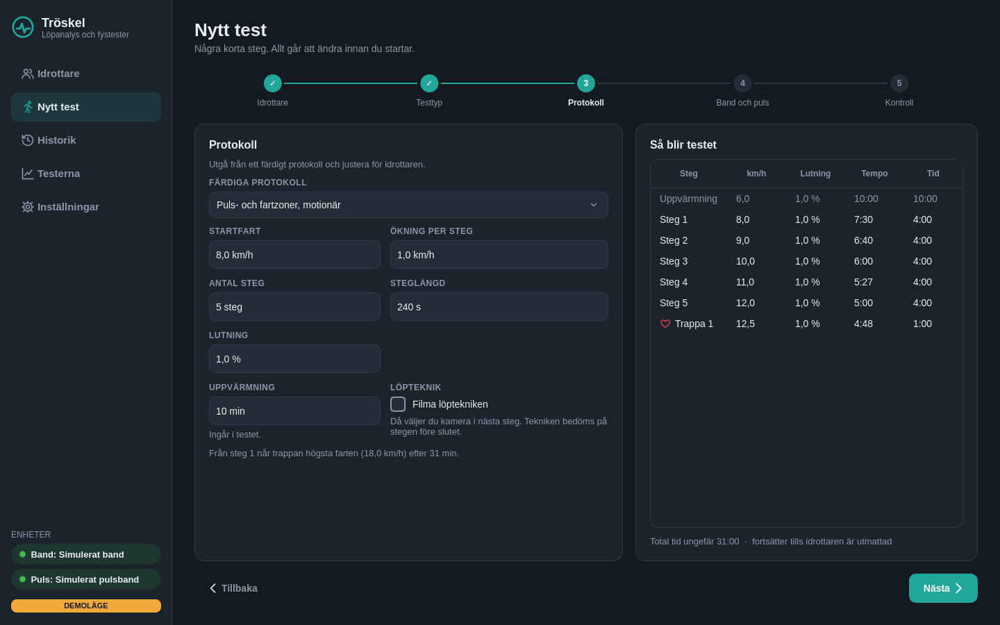
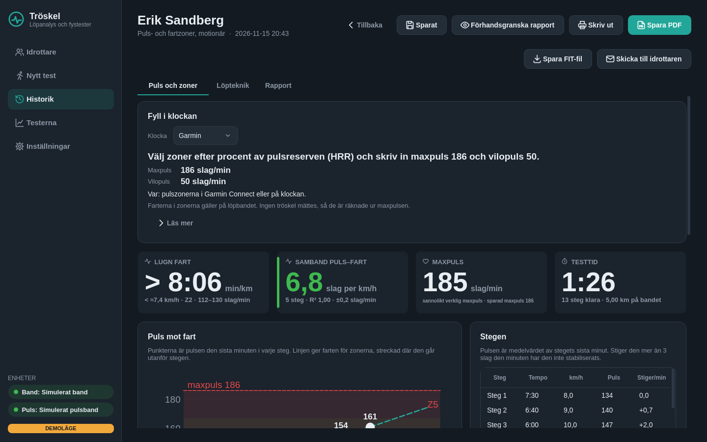

# Puls- och fartzoner

*Testet för den som saknar laktatmätare: steg i jämn fart och sedan en trappa till max. Ger maxpulsen och farten för varje pulszon. Tillbaka till [handboken](../handbok.md).*

<!-- toc -->
## Innehåll

- [Det här behövs](#det-här-behövs)
- [Varför stegen är tre minuter](#varför-stegen-är-tre-minuter)
- [Protokollet](#protokollet)
- [Kör testet](#kör-testet)
- [Resultatet](#resultatet)
  - [När pulsen inte stabiliseras](#när-pulsen-inte-stabiliseras)
  - [Zonerna och farten](#zonerna-och-farten)
- [Rapporten](#rapporten)
- [Löptekniken](#löptekniken)
<!-- /toc -->

## Det här behövs

- Löpbandet, styrt av programmet, och ett pulsband. Utan puls ger testet ingenting.
- Ingen laktatmätare och inga blodprov.
- Testet går till utmattning och tar ungefär 30 minuter med uppvärmningen.
- En kamera bara om löptekniken ska filmas, se [Löptekniken](#löptekniken).

Allt i resultatet är uppskattat ur puls. Testet hittar inte trösklarna, och ersätter inte en [laktattrappa](../laktattrappa/laktattrappa.md).

## Varför stegen är tre minuter

Pulsen ligger två till tre minuter efter farten. I ett maxpulstest med steg på en minut hinner den aldrig ikapp, och då går det inte att säga vilken fart som hör till en viss puls. Därför har testet två delar:

1. **Stegen** på 3 minuter i jämn fart ger sambandet mellan puls och fart. Stegets puls är medelvärdet av den sista minuten.
2. **Trappan** direkt efter sista steget, 0,5 km/h fortare varje minut, ger maxpulsen.

Det finns inga pauser mellan stegen och inget stopp före trappan. Lutningen är 1 % hela testet, så att samma samband gäller i båda delarna.

## Protokollet

Välj testtypen *Puls- och fartzoner* i [Nytt test](../nytt-test/nytt-test.md). Under *Färdiga protokoll* finns ett protokoll för varje nivå:

| Protokoll | Stegen |
|---|---|
| *Puls- och fartzoner, utifrån förra testet* | Finns när idrottaren har ett tidigare test, och står då först. Startfarten räknas ur LT2 i den senaste laktattrappan, eller ur det senaste testet av det här slaget |
| *Puls- och fartzoner, nybörjare* | 6,0–9,5 km/h |
| *Puls- och fartzoner, motionär* | 8,0–12,0 km/h |
| *Puls- och fartzoner, vältränad* | 10,5–14,5 km/h |
| *Puls- och fartzoner, elit* | 13,5–17,5 km/h |

Förvalet är 6 minuters uppvärmning, 5 steg på 3 minuter med 1 km/h högre fart för varje steg, och sedan trappan. Det sista steget ligger en halv km/h under den uppskattade tröskelfarten. Över tröskeln hinner pulsen inte stabiliseras i ett steg.

- **Justera** *Startfart*, *Ökning per steg* och *Antal steg* för idrottaren. Fyra eller fem steg räcker, och det lättaste ska kännas lätt.
- **Steglängden** bör vara minst 3 minuter. Ett kortare steg räknas inte. Välj 4 minuter (240 s) om pulsen brukar stiga länge i varje steg.
- **Hjärtat** framför sista raden i tabellen är trappans första steg. Trappan fortsätter tills idrottaren inte orkar mer.

## Kör testet

Testet går av sig självt, och idrottaren kan köra det ensam.

1. Gå igenom [Nytt test](../nytt-test/nytt-test.md) och tryck på *Starta livevyn* och *Starta testet*.
2. Bandet kör uppvärmningen och byter sedan fart för varje steg. TV:n säger 15 sekunder i förväg vad som kommer.
3. Efter sista steget fortsätter bandet direkt med trappan, och TV:n säger *Trappan: +0,5 km/h varje minut*.
   Sitter du vid datorn kan du trycka på *Slutspurt* när idrottaren har ungefär en minut kvar: 30 s med 2 km/h högre fart, eller 2 % högre lutning om bandet redan går på sin högsta fart. Efter spurten mäts återhämtningen.
4. **När idrottaren inte orkar mer: stoppa bandet på bandets egen panel.** Programmet ser att bandet står still, avslutar testet som utmattad och mäter pulsen en minut till. Bandet får inga fler kommandon. Sitter du vid datorn går det lika bra att trycka på *Utmattad*.
5. Resultatet öppnas av sig självt.

Stoppas bandet redan under stegen, före trappan, sparas stegen som hann bli klara. Testets högsta puls räknas då inte som maxpuls.

Ett test som avbryts går inte att fortsätta: pulsen sjunker i pausen, och stegen efter den skulle inte stämma. Kör det på nytt.

Testet på ett riktigt band är *(inte provat på riktig hårdvara)*, se [PROV.md](../../PROV.md#testerna-och-databasen).

## Resultatet

Bilden är från demoläget med snabbspolad klocka och simulerad puls.

| Ruta | Visar |
|---|---|
| *Lugn fart* | Farten för den lugna zonen (zon 2 i Garmins system), med pulsen och tempot under |
| *Samband puls–fart* | Hur många slag pulsen stiger per km/h, och under det antalet steg, R² och hur långt stegen ligger från linjen |
| *Högsta puls* | Den högsta pulsen i testet, med bedömningen *sannolikt verklig maxpuls* eller *kanske inte verklig max* som i [maxpulstestet](../maxpulstest/maxpulstest.md#resultatet) |
| *Testtid* | Testets längd och antalet steg |

**Diagrammet *Puls mot fart*** har en punkt för varje steg: pulsen under stegets sista minut. Linjen genom punkterna är sambandet. Den är heldragen över de uppmätta stegen och streckad där den går utanför dem. De färgade banden är pulszonerna, och den röda streckade linjen är maxpulsen.

**Tabellen *Stegen*** visar pulsen för varje steg och kolumnen *Stiger/min*: hur mycket pulsen fortfarande steg under den sista minuten.

### När pulsen inte stabiliseras

Stiger pulsen mer än 3 slag under ett stegs sista minut har den inte hunnit stabiliseras. Farten låg då troligen över tröskeln. Programmet varnar i gult under diagrammet, punkten ritas ihålig, och steget väger mindre när linjen räknas. Händer det på flera steg: kör testet igen med lägre startfart.

Andra varningar säger när ett steg blev för kort, när färre än tre steg går att använda (då får zonerna ingen fart) och när testet avslutades före trappan.

### Zonerna och farten

Zonerna är procent av maxpulsen. Förvalt är Garmins fem zoner (50, 60, 70, 80 och 90 % av maxpulsen), och de andra zonsystemen går att välja som vanligt, se [Resultat](../resultat/resultat.md#träningszonerna). Linjen ger farten vid varje gräns.

- **Märkningen** *Uppskattade ur maxpuls · Fart ur puls, inte ur laktat* står vid zonerna på skärmen och i rapporten.
- **≈ framför en fart** betyder att den ligger utanför de uppmätta stegen. Linjen följs högst 2 km/h utanför stegen, och aldrig förbi den högsta farten i trappan. Längre ut ges ingen fart, och zonen skrivs då som *under* eller *över* en fart.
- **Farterna gäller löpbandet med 1 % lutning.** Ute styr pulsen, inte farten: värme, backar, vätska och sömn flyttar pulsen från dag till dag.

Maxpulsen sparas på idrottaren som efter ett maxpulstest, när trappan hann börja. Har idrottaren redan en högre maxpuls räknas zonerna på den, och den är linjen *maxpuls* i diagrammet. [*Fyll i klockan*](../resultat/resultat.md#fyll-i-klockan) och [*Uppskattat VO2max*](../resultat/resultat.md#uppskattat-vo2max) fungerar som efter ett maxpulstest.

## Rapporten

Förstasidan har maxpulsen, farten för den lugna och den hårda zonen, uppskattat VO2max, diagrammet *Puls mot fart* och zonstapeln med puls och fart för varje zon. Sedan följer en sida med stegen och sambandet, en med zonerna och värdena till klockan, och en med maxpulsen och återhämtningen.

Den [samlade rapporten](../resultat/resultat.md#historik-och-jämförelse) kan ta med testet. Finns en laktattrappa bland testerna kommer zonerna från trösklarna i den, eftersom de är uppmätta.

## Löptekniken

Kryssa i *Filma löptekniken* i steget *Protokoll* i guiden. Då får guiden steget *Kamera*, testet filmas som *Kombinerat*, och livevyn visar löpstegets värden. Utan krysset körs testet med bara band och puls, och guiden frågar inte efter någon kamera.

Tekniken bedöms på stegen där pulsen låg under 90 % av testets högsta puls, och aldrig på de två sista minuterna. Stegen i testet är minst en minut långa med samma lutning, vilket är kravet för att löpteknik ska få kombineras med ett annat test, se [Nytt test](../nytt-test/nytt-test.md#löpteknik-tillsammans-med-ett-annat-test).
