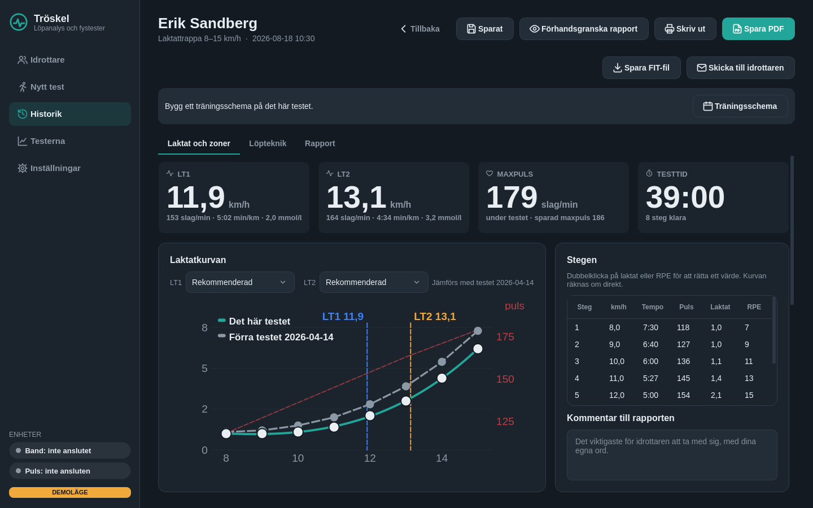
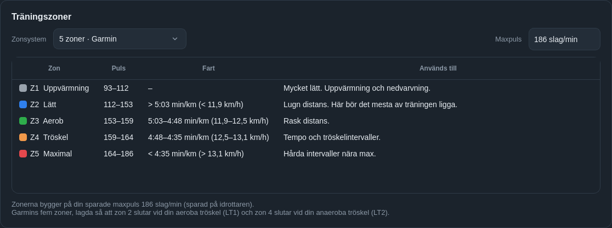
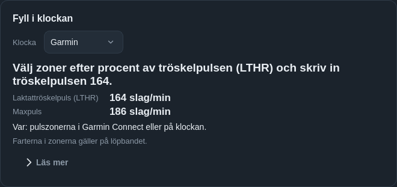
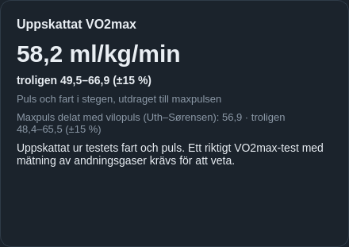
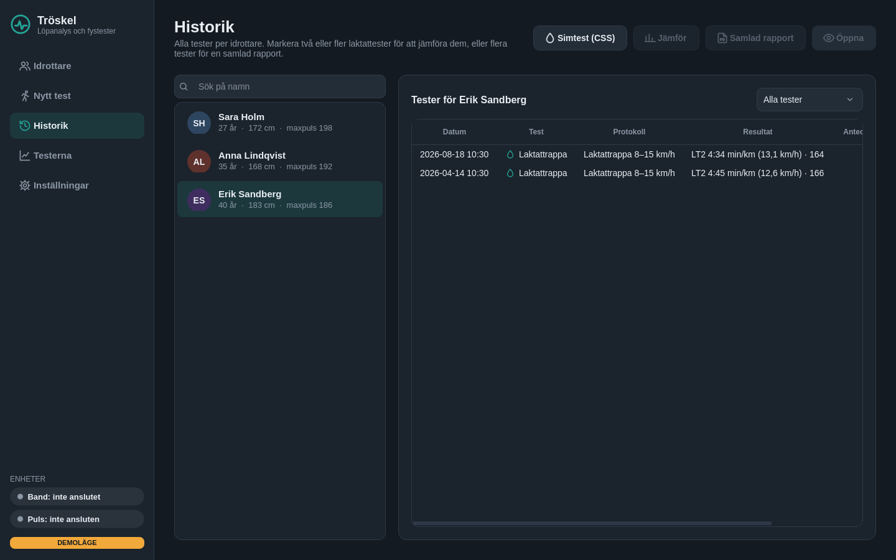
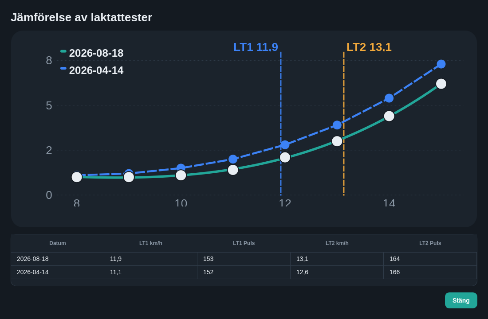
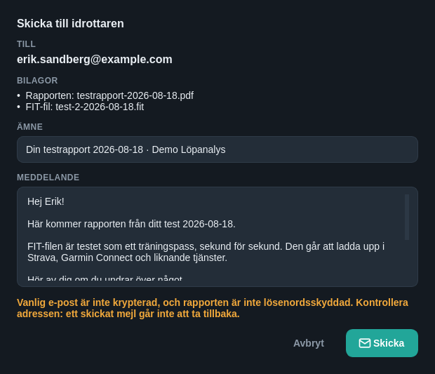
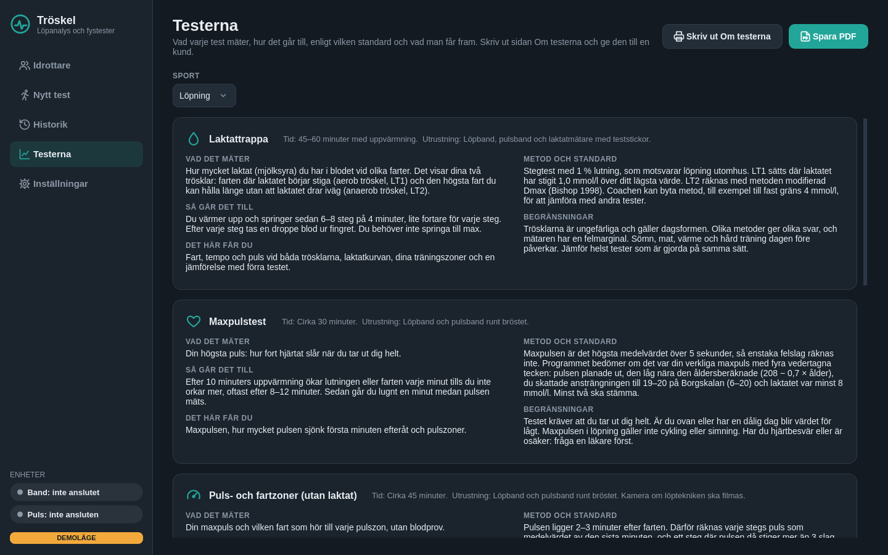
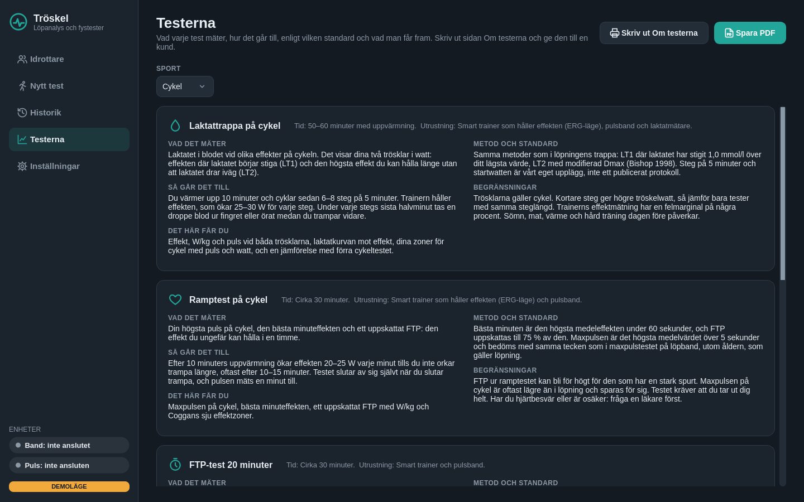

# Resultat

*Läsa resultatet, välja zonsystem, ge idrottaren värdena till klockan, jämföra med tidigare tester, skriva ut rapporten och mejla den med testets FIT-fil. Tillbaka till [handboken](../handbok.md).*

<!-- toc -->
## Innehåll

- [Öppna ett resultat](#öppna-ett-resultat)
- [Trösklarna och laktatkurvan](#trösklarna-och-laktatkurvan)
  - [Rätta ett värde](#rätta-ett-värde)
  - [Kommentaren och sparandet](#kommentaren-och-sparandet)
- [Träningszonerna](#träningszonerna)
- [Fyll i din klocka](#fyll-i-din-klocka)
- [Uppskattat VO2max](#uppskattat-vo2max)
- [Historik och jämförelse](#historik-och-jämförelse)
- [Rapporten och utskriften](#rapporten-och-utskriften)
- [FIT-filen och mejlet till idrottaren](#fit-filen-och-mejlet-till-idrottaren)
  - [Spara FIT-fil](#spara-fit-fil)
  - [Skicka till idrottaren](#skicka-till-idrottaren)
- [Sidan Testerna](#sidan-testerna)
<!-- /toc -->

## Öppna ett resultat

Resultatet öppnas av sig självt när ett test är klart. Ett äldre test öppnas från [*Historik*](#historik-och-jämförelse). Sidan har tre flikar: *Laktat och zoner* (*Puls och zoner* efter testet *Puls- och fartzoner*), *Löpteknik* och *Rapport*. På ett laktat- eller maxpulstest finns en rad över flikarna med knappen *Träningsschema*, se [Träningsschema](../traningsschema/traningsschema.md). Bikefit och stakteknik har bara sin egen flik och *Rapport*, se [Bikefit](../bikefit/bikefit.md#resultatet) och [Stakteknik](../stakteknik/stakteknik.md#resultatet). Fliken *Löpteknik* beskrivs på sidan [Löpteknik](../lopteknik/lopteknik.md#resultatet).

## Trösklarna och laktatkurvan

| Ruta | Visar |
|---|---|
| *LT1* | Den aeroba tröskeln: farten, och under den pulsen, tempot och laktatvärdet vid tröskeln |
| *LT2* | Den anaeroba tröskeln, på samma sätt |
| *Högsta puls* | Den högsta pulsen under testet |
| *Testtid* | Testets längd och antalet steg som blev klara |

**Laktatkurvan** visar laktatvärdena mot farten, med trösklarna som streckade linjer och pulsen som en streckad röd linje mot skalan till höger. Finns ett tidigare test av samma slag för idrottaren ritas det i grått, och raden *Jämförs med testet* säger vilket.

**Metoden för trösklarna** väljs i listorna *LT1* och *LT2* över kurvan. *Rekommenderad* väljer den metod som passar kurvan bäst. De andra finns för att kunna jämföra med andra laboratorier: vilovärde + 0,5, 1,0 eller 1,5 mmol/l, log-log-brytpunkt, första stegringen, fast 2,0 mmol/l, OBLA 4,0 mmol/l, Dmax och modifierad Dmax. Kurvan och zonerna räknas om direkt när du byter.

**Varningar** står i gult under kurvan, till exempel när laktatet aldrig nådde 4 mmol/l. Med färre än tre laktatvärden visar rutorna *Behöver minst 3 laktatvärden*.

### Rätta ett värde

Dubbelklicka på ett värde i kolumnen *Laktat* eller *RPE* i tabellen *Stegen* och skriv det rätta. Laktat ska vara 0,1–30 mmol/l och RPE 6–20. Kurvan räknas om direkt.

### Kommentaren och sparandet

Skriv det viktigaste för idrottaren under *Kommentar till rapporten*. Texten kommer med i rapporten.

Allt sparas av sig självt: testet medan det pågår, resultatet när sidan öppnas, och det du ändrar efteråt (rättade värden, metoderna, zonsystemet och kommentaren) en knapp sekund efter att du slutat skriva, och direkt när du lämnar sidan. Knappen *Spara* sparar på en gång och visar *Sparat*.

Ett test som stoppades eller avbröts av en krasch har en rad överst som säger det, se [Under testet](../under-testet/under-testet.md#testet-sparas-hela-tiden).

## Träningszonerna

Samma trösklar kan visas i sex zonsystem. Förvalt är Garmins fem zoner, så att zonerna och färgerna stämmer med klockan. Välj under *Zonsystem*:

| Zonsystem | Gränserna |
|---|---|
| *5 zoner · Garmin* | Zon 2 slutar vid LT1 och zon 4 slutar vid LT2 |
| *5 zoner · Olympiatoppen I1–I5* | I1 slutar vid LT1 och I3 slutar vid LT2 |
| *3 zoner · Seiler* | Under LT1, mellan trösklarna och över LT2 |
| *4 zoner · svenska A1–A3+* | A1 under LT1, A2 mellan trösklarna, A3 över LT2 och A3+ de sista slagen upp mot maxpuls |
| *5 zoner · Polar* | Fasta steg om 10 % av maxpulsen, oavsett trösklarna |
| *7 zoner · Friel* | Procent av tröskelpulsen, där pulsen vid LT2 används som tröskelpuls |

Tabellen visar pulsen, farten och vad varje zon används till. Texten under tabellen förklarar systemet du valde. Rapporten använder samma val.

**Utan laktattrösklar** räknas zonerna ur maxpulsen och märks *Uppskattade ur maxpuls*. Så är det efter ett maxpulstest och efter en laktattrappa med för få värden.

**Efter *Puls- och fartzoner*** har zonerna också en fart, räknad ur sambandet mellan puls och fart i testets steg. De märks *Fart ur puls, inte ur laktat*, och ≈ framför en fart betyder att den ligger utanför de uppmätta stegen. Resultatet har då diagrammet *Puls mot fart* i stället för laktatkurvan, se [Puls- och fartzoner](../puls-och-fartzoner/puls-och-fartzoner.md#resultatet).

## Fyll i din klocka

Rutan ger värdena som idrottaren skriver in i Garmin Connect eller på klockan, så att klockans zoner följer testet:

- **Efter en laktattrappa:** välj i Garmin Connect att zonerna bygger på laktattröskelpulsen (% LTHR), och fyll i maxpuls, laktattröskelpuls (LTHR), vilopuls, tröskeltempo och de fem zonerna. Zon 2 slutar då vid LT1 och zon 4 vid LT2.
- **Utan laktattrösklar:** fyll i maxpulsen och låt zonerna bygga på procent av maxpuls.
- **Värden som saknas** står utskrivna. Saknas vilopulsen ber rutan idrottaren mäta den liggande en lugn morgon. Är maxpulsen inte mätt, alltså varken känd sedan tidigare eller från ett test till utmattning, ska klockans eget värde stå kvar.
- **Stycket *Varför visar klockan andra zoner?*** förklarar för idrottaren varför klockans förval skiljer sig från testet.

Finns ingen maxpuls alls visar rutan *Det behövs en maxpuls för att räkna fram värden till klockan.*

Att fälten i Garmin Connect tar emot värdena är *(inte provat på riktig hårdvara)*, se [PROV.md](../../PROV.md#testerna-och-databasen).

## Uppskattat VO2max

VO2max mäts inte, det uppskattas ur testets fart, lutning och puls. Rutan visar alltid värdet tillsammans med ett intervall, metoden och förbehållet att ett riktigt VO2max-test kräver mätning av andningsgaser.

| Metod | Används när |
|---|---|
| Sista fullföljda steget i maxtestet (ACSM:s löpformel) | Testet gick till max, alltså avslutades med *Utmattad* eller med att bandet stoppades på panelen, och steget var minst 2 min långt och högst 5 % brant |
| Puls och fart i stegen, utdraget till maxpulsen | Minst tre steg på tre minuter med puls, och en känd maxpuls |
| Maxpuls delat med vilopuls (Uth–Sørensen) | Idrottaren har både maxpuls och vilopuls |

När flera metoder går att använda står de andra med sina värden under den som valdes. Går ingen att använda säger rutan vad som behövs.

Hellre inget värde än ett halvbra: ett test till max som inte uppfyllde kriterierna för maxpuls ger inget VO2max alls, och en uppskattning mer än 15 % från värdet ur maxpuls och vilopuls visas inte. Rutan säger då *Kan inte uppskattas ur det här testet* och varför, se [Maxpulstest](../maxpulstest/maxpulstest.md#resultatet).

Jämförelsen med klockans VO2max eller ett labbtest är *(inte provat på riktig hårdvara)*, se [PROV.md](../../PROV.md#testerna-och-databasen).

## Historik och jämförelse

*Historik* visar alla tester per idrottare, med datum, test, protokoll, resultat och anteckning. Listan uppe till höger filtrerar på testtyp. Dubbelklicka på ett test, eller markera det och tryck på *Öppna*.

**Jämför:** markera två till fyra laktattester och tryck på *Jämför*. Kurvorna ritas i samma diagram, med det senaste testets trösklar utritade, och tabellen visar farten och pulsen vid LT1 och LT2 för varje test.

**Samlad rapport:** har idrottaren gjort flera tester, till exempel en laktattrappa, ett maxpulstest och en löpteknikfilm samma dag, markerar du dem och trycker på *Samlad rapport*. Du får en rapport med alla testerna: förstasidan sammanfattar dem, och varje test har sina egna sidor efter. Zonerna och värdena till klockan räknas ur laktattrösklarna och den högsta uppmätta maxpulsen. Finns ingen laktattrappa men ett test *Puls- och fartzoner* får zonerna sin fart ur det, märkt *Fart ur puls, inte ur laktat*. Rapporten visas i en ruta med *Spara PDF*, *Skriv ut* och *Skicka till idrottaren* (se [FIT-filen och mejlet till idrottaren](#fit-filen-och-mejlet-till-idrottaren)). Varje test analyseras med de tröskelmetoder och den kommentar som är sparade på testet, så spara resultatet först.

## Rapporten och utskriften

Knapparna står uppe till höger i resultatet:

| Knapp | Vad som händer |
|---|---|
| *Förhandsgranska rapport* | Visar rapporten på fliken *Rapport* |
| *Skriv ut* | Öppnar rutan *Välj skrivare*. *Datorns standardskrivare* är förvald om du inte har valt en annan i *Inställningar*. *Avbryt* skriver inte ut något |
| *Spara PDF* | Frågar var filen ska sparas. Namnet föreslås ur idrottaren, protokollet och datumet |

Rapporten innehåller laktatkurvan, trösklarna, zonerna i det valda zonsystemet, värdena till klockan, uppskattat VO2max, jämförelsen med förra testet, stillbilderna från löptekniken och din kommentar, med din logga och dina kontaktuppgifter från *Inställningar*.

**Förstasidan** är rapportens ansikte: din logga och ditt företag, testet och idrottaren, datum, testtyp och protokoll, sedan *Det viktigaste* med upp till fyra nyckeltal (LT1 och LT2 med fart och puls, maxpuls, kadens och uppskattat VO2max med sitt intervall), testets diagram i litet format (laktatkurvan med trösklarna, pulsen mot farten från *Puls- och fartzoner*, eller pulskurvan från maxpulstestet), idrottarens pulszoner som en stapel i klockans färger och *Att jobba med*. Efter *Puls- och fartzoner* har stapeln också farten för varje zon, och då visas en punkt under *Att jobba med*. Laktat visas bara när det är mätt. För att förstasidan ska rymmas på en sida visas två punkter under *Att jobba med* när det finns ett diagram eller en kommentar från dig, och med både diagram och kommentar står kommentaren i deras ställe. Meningen om vilken maxpuls zonerna bygger på står på samma rad som rubriken *Dina pulszoner* när den ryms där. En längre mening får en egen rad, och har förstasidan laktatkurvan visas då en punkt under *Att jobba med*. Raden *I rapporten* visas bara när det inte finns något diagram. Sidan går att skriva ut i svartvitt: varje färg har en text bredvid sig.

Hittas ingen skrivare säger rutan att du kan spara som PDF i stället, eller lägga till en skrivare i Windows.

En testrapport är utskriven i färg. Den samlade rapporten med bilder, och utskriftsrutan utan förvald skrivare, är *(inte provat på riktig hårdvara)*, se [PROV.md](../../PROV.md#rapporten-och-utskriften).

## FIT-filen och mejlet till idrottaren

Under rubriken i resultatet står två knappar: *Spara FIT-fil* och *Skicka till idrottaren*. Till vänster om dem står när testet senast mejlades, eller varför det inte går att mejla.

### Spara FIT-fil

En FIT-fil är testet som ett träningspass, i formatet som Strava, Garmin Connect och liknande tjänster tar emot. *Spara FIT-fil* frågar var filen ska sparas. Den heter efter testets nummer och datum, till exempel `test-12-2026-11-14.fit`, aldrig efter idrottaren, och inget i filen säger vem det är.

Alla sporter får en fil: löpning, cykel och SkiErg, och bikefit och stakteknik när de har en sparad puls- och effektserie.

| I filen | Löpning | Cykel | SkiErg |
|---|---|---|---|
| Passet | Löpning på löpband | Cykling inomhus | Träningsmaskin, skidåkning inomhus |
| Varje sekund | Tid, puls, fart, sträcka, lutning och kadens | Tid, puls, effekt och kadens | Tid, puls, effekt, takt, fart och sträcka |
| Varv | Ett för uppvärmningen och ett för varje steg | Samma | Samma |
| Varvens summor | Snittfart, puls och kadens | Snitteffekt, högsta effekt, puls och kadens | Snitteffekt, högsta effekt, puls, takt och sträcka |

Stoppen för blodprov är vilovarv, och återhämtningen efter *Utmattad* är ett nedvarvningsvarv. Passet börjar när idrottaren börjar arbeta: när bandet startar, eller när effekten första gången når 30 W på cykeln och 20 W på SkiErgen.

- **Löpning:** sträckan räknas ur bandets fart. Kadensen står i filen som varv per minut, alltså halva antalet steg, eftersom formatet räknar så för löpning. Strava och Garmin Connect visar den som steg per minut igen.
- **Cykel:** filen har ingen fart och ingen sträcka, eftersom trainerns hjulfart inte sparas med testet.
- **SkiErg:** farten och sträckan räknas ur effekten på samma sätt som monitorn gör (Concept2: watt = 2,80 × fart³). Formatet har ingen egen sport för en skidergometer, så filen är en träningsmaskin med skidåkning inomhus.

Knappen är grå för ett test som saknar sparad puls och belastning per sekund, till exempel ett test som bara har stegens värden.

Importen i Strava och i Garmin Connect, och hur tjänsterna visar en cykel- och en SkiErg-fil, är *(inte provat på riktig hårdvara)*, se [PROV.md](../../PROV.md#fit-filen-och-mejlet).

### Skicka till idrottaren

*Skicka till idrottaren* mejlar rapporten som PDF och testets FIT-fil till idrottarens e-postadress, från kontot under [*Inställningar → E-post*](../kom-igang/kom-igang.md#e-post).

1. Tryck på *Skicka till idrottaren*. Rutan visar adressen, bilagorna, ämnet och ett meddelande med en kort hälsning, undertecknad med ditt namn och företag från *Inställningar*. Ämnet är till exempel *Din testrapport från Tröskel Test AB, 2026-11-14*.
2. Kontrollera adressen. Ändra ämnet och meddelandet om du vill.
3. Tryck på *Skicka*. *Avbryt* skickar inget.

Efteråt står det på testet när det skickades och vad som följde med, till exempel *Skickat till idrottaren 2026-11-14 10:32: rapporten + FIT-filen*. Adressen sparas inte där, och inte i loggen.

Knappen är grå, med skälet utskrivet bredvid, när något av det här saknas:

| Saknas | Gör så här |
|---|---|
| Idrottarens e-postadress | Fyll i *E-post* under [*Idrottare*](../kom-igang/kom-igang.md#idrottare) |
| Rutan *Kontakt om uppföljning* i samtycket | Utan den skickas ingen e-post. Kryssa bara i den efter den underskrivna blanketten |
| Kontot under *Inställningar → E-post* | Fyll i server, användare och applösenord, och prova med *Skicka ett provmejl* |

**Vanlig e-post är inte krypterad** på vägen till mottagaren, och rapporten är inte lösenordsskyddad. Mejla därför bara den som har bett om det, och kontrollera adressen: ett skickat mejl går inte att ta tillbaka, och raderingen i programmet når det inte.

En idrottare som inte har samtyckt till att resultaten sparas får frågan om radering när mejlet är skickat, precis som efter en utskrift.

Hamnar mejlet i skräpposten hos mottagaren, se [E-post](../kom-igang/kom-igang.md#e-post).

Från *Samlad rapport* skickas den samlade rapporten och en FIT-fil för varje test som har en.

Att mejlet kommer fram från en riktig dator är *(inte provat på riktig hårdvara)*, se [PROV.md](../../PROV.md#fit-filen-och-mejlet).

## Sidan Testerna

*Testerna* i menyn förklarar varje test: vad det mäter, hur det går till, enligt vilken standard och vad man får fram. *Skriv ut Om testerna* skriver ut texten på en A4 att ge till en kund, och *Spara PDF* sparar samma sida som fil.

Välj sport i listan *Sport* överst. Sidan och utskriften visar en sport i taget, så att varje sport får plats på sin egen A4:

| Sport | Korten |
|---|---|
| *Löpning* | Laktattrappa, maxpulstest, puls- och fartzoner, löpteknikanalys, träningszoner och uppskattat VO2max |
| *Cykel* | Laktattrappa på cykel, ramptest, FTP-test 20 minuter, bikefit och zoner för cykel |
| *SkiErg* | Laktattrappa på SkiErg, ramptest, stakteknik och zoner för SkiErg |

Korten för cykel och SkiErg säger vad testet mäter, protokollet, hur trösklarna och zonerna räknas (FTP, Coggans effektzoner, tempo per 500 m) och vad rapporten visar. De följer det som står på sidorna [Cykeltester](../cykeltester/cykeltester.md), [SkiErg](../skierg/skierg.md), [Bikefit](../bikefit/bikefit.md) och [Stakteknik](../stakteknik/stakteknik.md).

Utskriften heter efter sporten, till exempel *Om_testerna_Cykel.pdf*, och har sporten i rubriken.
