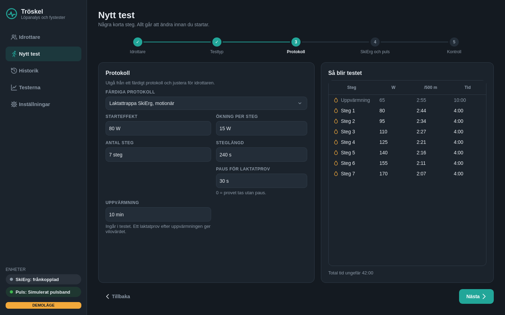
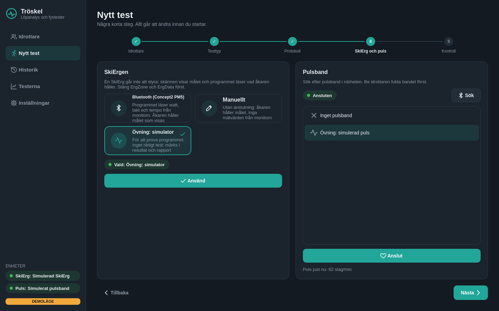
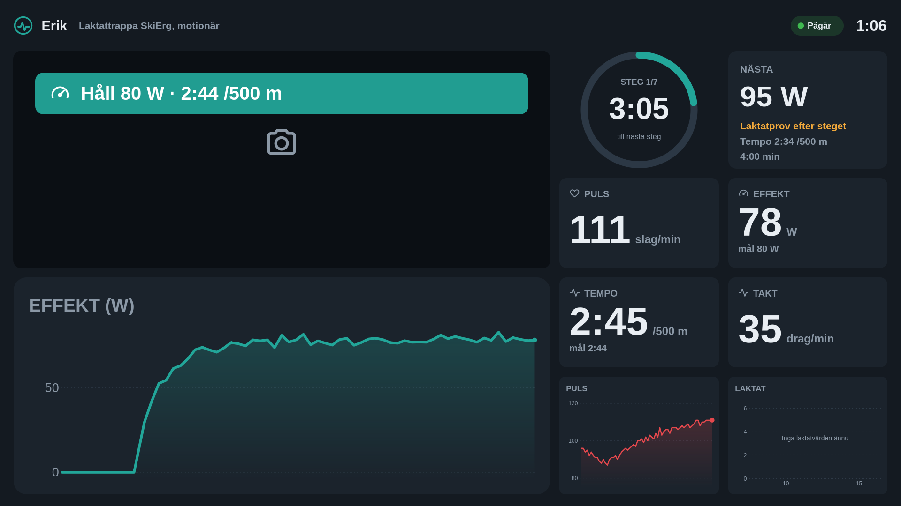
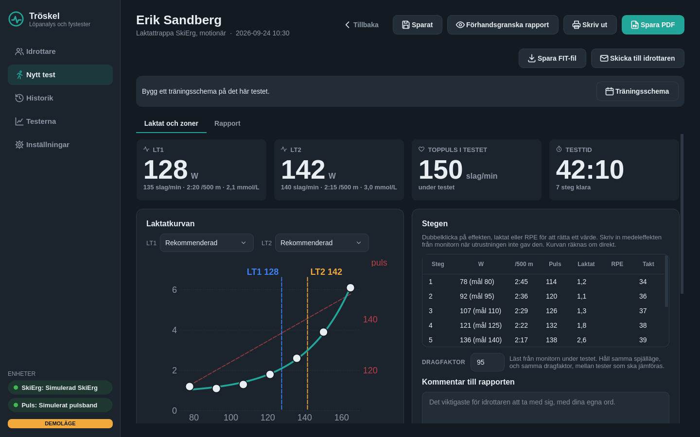

# SkiErg

*Laktattrappa och ramptest på Concept2 SkiErg, med watt och tempo per 500 m. Ger trösklar, zoner och högsta puls för stakning. Tillbaka till [handboken](../handbok.md).*

<!-- toc -->
## Innehåll

- [Det här behövs](#det-här-behövs)
- [En SkiErg går inte att styra](#en-skierg-går-inte-att-styra)
- [Passet på monitorn](#passet-på-monitorn)
- [Protokollet](#protokollet)
- [SkiErgen och pulsen](#skiergen-och-pulsen)
- [Kör testet](#kör-testet)
- [Resultatet](#resultatet)
- [Puls och zoner gäller bara stakning](#puls-och-zoner-gäller-bara-stakning)
<!-- /toc -->

## Det här behövs

- **En Concept2 SkiErg med monitorn PM5** *(inte provat på riktig hårdvara, se [PROV.md](../../PROV.md#skiergen))*. Programmet läser monitorn över Bluetooth.
- **Ett pulsband.**
- **Stäng ErgZone och ErgData** innan du ansluter. Monitorn tar en app åt gången.
- **Monitorn får testet som ett pass** när testet startar *(inte provat på riktig hårdvara)*. Går det inte säger operatörssidan till: välj då *Just Ski* på monitorn.
- **Laktatmätare** för laktattrappan.

Testerna i watt filmas inte. [Stakteknik](../stakteknik/stakteknik.md) är ett eget test, som filmas.

## En SkiErg går inte att styra

Motståndet är luft, och åkaren bestämmer effekten med hur hårt hen drar. Det finns inget ERG-läge. Testet går därför så här:

- **TV:n visar målet** för varje steg, i watt och som tempo per 500 m, till exempel *Håll 110 W · 2:27 /500 m*.
- **Programmet läser vad åkaren håller:** watt, takt i drag per minut och tempo.
- **Stegets effekt är den uppmätta medeleffekten,** inte målet. De första 15 sekunderna av steget räknas inte med, eftersom åkaren då tar sig upp i fart. Trösklarna räknas på det som faktiskt hölls.
- **Stegklockan går av sig själv.** Ingen behöver bekräfta att åkaren har kommit upp i rätt effekt.
- **Monitorn visar samma steg.** Programmet lägger in testet som ett pass på monitorn, se [Passet på monitorn](#passet-på-monitorn).

Watt och tempo hänger ihop enligt Concept2: watt = 2,80 / (sekunder per meter)³. Sambandet är kubiskt, så stegen anges i watt och tempot visas bredvid. Trösklarna räknas alltid på watt.

## Passet på monitorn

ErgData och ErgZone kan lägga in ett pass på monitorn från telefonen. Programmet gör samma sak när du trycker på *Starta testet*: varje steg blir ett intervall med stegets längd, pausen för laktatprovet som vila och målet som måltempo per 500 m. Monitorn visar då steget och målet framför åkaren, och TV:n visar det som vanligt.

- **Motståndet ändras inte.** Spjället ställs för hand, och åkaren håller målet själv.
- **Åkaren börjar dra när nedräkningen på TV:n är slut.** Monitorns klocka startar vid första draget, och TV:ns klocka är den som gäller för testet. De två kan skilja någon sekund.
- **Ramptestet** har inget sista steg. Monitorn får de 30 första stegen.
- **Går passet inte att lägga in** står det under knapparna på operatörssidan: *Passet gick inte att lägga in på monitorn. Testet fortsätter med målet på TV:n: välj Just Ski på monitorn.* Testet och mätvärdena påverkas inte.
- **I manuellt läge** läggs inget pass in.

Det här är *(inte provat på riktig hårdvara)*: kommandona till monitorn är till stor del skrivna ur minnet, se [PROV.md](../../PROV.md#skiergen).

## Protokollet

Välj *SkiErg* i listan *Sport* överst i steget *Testtyp*. Det finns två tester:

| Protokoll | Innehåll |
|---|---|
| *Laktattrappa SkiErg, motionär* | 10 min uppvärmning, sedan 7 steg på 4 min: 80 W och 15 W mer för varje steg, med 30 s paus för laktatprovet efter varje steg |
| *Laktattrappa SkiErg, vältränad* | Start på 110 W och 20 W mer för varje steg |
| *Ramptest SkiErg (högsta puls)* | 10 min uppvärmning, sedan 80 W och 15 W högre mål var 60:e sekund. Den andra varianten börjar på 120 W med 20 W per minut |

- **Det finns inget publicerat protokoll för SkiErg** att följa. Stegen är programmets egna förslag och följer löpningens trappa. Håll samma protokoll mellan tester som ska jämföras.
- **Pausen på 30 s** är till för ett prov från fingret, eftersom händerna är upptagna. Sätt *Paus för laktatprov* till 0 s om provet tas från örat med så kort avbrott som möjligt.
- **Håll spjället på samma läge** mellan tester. Programmet läser dragfaktorn från monitorn och sparar den med testet, se [Resultatet](#resultatet).

## SkiErgen och pulsen

| Val | Vad det gör |
|---|---|
| *Bluetooth (Concept2 PM5)* | Programmet läser watt, takt och tempo från monitorn. Tryck på en knapp på monitorn så att den vaknar, tryck *Sök*, välj monitorn och *Anslut* |
| *Manuellt* | Ingen anslutning. TV:n visar målet och du bekräftar varje steg. Stegets effekt blir målet tills du skriver in monitorns medeleffekt i resultatet |
| *Övning: simulator* | För att prova programmet. Testet märks som övning i resultat och rapport |

Pulsbandet ansluts i programmet som vanligt. Monitorn kan samtidigt ha sin egen anslutning till bandet.

## Kör testet

- **Rutorna** visar puls, effekt med målet under, tempo per 500 m med måltempot under och takten i drag per minut.
- **Målet står kvar** i meddelanderutan hela steget.
- **Mer än 5 % från målet:** rutorna blir gula och det står *Utanför målet: mer än 5 % ifrån*. Steget räknas ändå, på den effekt som hölls.
- **I pausen** tar du laktatprovet och skriver in värdet på operatörssidan. Nästa mål står under *Ta laktatprov*.
- **Ramptestet avslutas av sig självt** när åkaren slutar staka. Det tar ungefär en kvarts minut innan programmet ser det, eftersom monitorn inte säger till när dragen upphör. *Utmattad* avslutar direkt. I laktattrappan avslutar en vila inte testet.

## Resultatet

- **LT1 och LT2** visas i watt, med tempo per 500 m och puls under.
- **Tabellen *Steg*** visar den uppmätta effekten med målet inom parentes, till exempel *78 (mål 80)*, tempot, pulsen, laktatet och medeltakten. Ett steg som låg mer än 5 % från målet är gult.
- **Tappade monitorn anslutningen** under ett steg, eller kördes testet manuellt, skriver du in stegets medeleffekt från monitorn: dubbelklicka på effekten i tabellen *Steg* och skriv talet. Steget visar då till exempel *150\* (mål 145)*, trösklarna räknas om direkt, och rapporten säger att effekten är inskriven för hand. Töm rutan för att ta tillbaka programmets värde.
- **Dragfaktorn** står under tabellen. Den läses från monitorn under testet (medianen under stegen efter uppvärmningen) och märks *Läst från monitorn*. Gav monitorn ingen, skriv in den som monitorn visar. Rapporten skriver den under laktatkurvan och vid bästa minuten.
- **Två steg på nästan samma effekt** (inom 2 %) räknas som ett, och det senare provet gäller. Resultatet säger när det har hänt.
- **Zonerna** visas med puls, effekt och tempo per 500 m.
- **Ramptestet** ger den högsta pulsen i stakning och bästa minuteffekten. FTP räknas inte för SkiErg.
- **Rutan *Fyll i klockan* och uppskattat VO2max** finns inte för SkiErg.
- **FIT-filen** är en träningsmaskin med skidåkning inomhus, med effekt, takt och sträckan som monitorn räknar den. Se [Resultat → Spara FIT-fil](../resultat/resultat.md#spara-fit-fil).

## Puls och zoner gäller bara stakning

Pulsen vid tröskeln är tydligt lägre i stakning än i löpning, eftersom mindre muskelmassa arbetar. En studie på nio elitskidåkare fann cirka 161 slag per minut i stakning mot 187 i löpning (Larson 2006). Skillnaden är personlig.

- **Högsta pulsen sparas som *Maxpuls SkiErg*** på idrottaren och rör inte löpningens eller cykelns maxpuls.
- **Zonerna räknas ur SkiErgens egna tester.** Saknas ett eget test säger resultatet det, och programmet räknar inte om zoner från en annan sport.
- **Åldern används inte** när toppulsen bedöms.

Mer om sporterna står på sidan [Cykeltester](../cykeltester/cykeltester.md#maxpuls-och-zoner-gäller-bara-cykel).
