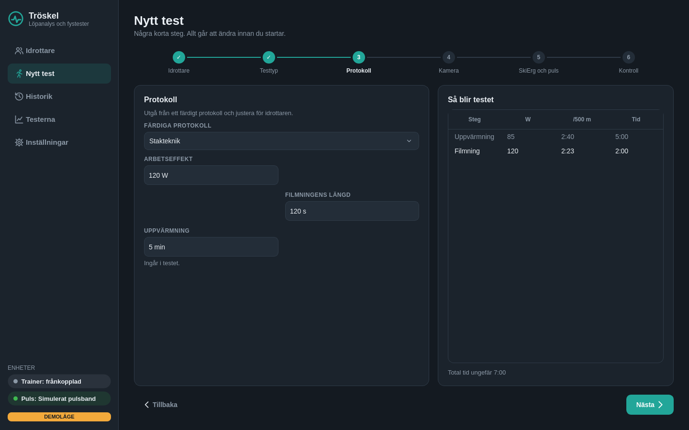
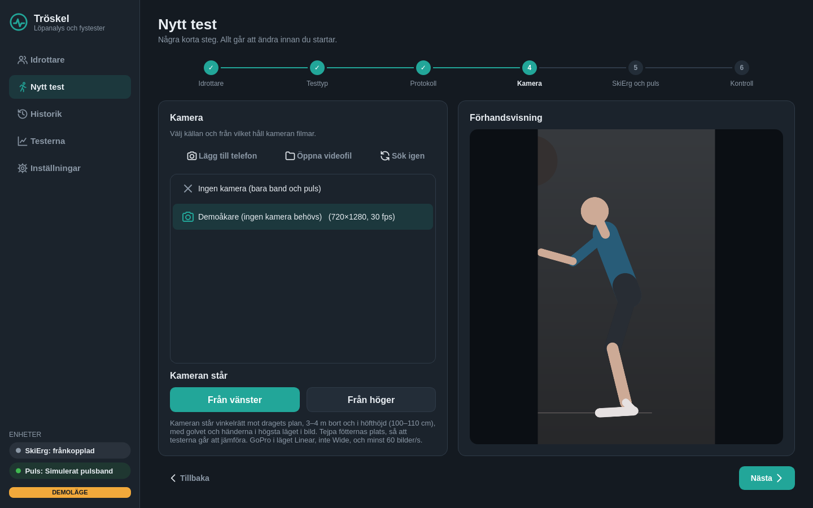
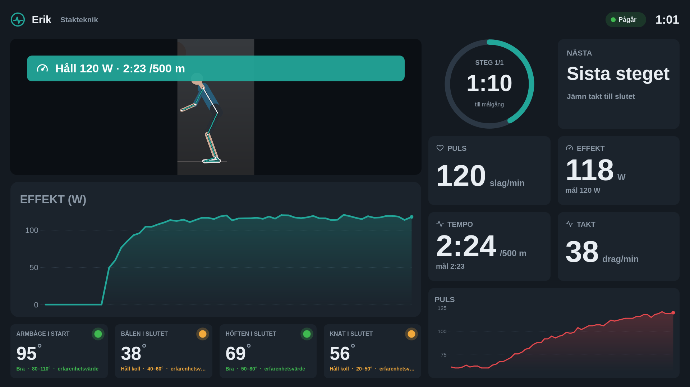
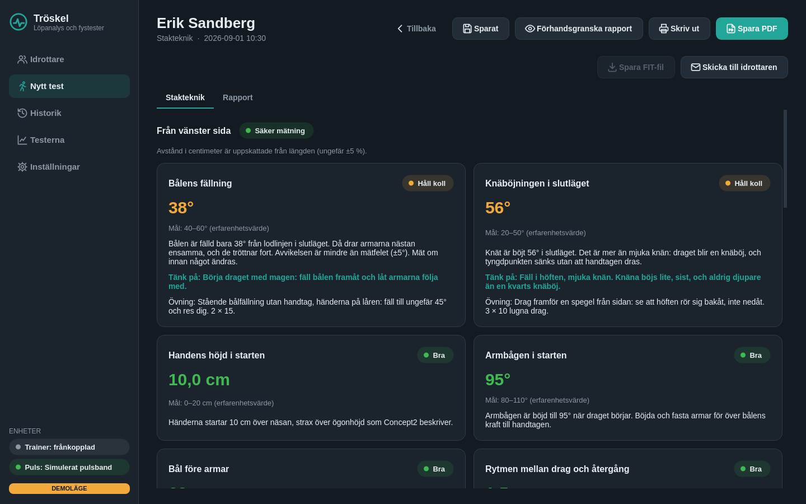
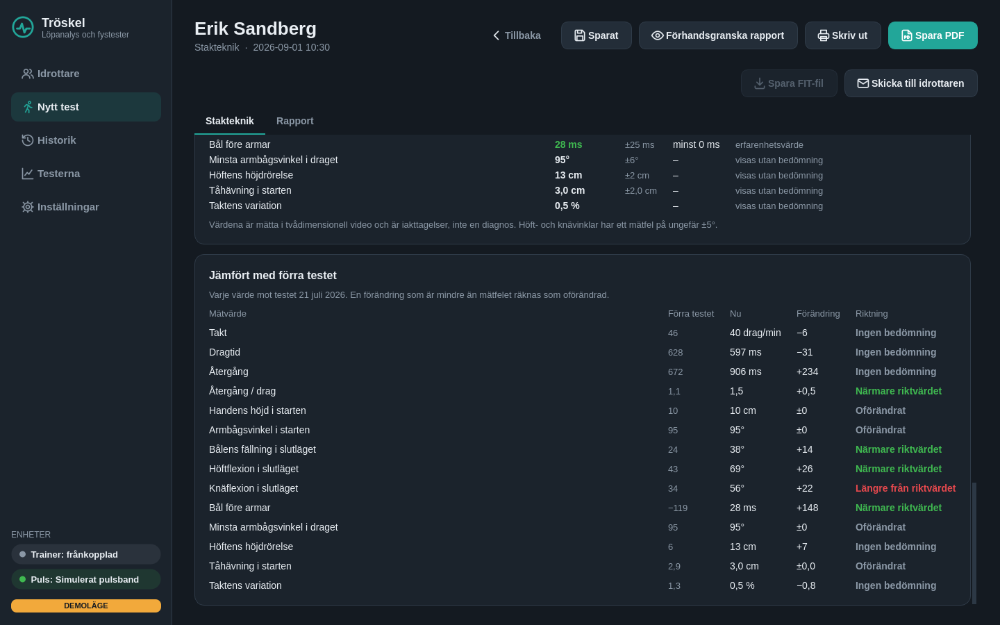

# Stakteknik

*Åkaren filmas från sidan på SkiErgen. Programmet hittar varje drag, mäter ställningen i start och slutläge och rytmen mellan drag och återgång, och ger återkoppling redan första gången. Tillbaka till [handboken](../handbok.md).*

<!-- toc -->
## Innehåll

- [Läget](#läget)
- [Det här behövs](#det-här-behövs)
- [Filma](#filma)
- [Testet i guiden](#testet-i-guiden)
- [Resultatet](#resultatet)
- [Mätvärdena och riktvärdena](#mätvärdena-och-riktvärdena)
- [Jämfört med förra testet](#jämfört-med-förra-testet)
- [När mätningen är osäker](#när-mätningen-är-osäker)
<!-- /toc -->

## Läget

*Stakteknik* väljs i *Nytt test* under sporten *SkiErg*. Programmet visar målet genom uppvärmningen och det filmade steget, analyserar filmen när testet är klart och öppnar fliken *Stakteknik* av sig själv. Allt är provat i demoläget med en syntetisk åkare, inget på en riktig åkare än, se [Prov](../../PROV.md#bikefit-och-stakteknik). Filmer som redan finns granskas med verktyget i [Arkitektur](../../ARKITEKTUR.md#bikefit-och-stakteknik).

## Det här behövs

- Concept2 SkiErg och en kamera med minst 60 bilder/s. Draget tar ungefär 0,6 s, så med 30 bilder/s märks mätningen som osäker.
- Idrottarens längd, ifylld under *Idrottare*.
- Tejp på golvet där fötterna ska stå, så att testerna går att jämföra.

## Filma

- Ställ kameran **rakt från sidan**, vinkelrätt mot dragets plan, 3–4 m bort och med linsen cirka 100–110 cm över golvet.
- Hela kroppen ska synas, från golvet till händerna i högsta läget, med marginal. Filma med stående bild.
- Använd GoProns läge *Linear*.

Staktekniken analyseras bara från sidan, så testet har ingen andra kamera.

## Testet i guiden

1. **Testtyp:** välj sporten *SkiErg* och testet *Stakteknik*.
2. **Protokoll:** *Stakteknik* är 5 min uppvärmning, som inte filmas, och sedan 2 min *Filmning* på 120 W i jämn takt. Ändra *Arbetseffekt* till en effekt åkaren håller med god teknik i flera minuter. *Filmningens längd* är minst 30 sekunder.

   

3. **Kamera:** välj kameran och om den filmar *Från vänster* eller *Från höger*. Ger kameran under 60 bilder/s säger steget till.

   

4. **SkiErg och puls:** anslut monitorn. Pulsbandet behövs inte.
5. **Under testet** visar TV:n målet, bilden och skelettet, watt, tempo och takt, och under bilden rutor med dragets vinklar: *Armbåge i start*, *Bålen i slutet*, *Höften i slutet* och *Knät i slutet*. Rutorna visar medianen av de sex senaste dragen och uppdateras varje sekund, med samma riktvärden och färger som resultatet. Tills tre drag är mätta står det *–* och *Väntar på 3 drag*. Resultatet räknas ändå ur hela filmen efter testet. Filmen börjar när uppvärmningen är slut, och testet slutar av sig självt efter det filmade steget.

   

Resultatsidan visar bara fliken *Stakteknik* och *Rapport*. Har idrottaren inte samtyckt till film startar testet inte.

## Resultatet

Resultatet öppnas på fliken *Stakteknik*. Varje iakttagelse har ett kort med värdet, riktvärdet, vad det betyder, *Tänk på* och en *Övning*. Det som avviker är inringat i nyckelbilderna:

| Bild | Visar |
|---|---|
| *Startläget* | Armbågsvinkeln och handens höjd mot en linje genom näsan |
| *Mitt i draget* | Händerna i axelhöjd: här syns om bålen eller armarna drar |
| *Slutläget* | Bålens fällning mot lodlinjen, höften och knät |
| *Återgången* | Kroppen på väg upp, med höftens höjd i startläget som linje |
| *Dragets faser* | De fyra lägena i rad, med handledens bana |

## Mätvärdena och riktvärdena

**Alla riktvärden är erfarenhetsvärden,** och det står vid varje värde. Forskningen om stakning gäller snö och rullskidor och ger riktningar, inte gradtal för SkiErg. Concept2 beskriver de vanliga felen. Se [underlaget](../../sporter/bikefit-och-stakteknik.md#2-stakteknik-på-skierg).

| Mätvärde | Riktvärde | Rött | Mätfel |
|---|---|---|---|
| *Handens höjd i starten* (handleden över näsan) | 0–20 cm | under −15, över 35 | ±4 cm |
| *Armbågsvinkel i starten* | 80–110° | över 140° (raka armar) | ±6° |
| *Bålens fällning i slutläget* | 40–60° från lodlinjen | under 25°, över 80° | ±5° |
| *Höftflexion i slutläget* | 50–80° | under 30° | ±5° |
| *Knäflexion i slutläget* | 20–50° | över 70° (knäböj) | ±5° |
| *Bål före armar* | minst 0 ms | armarna mer än 100 ms före | 1,5 bild |
| *Återgång / drag* | minst 1,2 | under 0,9 | ±0,1 |

*Takt*, *Dragtid*, *Återgång*, *Minsta armbågsvinkel i draget*, *Höftens höjdrörelse*, *Tåhävning i starten* och *Taktens variation* visas utan bedömning.

- **Dragtiden** räknas från att handen börjar röra sig nedåt tills den stannar.
- **Bål före armar** är tiden från att höften börjar fällas tills armbågen börjar sträckas. Ett negativt värde betyder att armarna drar först.
- En avvikelse som är mindre än mätfelet märks *inom mätfelet* och blir som mest *Håll koll*.

## Jämfört med förra testet

Vid första testet står *Det här är första testet*. Från andra testet jämförs varje värde med idrottarens förra staktest från samma sida:

| Riktning | Betyder |
|---|---|
| *Närmare riktvärdet* | Värdet har rört sig mot sitt intervall |
| *Längre från riktvärdet* | Värdet har rört sig bort från det |
| *Oförändrat* | Förändringen är mindre än mätfelet |
| *Ingen bedömning* | Värdet saknar riktvärde |

Jämförelsen finns också i rapporten.

## När mätningen är osäker

| Varning | Gör så här |
|---|---|
| Filmen har för få bilder per sekund | Filma med minst 60 bilder/s |
| Dragen gick inte att hitta | Händerna ska synas hela vägen, även i högsta läget. Inget bedöms ur filmen |
| Bara några få drag hittades | Filma minst 30 sekunder |
| Takten varierar | Filma i jämn takt efter uppvärmningen |
| Axeln, armbågen och handleden syntes otydligt | Bättre ljus, åtsittande kläder, och kontrollera att stolpen inte skymmer |
