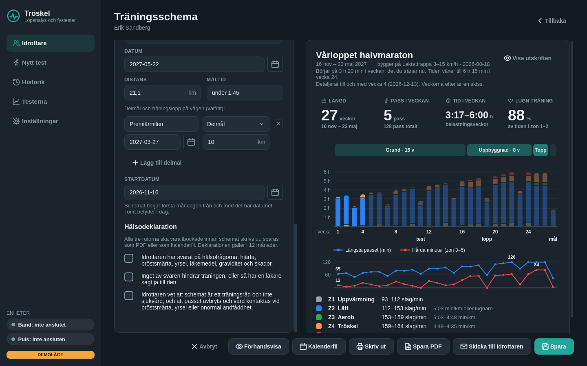

# Träningsschema

*Bygga ett träningsschema på ett test, spara det på idrottaren, skriva ut det, ge idrottaren passen som kalenderfil och mejla schemat. Tillbaka till [handboken](../handbok.md).*

<!-- toc -->
## Innehåll

- [Öppna träningsschemat](#öppna-träningsschemat)
- [Fyll i formuläret](#fyll-i-formuläret)
  - [Vad testet ger schemat](#vad-testet-ger-schemat)
- [Förhandsvisa schemat](#förhandsvisa-schemat)
- [Hälsodeklarationen](#hälsodeklarationen)
- [Spara och lämna ut](#spara-och-lämna-ut)
  - [Skicka schemat med e-post](#skicka-schemat-med-e-post)
- [Efter ett nytt test](#efter-ett-nytt-test)
- [Det som inte är provat](#det-som-inte-är-provat)
<!-- /toc -->

## Öppna träningsschemat

Sidan *Träningsschema* gäller en idrottare i taget och öppnas på två sätt:

- **Från *Idrottare*:** välj idrottaren och tryck *Träningsschema* överst i formuläret.
- **Från ett resultat:** raden under rubriken på ett laktattest, ett maxpulstest och testet *Puls- och fartzoner* har knappen *Träningsschema*. Schemat byggs då på det testet.

Har idrottaren redan ett schema visas det. Annars är formuläret tomt, och det senaste av de tre testerna är valt. *Tillbaka* går till sidan du kom från.

## Fyll i formuläret

| Del | Fält | Vad det styr |
|---|---|---|
| *Underlag* | *Bygger på testet* | Testet som zonerna räknas ur. Välj *Inget test* för ett schema med zon och ansträngning, utan puls och fart. Har idrottaren en maxpuls men inget test blir zonerna uppskattade |
| | *Nivå* | *Nybörjare*, *Motionär* eller *Vältränad*. Styr var schemat börjar och hur många hårda pass en vecka får |
| | *Tränar nu* | Minuter löpning i veckan i snitt de senaste 4–6 veckorna. Tomt betyder nivåns förval |
| *Tillgänglig tid* | Minuter per veckodag | Så länge idrottaren kan träna den dagen, 20–480 minuter. En tom dag får inget pass |
| | Klockslag | Valfritt. Passet får den tiden i kalenderfilen, annars blir det en heldagshändelse |
| *Mål* | *Schemat slutar med ett mål (lopp)* | Namn, datum, distans och måltid. Schemat räknas bakåt från loppet |
| | *Lägg till delmål* | Ett *Delmål* (till exempel ett seedningslopp) får en lättare vecka runt sig. Ett *Träningslopp* ersätter ett av veckans hårda pass |
| | *Inget mål: ange längd* | Antal veckor, minst 4. Schemat slutar med ett nytt test |
| | *Startdatum* | Schemat börjar första måndagen från och med datumet. Tomt betyder i dag |

Datum skrivs som `2027-05-22` eller väljs i kalendern bredvid fältet.

### Vad testet ger schemat

| Test | Puls i zonerna | Fart i zonerna |
|---|---|---|
| Laktattest | Ur trösklarna | Ur trösklarna, bara där testet mätte |
| Maxpulstest | Uppskattad ur maxpulsen | Ingen |
| *Puls- och fartzoner* | Uppskattad ur maxpulsen från trappan till max | Ur sambandet mellan puls och fart i stegen. *≈* framför en fart betyder att den ligger lite utanför stegen. Längre ut anges ingen fart |

Maxpulsen är den högsta pulsen som medel över 5 sekunder. Har idrottaren en sparad maxpuls används den i stället. Ett zontest som avbröts i stegen, innan trappan till max hann gå en minut, eller som slutade utan *Utmattad*, ger ingen maxpuls: då bygger zonerna på idrottarens sparade maxpuls, och utan en sådan får schemat bara zon och ansträngning. Farten ur stegen gäller ändå.

## Förhandsvisa schemat

Tryck *Förhandsvisa*. Översikten till höger visar:

- målet eller längden, perioden och testet schemat bygger på,
- fyra rutor: *Längd*, *Pass i veckan*, *Tid i veckan* och *Lugn träning* (andelen av tiden i zon 1–2),
- blocken som ett band över en stapel per vecka, med tiden per zon i klockans färger. *lätt*, *test*, *lopp* och *mål* står under veckorna,
- zonerna med puls och fart ur testet.

Saknas något i formuläret står det i rött under översikten, till exempel *Välj nivå*. Ändrar du formuläret efter en förhandsvisning säger en gul rad att översikten inte visar ändringarna än. *Visa utskriften* öppnar hela utskriften: översikten, läsanvisningen och ett blad per vecka.

Hur schemat räknas fram (block, lätta veckor, andelen lugn träning) står i [Träningsplanen](../../TRANINGSPLAN.md#2-planmotorn).

## Hälsodeklarationen

Sist i formuläret finns tre rutor. Gå igenom dem med idrottaren:

1. idrottaren har svarat på hälsofrågorna: hjärta, bröstsmärta, yrsel, läkemedel, graviditet och skador,
2. inget av svaren hindrar träningen, eller så har en läkare sagt ja till den,
3. idrottaren vet att schemat är ett träningsråd och inte sjukvård.

**Alla tre måste vara ibockade innan schemat skrivs ut, sparas som PDF eller som kalenderfil, eller skickas till idrottaren.** Annars säger programmet till och lämnar inte ut något. Förhandsvisa och spara går utan rutorna. Datumet för deklarationen sparas med schemat, och efter 12 månader är rutorna tomma igen.

## Spara och lämna ut

| Knapp | Gör |
|---|---|
| *Spara* | Sparar schemat på idrottaren: det du fyllt i, testet det bygger på, schemat som det byggdes och hälsodeklarationen. En idrottare har ett schema, och ett nytt ersätter det gamla |
| *Skriv ut* | Skriver ut schemat på den skrivare du väljer |
| *Spara PDF* | Sparar utskriften som PDF |
| *Kalenderfil* | Sparar passen som en `.ics`-fil som idrottaren öppnar i telefonens kalender. En ny import av ett ändrat schema skriver över passen i stället för att dubblera dem |
| *Skicka till idrottaren* | Mejlar PDF:en och kalenderfilen till idrottarens adress, se [Skicka schemat med e-post](#skicka-schemat-med-e-post) |
| *Avbryt* | Tar tillbaka formuläret till det sparade schemat |
| *Ta bort schemat* | Tar bort schemat. Testerna ligger kvar |

*Skriv ut*, *Spara PDF*, *Kalenderfil* och *Skicka till idrottaren* sparar alltid schemat först, så att det idrottaren får är det som finns i programmet. Lämnar du sidan med osparade ändringar frågar programmet om de ska kastas.

Ett sparat schema ändras inte av att det öppnas, och inte av en ny programversion. Det byggs om först när du ändrar något i formuläret och sparar.

**Om uppgifterna:** schemat sparas i databasen på idrottaren och tas bort när idrottaren tas bort. Det följer med i *Exportera allt*. PDF:en och kalenderfilen innehåller idrottarens namn, och programmet kommer ihåg var de sparades så att raderingen hittar dem.

### Skicka schemat med e-post

*Skicka till idrottaren* använder samma e-postkonto och samma fråga som när resultatet skickas, se [Skicka till idrottaren](../resultat/resultat.md#skicka-till-idrottaren). Knappen är grå, med skälet bredvid, när idrottaren saknar e-postadress, inte har kryssat i *Kontakt om uppföljning* i samtycket eller när e-posten inte är inställd under *Inställningar → E-post*.

Innan något skickas visar programmet adressen, de två bilagorna (`traningsschema-<startdatum>.pdf` och `.ics`), ämnet och texten. Ämnet är *Ditt träningsschema från* företaget eller coachen. Texten säger hur kalenderfilen öppnas i en iPhone och i en Android-telefon, och går att ändra. Mejlet går iväg först när du trycker *Skicka*.

Efteråt står det bredvid knappen när schemat senast skickades. Programmet antecknar tiden och vad som skickades i schemats logg, aldrig adressen. PDF:en som mejlas sparas inte på datorn.

## Efter ett nytt test

Schemat anger varje pass i en zon. Pulsen och farten räknas ur testet. Rättar du ett laktatvärde i testet som schemat bygger på följer målen med nästa gång schemat öppnas.

När idrottaren har gjort ett nytt laktattest, maxpulstest eller zontest erbjuder programmet att lägga om schemat, på två ställen:

- **På resultatet av det nya testet:** raden under rubriken säger att idrottaren har ett schema som bygger på ett äldre test, med knappen *Lägg om schemat*.
- **På sidan *Träningsschema*:** en gul rad överst säger att det finns ett nyare test, med samma knapp.

*Lägg om schemat* gör så här:

- **Passen från och med i dag** får mål i puls och fart ur det nya testet.
- **Passen före i dag** har kvar målen från testet de lämnades ut med.
- **Inget pass byter dag,** varken bakåt eller framåt. Veckorna, blocken och passens innehåll är desamma.

Skriv ut schemat igen eller spara en ny kalenderfil efteråt, så får idrottaren de nya målen. Vill du i stället ha ett helt nytt schema från i dag: välj det nya testet under *Bygger på testet*, ändra startdatumet och spara.

## Det som inte är provat

Utskriften på en riktig skrivare, kalenderfilen i en telefon och schemat med e-post till en riktig inkorg är inte provade än. Läget står i [PROV.md](../../PROV.md).
