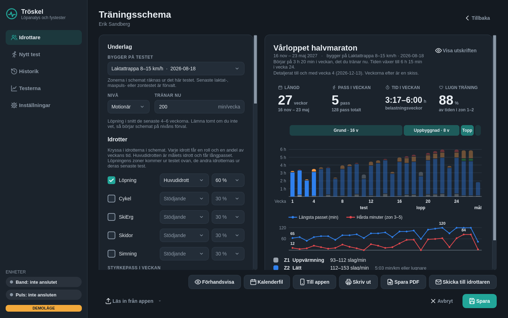
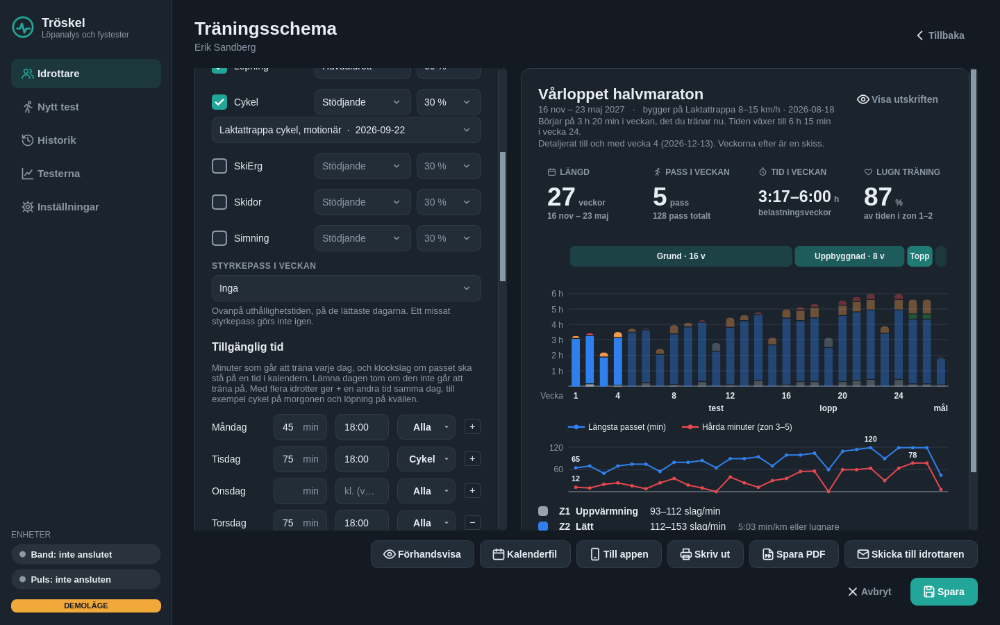
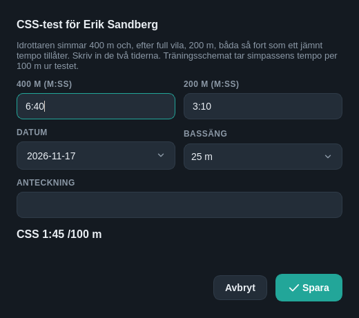
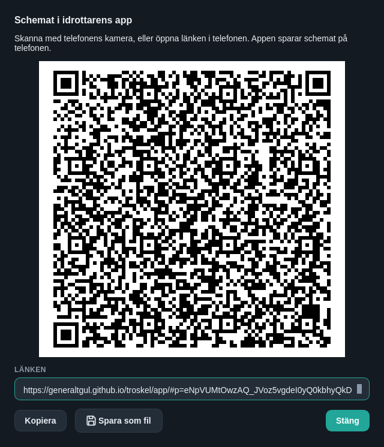

# Träningsschema

*Bygga ett träningsschema på ett test, i en idrott eller flera, spara det på idrottaren, förnya det fyra veckor i taget, skriva ut det, ge idrottaren passen som kalenderfil och schemat i appen, och mejla schemat. Tillbaka till [handboken](../handbok.md).*

<!-- toc -->
## Innehåll

- [Öppna träningsschemat](#öppna-träningsschemat)
- [Fyll i formuläret](#fyll-i-formuläret)
  - [Flera idrotter](#flera-idrotter)
  - [Simtestet (CSS)](#simtestet-css)
  - [Vad testet ger schemat](#vad-testet-ger-schemat)
- [Förhandsvisa schemat](#förhandsvisa-schemat)
- [Förnya schemat](#förnya-schemat)
- [Hälsodeklarationen](#hälsodeklarationen)
- [Spara och lämna ut](#spara-och-lämna-ut)
  - [Till appen](#till-appen)
  - [Skicka schemat med e-post](#skicka-schemat-med-e-post)
- [Efter ett nytt test](#efter-ett-nytt-test)
- [Det som inte är provat](#det-som-inte-är-provat)
<!-- /toc -->

## Öppna träningsschemat

Sidan *Träningsschema* gäller en idrottare i taget och öppnas på två sätt:

- **Från *Idrottare*:** välj idrottaren och tryck *Träningsschema* överst i formuläret.
- **Från ett resultat:** raden under rubriken på ett laktattest, ett maxpulstest och testet *Puls- och fartzoner* har knappen *Träningsschema*. Schemat byggs då på det testet.

Har idrottaren redan ett schema visas det. Annars är formuläret tomt, och det senaste av de tre testerna är valt. *Tillbaka* går till sidan du kom från.

## Fyll i formuläret

| Del | Fält | Vad det styr |
|---|---|---|
| *Underlag* | *Bygger på testet* | Löpningens test, som zonerna räknas ur. Välj *Inget test* för ett schema med zon och ansträngning, utan puls och fart. Har idrottaren en maxpuls men inget test blir zonerna uppskattade. Fältet syns bara när löpning är med i schemat |
| | *Nivå* | *Nybörjare*, *Motionär* eller *Vältränad*. Styr var schemat börjar och hur många hårda pass en vecka får |
| | *Tränar nu* | Minuter löpning i veckan i snitt de senaste 4–6 veckorna. Schemat börjar där. Tomt betyder nivåns förval (2, 3 eller 5 timmar), men aldrig mer än 70 % av den tillgängliga tiden |
| *Idrotter* | En rad per idrott | Idrotterna i schemat, med roll och andel av veckans tid, se [Flera idrotter](#flera-idrotter) |
| | *Styrkepass i veckan* | *Inga* eller 1–3 pass. Styrkan läggs ovanpå uthållighetstiden, på de lättaste dagarna, och ett missat styrkepass görs inte igen |
| *Tillgänglig tid* | Minuter per veckodag | Så länge idrottaren kan träna den dagen, 20–480 minuter. En tom dag får inget pass |
| | Klockslag | Valfritt. Passet får den tiden i kalenderfilen, annars blir det en heldagshändelse |
| | Idrotterna den dagen | Bara med flera idrotter: *Alla* eller de idrotter som går den dagen, till exempel bara cykel en dag utan löpband |
| | *+* (en andra tid samma dag) | Bara med flera idrotter: en rad till under dagen, *Andra passet*, med egna minuter, klockslag och idrotter. Båda tiderna behöver ett klockslag, och de ska vara olika. *−* tar bort den andra tiden, se [Två pass samma dag](#två-pass-samma-dag) |
| *Mål* | *Schemat slutar med ett mål (lopp)* | Namn, datum, distans och måltid. Schemat räknas bakåt från loppet |
| | *Lägg till delmål* | Ett *Delmål* (till exempel ett seedningslopp) får en lättare vecka runt sig. Ett *Träningslopp* ersätter ett av veckans hårda pass |
| | *Inget mål: ange längd* | Antal veckor, minst 4. Schemat slutar med ett nytt test |
| | *Startdatum* | Schemat börjar första måndagen från och med datumet. Tomt betyder i dag |

Datum skrivs som `2027-05-22` eller väljs i kalendern bredvid fältet.

### Flera idrotter

Under *Idrotter* finns löpning, cykel, SkiErg, skidor och simning. Löpning är förvald som huvudidrott. Kryssa i de idrotter schemat ska ha och välj för var och en:

- **Roll:** *Huvudidrott* (målets idrott, som får långpasset och testet), *Stödjande* (varannan vecka ett mindre, lugnt långpass när tiden räcker, aldrig dagen före eller efter huvudidrottens långpass) eller *Underhåll* (högst ett lugnt pass i veckan). Det finns en huvudidrott: väljer du en ny blir den förra stödjande.
- **Andel:** hur stor del av veckans tid idrotten får, i tiotal procent. Rollen fyller i 60, 30 eller 10 %. Andelarna räknas mot varandra, så 60 och 30 ger två tredjedelar och en tredjedel.

Under varje idrott utom löpning står vad zonerna bygger på: idrottens senaste laktat-, maxpuls- eller zontest, annars maxpulsen i idrotten (uppskattade zoner), annars bara zon och ansträngning. Skidor lånar SkiErgens zoner. Simning tar tempot per 100 m ur idrottarens senaste [simtest](#simtestet-css), och går på upplevd ansträngning när det inte finns något. Med flera idrotter får varje veckodag en knapp för idrotterna den dagen, där *Alla* är förvalt.

Hur motorn fördelar passen över idrotterna står i [Träningsplanen → Flera idrotter](../../TRANINGSPLAN.md#flera-idrotter).

#### Två pass samma dag

Med flera idrotter kan en veckodag ha två tider: tryck *+* bredvid dagen och fyll i *Andra passet*, till exempel 45 minuter cykel kl. 07:00 bredvid löpningen kl. 18:00. Schemat använder den andra tiden så här:

- **Bara när veckan vill ha fler pass än det finns dagar.** En motionär har högst fem pass i veckan, så med fem dagar blir det inga dubbla dagar utom i en vecka med lopp.
- **Det andra passet är alltid lugnt** och i en annan idrott än dagens första. Är dagens första pass hårt blir det andra ett återhämtningspass.
- **Aldrig två hårda pass samma dag.** En dag med två pass räknas som hård om något av dem är hårt.
- **Aldrig** på långpassets dag, dagarna runt ett lopp eller i nedtrappningen och loppveckan. Dagar utan hårt pass får det andra passet först.

### Simtestet (CSS)

Simtestet ger det kritiska simtempot (CSS, Critical Swim Speed): tempot per 100 m som idrottaren kan hålla länge, ett mått på tröskeln i vattnet. Testet görs i bassängen utan utrustning, och du skriver in tiderna efteråt.

1. **Idrottaren simmar** 400 m så fort ett jämnt tempo tillåter, vilar tills hen är återhämtad och simmar sedan 200 m på samma sätt. Båda börjar i vattnet med frånskjut från kanten.
2. **Öppna *Historik*,** välj idrottaren och tryck *Simtest (CSS)*.
3. **Skriv in tiderna** på 400 m och 200 m som minuter och sekunder (*6:40* eller *6:40,5*), datumet och bassängens längd (25 eller 50 m). Tempot visas direkt under fälten, till exempel *CSS 1:45 /100 m*: skillnaden mellan tiderna delad med två.
4. **Tryck *Spara*.**

Går tiderna inte ihop står felet i rött när du sparar, och inget sparas:

- **en tid saknas** eller går inte att läsa,
- **en tid är orimlig:** 200 m ska ligga mellan 1:40 och 10:00, och 400 m mellan 3:20 och 20:00,
- **400 m tar inte mer än dubbelt så lång tid som 200 m:** då har tiderna oftast bytt plats.

Testet står sedan i *Historik* som *Simning · CSS-test* med tempot. Det har ingen resultatsida: *Öppna* visar formuläret igen, där du kan rätta tiderna. Det går inte att jämföra eller ta med i en samlad rapport, eftersom det inte har några mätvärden.

Nästa gång du bygger ett schema med simning står *Tempot ur CSS-testet* med datum och tempo under idrotten, och simpassen får tid per 100 m i varje zon. Zonerna står i [Träningsplanen → Simning](../../TRANINGSPLAN.md#simning).

### Vad testet ger schemat

| Test | Puls i zonerna | Fart i zonerna |
|---|---|---|
| Laktattest | Ur trösklarna | Ur trösklarna, bara där testet mätte |
| Maxpulstest | Uppskattad ur maxpulsen | Ingen |
| *Puls- och fartzoner* | Uppskattad ur maxpulsen från trappan till max | Ur sambandet mellan puls och fart i stegen. *≈* framför en fart betyder att den ligger lite utanför stegen. Längre ut anges ingen fart |

Maxpulsen är den högsta pulsen som medel över 5 sekunder. Har idrottaren en sparad maxpuls används den i stället. Ett zontest som avbröts i stegen, innan trappan till max hann gå en minut, eller som slutade utan *Utmattad*, ger ingen maxpuls: då bygger zonerna på idrottarens sparade maxpuls, och utan en sådan får schemat bara zon och ansträngning. Farten ur stegen gäller ändå.

## Förhandsvisa schemat

Tryck *Förhandsvisa*. Översikten till höger visar:

- målet eller längden, perioden och testet schemat bygger på,
- hur långt passen går: *Detaljerat till och med vecka 4 (2026-12-13). Veckorna efter är en skiss.* Ett sparat schema har knappen *Förnya* på samma rad, se [Förnya schemat](#förnya-schemat),
- var tiden i veckan börjar och vart den växer, till exempel *Börjar på 3 h 20 min i veckan, det du tränar nu. Tiden växer till 6 h 15 min i vecka 24.* Med *Tränar nu* tomt står det att schemat utgår från nivåns förval,
- fyra rutor: *Längd*, *Pass i veckan*, *Tid i veckan* (i belastningsveckorna, från den första till den största) och *Lugn träning* (andelen av tiden i zon 1–2),
- blocken som ett band över en stapel per vecka, med tiden per zon i klockans färger. *lätt*, *test*, *lopp* och *mål* står under veckorna. Veckorna i skissen har bleka staplar,
- under staplarna två linjer med en egen axel i minuter: **det längsta passet** varje vecka (blå) och **de hårda minuterna**, tiden i zon 3–5 (röd). Siffran står vid den första veckan och vid den största. Linjerna visar ökningen även när staplarna är lika höga, till exempel när dagarna inte rymmer mer tid och schemat i stället gör passen längre och hårdare,
- zonerna med puls och fart ur testet, i huvudidrotten. Är huvudidrotten cykel eller SkiErg står watt, och för SkiErgen också tiden per 500 m.

Schemat börjar på det idrottaren tränar nu och växer mot den tillgängliga tiden, högst nivåns takt (5, 7 eller 8 %) per belastningsvecka. Ligger starten nära den tillgängliga tiden växer det långsammare, så att hela tiden nås först i slutet av uppbyggnaden. Tränar idrottaren mer än dagarna rymmer börjar schemat på all tillgänglig tid och står still i tid; ökningen ligger då i passen. Samma diagram med linjerna finns på utskriftens första sida.

Saknas något i formuläret står det i rött under översikten, till exempel *Välj nivå*. Ändrar du formuläret efter en förhandsvisning säger en gul rad att översikten inte visar ändringarna än. *Visa utskriften* öppnar hela utskriften: översikten, läsanvisningen, ett blad per vecka med pass och sist skissen över veckorna efter. Läsanvisningen börjar med rutan *Så använder du schemat* och förklarar under *Passen i schemat* varje sorts pass som schemat har. Veckobladet har dagens pass i tidsordning och veckans belastning längst ned (minuter × zon × idrott, för att jämföra veckorna).

Med flera idrotter, eller med styrkepass, börjar varje pass med idrotten (*Löpning: lugnt pass*), och utskriften har också:

- **en tabell över idrotterna** på första sidan: roll, andel av tiden och testet zonerna bygger på, med datum. Styrkan står sist med antalet pass i veckan,
- **en rad per idrott med watt eller tempo under *Dina zoner***: cykelns watt, SkiErgens watt och tid per 500 m och, med ett simtest, simningens tid per 100 m, zon för zon. Styrkepassen har ingen zon, bara ansträngningen,
- **en färg per idrott** bredvid passets namn på veckobladet. Färgerna skiljer sig från zonernas,
- **veckans tid per idrott** som en stapel längst ned på veckobladet,
- **passen per idrott i läsanvisningen:** *Passen i schemat* har en rubrik per idrott med idrottens egna pass, också testet i idrotten och styrkepassen. Skidor står ihop med SkiErgen, vars pass de använder.

Hur schemat räknas fram (block, lätta veckor, andelen lugn träning) står i [Träningsplanen](../../TRANINGSPLAN.md#2-planmotorn).

## Förnya schemat

Bara de närmaste fyra veckorna har pass: veckan schemat byggs och de tre veckorna efter. Resten av schemat är en skiss. Block, typ av vecka (belastning, lätt, test, lopp), tid och antal pass ligger fast ända fram till målet, men de enskilda passen kommer först när veckan närmar sig. Då kan schemat följa tiden som går och nya tester, utan att du fyller i något igen.

- **Förnya** ger passen till och med tre veckor efter den vecka du står i. Formuläret, testet och hälsodeklarationen är desamma som när schemat sparades. Veckor som redan har pass ändras inte, varken de som har gått eller de som är utlämnade.
- **När passen tar slut inom en vecka** erbjuder programmet *Förnya* överst på sidan *Träningsschema* och i idrottarens formulär under *Idrottare*, bredvid knappen *Träningsschema*.
- **Samma underlag ger samma pass.** En förnyelse gör om ingenting: en vecka får samma pass som den skulle ha fått om hela schemat hade haft pass från början.
- **Ett nytt test** förnyar också, se [Efter ett nytt test](#efter-ett-nytt-test).

Efter en förnyelse: skriv ut schemat igen, spara en ny kalenderfil eller ge idrottaren schemat i appen igen med [*Till appen*](#till-appen), så får idrottaren de nya veckorna. Kalenderfilen och veckobladen har bara veckorna med pass. Skissen står som en tabell sist i utskriften.

Scheman som sparades innan schemat blev rullande har pass i alla veckor och behöver aldrig förnyas.

## Hälsodeklarationen

Sist i formuläret finns tre rutor. Gå igenom dem med idrottaren:

1. idrottaren har svarat på hälsofrågorna: hjärta, bröstsmärta, yrsel, läkemedel, graviditet och skador,
2. inget av svaren hindrar träningen, eller så har en läkare sagt ja till den,
3. idrottaren vet att schemat är ett träningsråd och inte sjukvård.

**Alla tre måste vara ibockade innan schemat skrivs ut, sparas som PDF eller som kalenderfil, går till appen eller skickas till idrottaren.** Annars säger programmet till och lämnar inte ut något. Förhandsvisa och spara går utan rutorna. Datumet för deklarationen sparas med schemat, och efter 12 månader är rutorna tomma igen.

## Spara och lämna ut

| Knapp | Gör |
|---|---|
| *Spara* | Sparar schemat på idrottaren: det du fyllt i, testet det bygger på, schemat som det byggdes och hälsodeklarationen. En idrottare har ett schema, och ett nytt ersätter det gamla |
| *Skriv ut* | Skriver ut schemat på den skrivare du väljer |
| *Spara PDF* | Sparar utskriften som PDF |
| *Kalenderfil* | Sparar passen som en `.ics`-fil som idrottaren öppnar i telefonens kalender. En ny import av ett ändrat schema skriver över passen i stället för att dubblera dem |
| *Till appen* | Visar schemat för idrottarens app som QR-kod, som länk och som fil, se [Till appen](#till-appen) |
| *Skicka till idrottaren* | Mejlar PDF:en, kalenderfilen och filen till appen till idrottarens adress, med länken till appen i texten, se [Skicka schemat med e-post](#skicka-schemat-med-e-post) |
| *Avbryt* | Tar tillbaka formuläret till det sparade schemat |
| *Ta bort schemat* | Tar bort schemat. Testerna ligger kvar |

*Skriv ut*, *Spara PDF*, *Kalenderfil*, *Till appen* och *Skicka till idrottaren* sparar alltid schemat först, så att det idrottaren får är det som finns i programmet. Lämnar du sidan med osparade ändringar frågar programmet om de ska kastas.

Ett sparat schema ändras inte av att det öppnas, och inte av en ny programversion. Det byggs om först när du ändrar något i formuläret och sparar.

**Om uppgifterna:** schemat sparas i databasen på idrottaren och tas bort när idrottaren tas bort. Det följer med i *Exportera allt*. PDF:en, kalenderfilen och filen till appen innehåller idrottarens namn, och programmet kommer ihåg var de sparades så att raderingen hittar dem.

### Till appen

*Till appen* ger idrottaren schemat i [appen för idrottaren](../../app/app.md), som visar dagens pass, veckan och hela schemat i telefonen. Knappen öppnar en ruta med tre vägar till samma schema:

- **QR-koden:** idrottaren skannar den på skärmen med telefonens kamera. Telefonen öppnar appen med schemat.
- **Länken**, med *Kopiera*, till exempel för ett sms eller ett meddelande som idrottaren öppnar i telefonen.
- ***Spara som fil***: `traningsschema_<startdatum>.troskel`, som idrottaren öppnar i appen med *Öppna en fil*.

Appen sparar schemat i telefonen. Schemat skickas inte via någon server: allt står i länken, koden eller filen. Länken innehåller idrottarens namn och schemat, så ge den bara till idrottaren.

En QR-kod rymmer en länk på cirka 2 900 tecken, ungefär ett schema på tolv veckor. Är länken längre står det i rutan i stället för koden: skicka då schemat med e-post, där länken och filen följer med, eller spara filen och ge idrottaren den.

Efter [*Förnya*](#förnya-schemat) eller [*Lägg om schemat*](#efter-ett-nytt-test) ger *Till appen* det nya schemat. Appen har ett schema i taget, och ett nytt ersätter det gamla.

### Skicka schemat med e-post

*Skicka till idrottaren* använder samma e-postkonto och samma fråga som när resultatet skickas, se [Skicka till idrottaren](../resultat/resultat.md#skicka-till-idrottaren). Knappen är grå, med skälet bredvid, när idrottaren saknar e-postadress, inte har kryssat i *Kontakt om uppföljning* i samtycket eller när e-posten inte är inställd under *Inställningar → E-post*.

Innan något skickas visar programmet adressen, de tre bilagorna (`traningsschema-<startdatum>.pdf`, `.ics` och `.troskel`), ämnet och texten. Ämnet är *Ditt träningsschema från* företaget eller coachen. Texten säger hur kalenderfilen öppnas i en iPhone och i en Android-telefon, har en rad *Öppna schemat i appen:* med länken till appen, och går att ändra. Mejlet går iväg först när du trycker *Skicka*.

Efteråt står det bredvid knappen när schemat senast skickades. Programmet antecknar tiden och vad som skickades i schemats logg, aldrig adressen. PDF:en som mejlas sparas inte på datorn.

## Efter ett nytt test

Schemat anger varje pass i en zon. Pulsen och farten räknas ur testet. Rättar du ett laktatvärde i testet som schemat bygger på följer målen med nästa gång schemat öppnas.

När idrottaren har gjort ett nytt laktattest, maxpulstest eller zontest i löpning erbjuder programmet att lägga om schemat, på två ställen:

- **På resultatet av det nya testet:** raden under rubriken säger att idrottaren har ett schema som bygger på ett äldre test, med knappen *Lägg om schemat*.
- **På sidan *Träningsschema*:** en gul rad överst säger att det finns ett nyare test, med samma knapp.

*Lägg om schemat* gör så här:

- **Passen från och med i dag** får mål i puls och fart ur det nya testet.
- **Passen före i dag** har kvar målen från testet de lämnades ut med.
- **Inget pass byter dag,** varken bakåt eller framåt. Veckorna, blocken och passens innehåll är desamma.
- **Schemat förnyas,** så att passen går till och med tre veckor efter den vecka du står i (som [*Förnya*](#förnya-schemat)).

Skriv ut schemat igen, spara en ny kalenderfil eller använd *Till appen* efteråt, så får idrottaren de nya målen. Vill du i stället ha ett helt nytt schema från i dag: välj det nya testet under *Bygger på testet*, ändra startdatumet och spara.

## Det som inte är provat

Utskriften på en riktig skrivare, kalenderfilen i en telefon, QR-koden från *Till appen* med en riktig telefon och schemat med e-post till en riktig inkorg är inte provade än, och inte heller formuläret och utskriften med flera idrotter på Windows. Läget står i [PROV.md](../../PROV.md).
