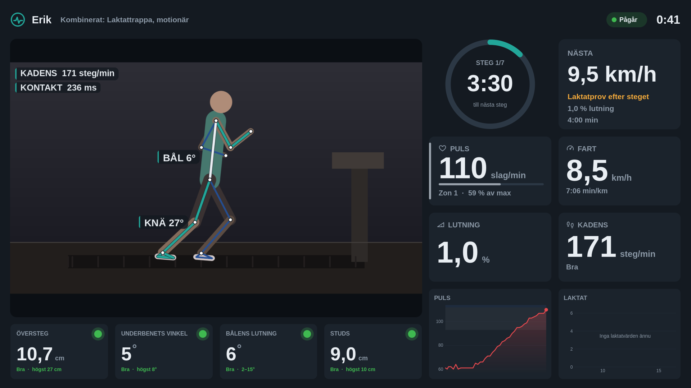
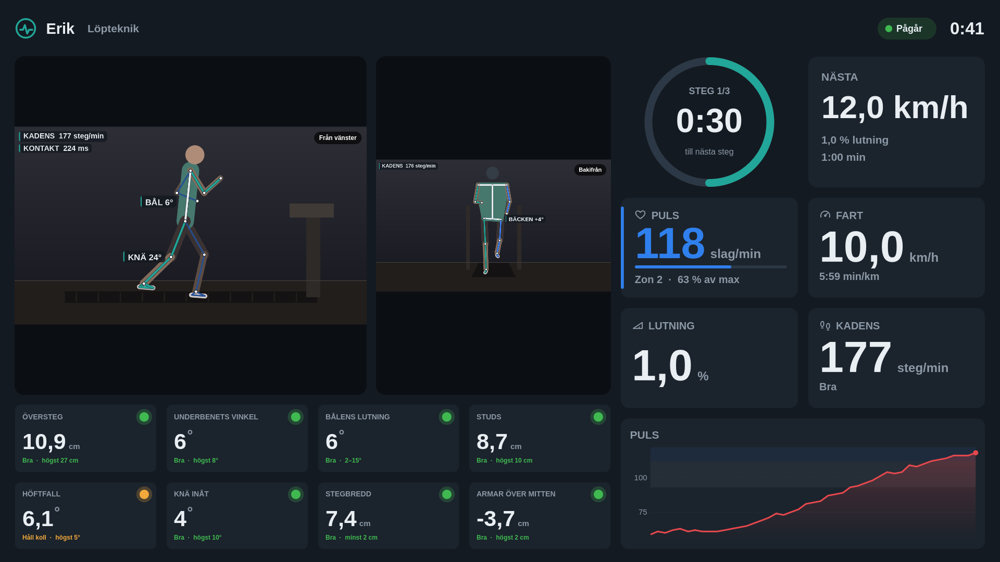
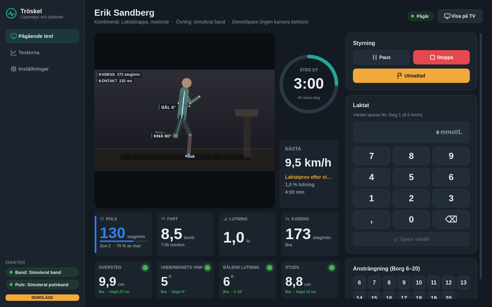

# Under testet

*Operatörssidan på datorn och livevyn på TV:n: vad som syns och vad knapparna gör. Gäller alla tester. Tillbaka till [handboken](../handbok.md).*

<!-- toc -->
## Innehåll

- [Två skärmar](#två-skärmar)
- [Livevyn på TV:n](#livevyn-på-tvn)
  - [Två kameror](#två-kameror)
- [Operatörssidan](#operatörssidan)
- [Manuellt band](#manuellt-band)
- [När testet är klart](#när-testet-är-klart)
- [Testet sparas hela tiden](#testet-sparas-hela-tiden)
<!-- /toc -->

## Två skärmar

När du trycker på *Starta livevyn* i [Nytt test](../nytt-test/nytt-test.md) öppnas två saker:

- **Operatörssidan** i programmets fönster, för dig. Den finns under *Pågående test* i menyn så länge testet pågår, så du kan gå till en annan sida och tillbaka.
- **Livevyn** i ett eget fönster, för idrottaren. Med två skärmar öppnas den i helskärm på TV:n, annars som ett vanligt fönster. F11 växlar helskärm och Esc lämnar helskärm. Vilken skärm som är TV:n väljs i *Inställningar*. *Visa på TV* öppnar fönstret igen om det har stängts.

TV:n visar bara idrottarens förnamn, eftersom den syns i hela rummet. Medan testet pågår är *Idrottare*, *Nytt test* och *Historik* dolda i menyn, så att idrottaren inte ser andra personer på din skärm. Det är kundläget, som går att slå av i [Inställningar](../kom-igang/kom-igang.md#lås-och-kundläge).

Helskärm på en TV som andra skärm är *(inte provat på riktig hårdvara)*, se [PROV.md](../../PROV.md#programmet).

## Livevyn på TV:n

Bilden är från ett test som filmas (*Kombinerat*). Laktattrappan, maxpulstestet och *Puls- och fartzoner* utan film har ingen kamera: där visas ingen kamerabild och inga värden för löpsteget, bara klockan, pulsen, farten och lutningen.

| Del | Visar |
|---|---|
| Kamerabilden | Idrottaren med skelettet och vinklarna ritade i bilden |
| Ringen | Vilket steg som pågår och tiden kvar till nästa. Under ett laktatprov visar den tiden kvar av pausen |
| *NÄSTA* | Nästa stegs fart, lutning och längd, och om ett laktatprov tas efter steget som pågår |
| *PULS* | Pulsen just nu. När idrottarens maxpuls är känd visas också zonen och procent av max |
| *FART*, *LUTNING*, *KADENS* | Bandets värden och stegfrekvensen |
| Rutorna under bilden | Löptekniken just nu, med grön, gul eller röd markering. Från sidan: översteg, underbenets vinkel, bålens lutning och studs |
| Diagrammen | Pulsen under testet och laktatvärdena som skrivits in |

Inför varje byte visas en rad om vad som kommer, till exempel *Om 15 s: 9,5 km/h · 1 %*. Med ljudsignalen påslagen hörs korta pip de sista sekunderna före bytet.

### Två kameror

Med [två kameror](../nytt-test/nytt-test.md#två-kameror-samtidigt) visas båda bilderna bredvid varandra, på TV:n och på operatörssidan. Uppe till höger i varje bild står hållet.

- **Två rader med rutor:** den övre raden hör till den första kameran och den undre till den andra. Bakifrån visar *Höftfall*, *Knä inåt*, *Stegbredd* och *Armar över mitten*.
- **Båda filmas** under hela testet, och båda filmerna analyseras efteråt.
- **Den andra bilden kan röra sig lite ryckigare** i skelettet än den första. Den analyseras med lägre bildtakt, så att den första kameran får datorns kraft. Filmen från den andra kameran har ändå alla bilder.
- ***Bilden försvann*** i den andra bilden betyder att den kameran har slutat sända. Testet och den första kameran fortsätter.

Två kameror på riktig hårdvara är *(inte provat på riktig hårdvara)*, se [PROV.md](../../PROV.md#löptekniken).

## Operatörssidan

Till vänster ser du samma sak som idrottaren. Rubriken visar idrottaren, protokollet, hur bandet styrs och kameran, eller båda kamerorna. Märket uppe till höger visar läget: *Redo*, *Startar*, *Pågår*, *Laktatprov*, *Ställ in bandet*, *Pausat*, *Återhämtning*, *Klart* eller *Stoppat*.

Kortet *Styrning*:

| Knapp | Vad som händer |
|---|---|
| *Starta testet* | Bandet startar efter en nedräkning. Knappen försvinner när testet är igång |
| *Paus* | Fryser klockan. *Fortsätt* tar vid i samma steg efter en kort nedräkning |
| *Stoppa* | Frågar först. Testet sparas med allt som hunnit mätas och märks *(stoppat i förtid)*. Ett påbörjat steg i ett löptekniktest sparas också om det pågått i minst 20 s. Före start avbryter knappen utan att spara något |
| *Utmattad* | Idrottaren orkar inte mer. Testet räknas som fullföljt, bandet går ner till gångfart och pulsen mäts en minut till. Under återhämtningen heter *Stoppa* i stället *Avsluta* |

Kortet *Laktat* finns när protokollet har laktatprov, se [Laktattrappa](../laktattrappa/laktattrappa.md#ta-provet-och-skriv-in-värdet).

Kortet *Ansträngning (Borg 6–20)*: fråga *Hur ansträngande känns det just nu?* och tryck på siffran. Värdet sparas på samma steg som laktatvärdet: det äldsta steget som väntar på ett laktatvärde, annars det senast avslutade.

## Manuellt band

När bandet är valt som *Manuellt* ställer du själv farten. Inför varje steg visar TV:n *Sätt bandet på 12,0 km/h* med lutningen under, och operatörssidan får knappen *Bandet står på 12,0 km/h*. Steget börjar när du trycker på den.

Det manuella läget är *(inte provat på riktig hårdvara)*, se [PROV.md](../../PROV.md#testerna-och-databasen).

## När testet är klart

TV:n visar *Bra jobbat! Testet är klart* en stund till, och programmet öppnar resultatet. Fortsätt på [Resultat](../resultat/resultat.md).

Stänger du programmet medan ett test pågår får du frågan *Ett test pågår. Vill du avbryta testet och stänga programmet?* Svarar du ja sparas testet som stoppat.

## Testet sparas hela tiden

Du behöver aldrig spara ett test. Det finns i databasen från *Starta testet*, och varje avslutat steg, varje laktat- och RPE-värde och pulsen var tionde sekund skrivs direkt. Byter du sida, stänger fönstret eller programmet finns allt kvar under *Historik*.

**Om programmet kraschar eller strömmen går** frågar programmet nästa gång det startar: *Ett test avbröts 14:32 (…). Öppna det?* Testet öppnas med allt som hann sparas och märks *avbrutet*, också i *Historik*.

**Fortsätta testet:** resultatsidan har knappen *Fortsätt från steg N* när det går att få ett användbart test:

- en laktattrappa, *Kombinerat* eller löpteknik, inte ett maxpulstest (ett maxpulstest blir inte rätt efter en paus),
- minst ett steg efter uppvärmningen är klart, och protokollet har steg kvar,
- avbrottet var för högst 20 minuter sedan.

Tryck på knappen, gå igenom guiden igen för att ansluta bandet, pulsbandet och kameran och tryck på *Starta testet*. Testet fortsätter från nästa steg med samma protokoll och sparas i samma test. Valet av testtyp och protokoll i guiden används inte den gången. Pausen finns inte med i pulskurvan, och resultatet visar att testet fortsattes efter ett avbrott.

**Filmen vid en krasch:** filmen sparas som MP4, och en MP4-fil som inte stängdes kan inte läsas. Vid en krasch blir filmen därför oftast borta, och resultatsidan säger det. Mätvärdena från livevyn finns kvar per steg.

Återställningen efter en krasch är provad med simulerat band och puls, men *(inte provat på riktig hårdvara)*, se [PROV.md](../../PROV.md#testerna-och-databasen).
